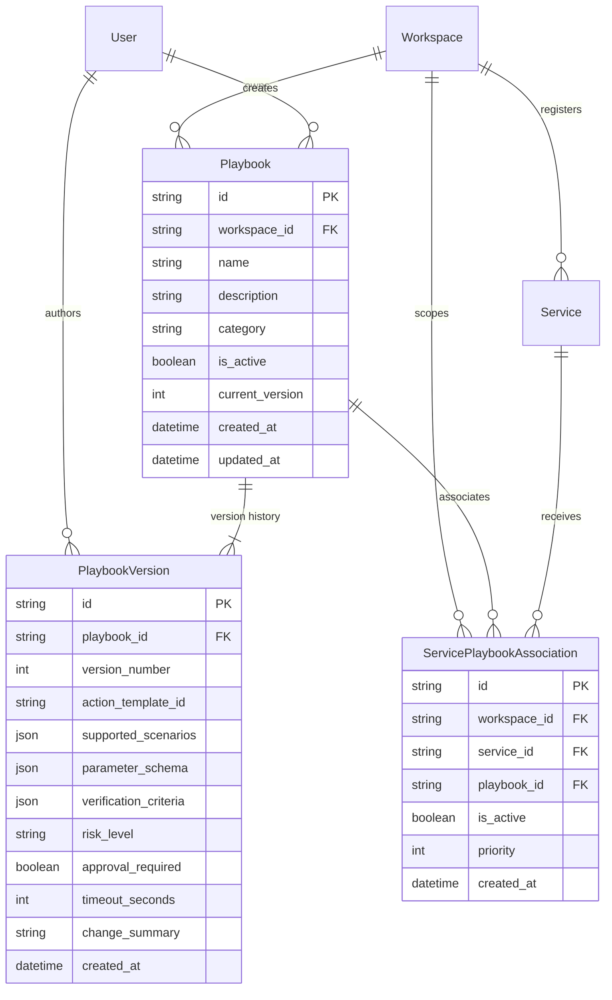
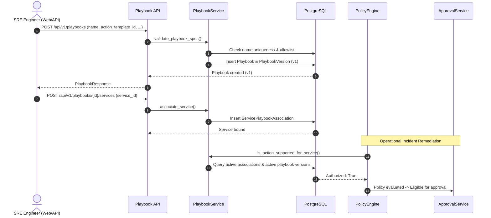

# SentinelOps AI — Phase 4.1: Persistent Dynamic Remediation Playbooks Architecture

## 1. Overview

In Phase 4.1, SentinelOps introduces persistent, user-configurable, versioned remediation playbooks. This architecture allows SRE teams to define and associate remediation procedures for newly registered services without modifying platform source code, while preserving strict security boundaries.

### Core Architecture Principles
1. **Allowlisted Action Templates Only:** Playbooks reference strictly pre-approved and allowlisted action templates from the `ActionRegistry`. Arbitrary shell commands, Python scripts, and untrusted execution paths are strictly rejected.
2. **Immutable Versioning:** Any modification to a playbook's operational specification creates a new immutable version record (`PlaybookVersion`), preserving full auditability and preventing tampering with active or historical executions.
3. **Strict Workspace Isolation:** Playbooks and service bindings belong strictly to a single workspace. Users and services from different workspaces cannot interact across tenant boundaries.
4. **Deterministic Policy Integration:** `PolicyEngine` enforces allowlist compliance, service compatibility, risk assessment, and human approval requirements prior to execution dispatch.
5. **Fail-Closed Default:** If a service has no active, compatible playbook configured, policy evaluation strictly rejects the remediation proposal (`PolicyDecisionType.REJECTED`).

---

## 2. Entity-Relationship Architecture



---

## 3. Security & Safety Invariants

### Invariant 1: Zero Arbitrary Code Execution
Playbooks never store or execute raw bash, shell, PowerShell, or Python scripts. Every playbook must point to a recognized `action_template_id` registered in `ActionRegistry`. Payloads are scanned recursively to detect and reject dangerous patterns (`exec(`, `eval(`, `os.system`, `subprocess`, etc.).

### Invariant 2: Schema Parameter Validation
Parameter schemas defined on playbooks are validated against the action's Pydantic validation model using `extra="forbid"`. Extra, unpermitted, or malformed parameters are rejected before storage.

### Invariant 3: Service-to-Action Compatibility
Actions with explicit service restrictions (e.g., `restore_order_api_demo`) cannot be associated with arbitrary services. Universal actions (such as `inspect_service_health`) can be associated with any registered service.

### Invariant 4: Monotonic Versioning
Whenever operational fields (`action_template_id`, `supported_scenarios`, `parameter_schema`, `verification_criteria`, `risk_level`, `approval_required`, `timeout_seconds`) are updated:
- The parent playbook increments `current_version += 1`.
- A new `PlaybookVersion` row is created.
- Existing historical versions remain read-only and immutable.

### Invariant 5: Fail-Closed Policy Enforcement
If no active, compatible playbook is bound to a service, the `PolicyEngine` immediately rejects remediation with:
```
No approved remediation playbook is configured for this service.
```

---

## 4. Role-Based Access Control (RBAC)

All endpoints enforce tenant scoping (`workspace_id`) and user membership:

| Operation | HTTP Method & Route | Required Role |
| :--- | :--- | :--- |
| **List Playbooks** | `GET /api/v1/playbooks` | `viewer` or higher |
| **Get Playbook Details** | `GET /api/v1/playbooks/{playbook_id}` | `viewer` or higher |
| **Validate Specification** | `POST /api/v1/playbooks/validate` | `engineer` or higher |
| **Create Playbook** | `POST /api/v1/playbooks` | `engineer` or higher |
| **Update Playbook** | `PUT /api/v1/playbooks/{playbook_id}` | `engineer` or higher |
| **Activate Playbook** | `POST /api/v1/playbooks/{playbook_id}/activate` | `engineer` or higher |
| **Deactivate Playbook** | `POST /api/v1/playbooks/{playbook_id}/deactivate` | `engineer` or higher |
| **Associate Service** | `POST /api/v1/playbooks/{playbook_id}/services` | `engineer` or higher |
| **Disassociate Service** | `DELETE /api/v1/playbooks/{playbook_id}/services/{service_id}` | `engineer` or higher |
| **Service Active Playbooks** | `GET /api/v1/playbooks/services/{service_id}` | `viewer` or higher |

---

## 5. Integration Flow



---

## 6. Compatibility & Seeding

The existing Order API demo recovery action (`restore_order_api_demo`) is automatically seeded into the persistent dynamic playbook model via `PlaybookService.seed_default_order_api_playbook`:
- Playbook Name: `"Order API Failure Recovery"`
- Action: `"restore_order_api_demo"`
- Scenarios: `["http_5xx_rate_exceeded", "demo_failure", "*"]`
- Association Priority: `100`

All existing executions, approvals, and verification cycles remain 100% functional and preserved without modification.
