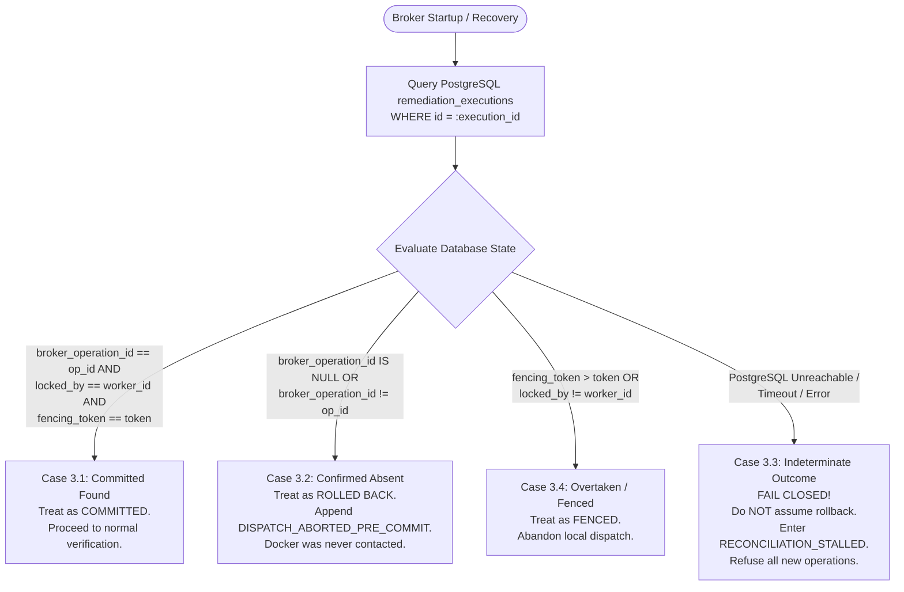

# SentinelOps AI — Phase 4.3.6: Verification, Audit Integrity, Host Attestation, and Watchdog Recovery Specification

**Document Status:** Approved Architecture & Security Design Specification (Revision 10 — Final Dispatch-Boundary Clarification)
**Phase:** 4.3.6 (Post-Execution Verification, Audit Integrity, Host Attestation, and Watchdog Recovery)
**Author:** SentinelOps AI Core Architecture & Security Engineering
**Date:** October 31, 2026
**Implementation Status:** **STRICT DESIGN-ONLY — ZERO IMPLEMENTATION AUTHORIZED**

---

## Executive Summary & Design Constraints

This document provides the definitive, mathematically rigorous security specification for **SentinelOps AI Phase 4.3.6 (Revision 10)**. It incorporates all final architecture review corrections:
1. **Docker Fencing Proxy Architecture Settled**: Establishes `sentinelops-dispatch-guardd` as the concrete dispatch-boundary proxy owning the Docker socket, details communication paths, epoch validation, stale rejection, fail-closed behavior across PostgreSQL outages and restarts, and bypass prevention. Explicitly classifies strict physical target fencing as an **unresolved infrastructure requirement**.
2. **Strengthened Journal-Marker Proof**: Defines the six mandatory, simultaneous conditions under which absence of `DOCKER_CALL_STARTED` proves Docker was never invoked; mandates fail-closed `HOLD:EXECUTION_UNCERTAIN` if any condition is unverified, missing, or corrupted.
3. **Disentangled Zero-Redispatch Guarantee**: Separates database write rejection, watchdog redispatch prevention, delayed first dispatch potential, and physical boundary enforcement; removes any claim that database fencing alone prevents physical execution.
4. **Integrated Adversarial Test Specification**: Documents `test_adversarial_paused_broker_dispatch.py` modeling paused-broker dispatch, lease expiration, watchdog fencing, proxy restart, broker restart, database outage, and surviving old broker processes.
5. **Evidence-Based Guarantee Classifications**: Rigorously categorizes all system invariants into four tiers: *Demonstrated by Executed Tests*, *Specified but Not Yet Tested*, *Architectural Goal Requiring Additional Infrastructure*, and *Known Limitation or Residual Risk*.
6. **Canonical Claim Predicate & Test Evidence**: Production SQL predicate and watchdog fencing tests genuinely executed on live PostgreSQL 18.3, strictly distinguished from proposed test specifications.

---

## 1. Broker/Watchdog Coordination Protocol & Achievable Invariants

### 1.1 The Post-Check Suspension Race Problem
In distributed systems without atomic coordination across the database, host OS, and target daemon, point-in-time database queries and journal markers alone cannot prevent a suspended process from resuming:
1. Broker re-verifies lease freshness and fencing authority in PostgreSQL.
2. The broker thread or process pauses (e.g. OS thread scheduling freeze, `SIGSTOP`, container pause, 60-second garbage-collection pause, virtual machine live migration, or hypervisor stall).
3. The lease expires in PostgreSQL; Watchdog establishes `HOLD:EXECUTION_UNCERTAIN` with `fencing_token = 11`.
4. The broker process resumes, writes `DOCKER_CALL_STARTED`, and writes bytes to `/var/run/docker.sock`.

### 1.2 Disentangled Zero-Redispatch Guarantee & Boundary Clarifications

To prevent conflation of distinct distributed systems boundaries, SentinelOps AI explicitly separates the four components of the execution guarantee:

1. **Stale Database Writes are Rejected by Fencing**:
   - The PostgreSQL `fencing_token` predicate (`WHERE id = :execution_id AND fencing_token = :my_token`) ensures that any worker or broker attempting to write a heartbeat, update status, or commit finalization with a stale token affects exactly 0 rows (`rowcount == 0`). Database state remains strictly protected against stale writes.
2. **The Watchdog Prevents Automatic Redispatch After Uncertainty**:
   - When a lease expires and the watchdog transitions the execution row to `HOLD:EXECUTION_UNCERTAIN` (or `HOLD:VERIFICATION_UNCERTAIN`), the claim predicate unconditionally excludes this row (`uncertain_reason IS NULL AND NOT (locked_by LIKE 'HOLD:%')`).
   - The scheduler **never automatically redispatches** a second remediation container while an execution remains unresolved.
3. **A Delayed First Dispatch May Still Occur if the Physical Docker Boundary Does Not Enforce Fencing**:
   - If a stale broker was suspended *after* passing database checks (or during socket write) and resumes after lease expiration, and if the physical Docker boundary does not enforce target fencing, that delayed broker may physically issue its original container creation request to `dockerd`.
   - **Database fencing alone CANNOT reach into the host kernel or Docker daemon to abort already-transmitted or paused socket operations.** Wording implying database fencing alone prevents duplicate physical execution is explicitly rejected.
4. **Strict Physical Dispatch Prevention Requires a Proven Target-Boundary Enforcement Mechanism**:
   - Strictly preventing a delayed first dispatch from reaching Docker or executing requires target-native epoch validation (e.g., in `dockerd`), hardware STONITH, or kernel-enforced network/cgroup isolation upon lease expiration.
   - Because `dockerd` natively lacks fencing token awareness and a software proxy thread can pause after validation, **strict physical fencing at the dispatch boundary is an UNRESOLVED INFRASTRUCTURE REQUIREMENT**. It is not claimed to be achieved.

### 1.3 Evidence-Based Guarantees Taxonomy
To maintain scientific and engineering integrity, SentinelOps AI categorizes all guarantees into four distinct classifications:

```
┌────────────────────────────────────────────────────────────────────────┐
│                        Guarantees Taxonomy                             │
├────────────────────────────────────────────────────────────────────────┤
│ 1. [Demonstrated by Executed Tests]:                                   │
│    - Control Plane Fencing: A delayed worker attempting to commit      │
│      heartbeats or terminal states to PostgreSQL is blocked            │
│      (rowcount == 0 via fencing_token predicate).                      │
│    - Claim Predicate & Hold Exclusions: 30 tested boundary conditions  │
│      preventing claims on active leases or uncertainty holds.          │
│    - Watchdog Verification Fencing: Transitions crashed verification   │
│      cycles to HOLD:VERIFICATION_UNCERTAIN with token increment.       │
├────────────────────────────────────────────────────────────────────────┤
│ 2. [Specified but Not Yet Tested]:                                     │
│    - Full cryptographic Merkle compaction lineage validation.          │
│    - Two-phase crash recovery across compaction renames.               │
│    - Looping os.write() partial write recovery in journal writer.      │
│    - Indeterminate lost-COMMIT reconciliation on startup.              │
│    - Integrated adversarial paused-broker dispatch test suite.         │
├────────────────────────────────────────────────────────────────────────┤
│ 3. [Architectural Goal Requiring Additional Infrastructure]:           │
│    - SentinelOps Docker Dispatch Guard (sentinelops-dispatch-guardd).  │
│    - Target-native Docker daemon token validation plugin or STONITH.   │
│    - Non-exportable hardware TPM 2.0 attestation quotes.               │
├────────────────────────────────────────────────────────────────────────┤
│ 4. [Known Limitation or Residual Risk]:                                │
│    - Raw dockerd Unix Socket Ignorance: dockerd does NOT validate DB   │
│      fencing tokens. Bytes written to /var/run/docker.sock are         │
│      executed by Docker regardless of PostgreSQL state.                │
│    - Proxy Pause Window: A software proxy can be preempted by the OS   │
│      scheduler after validating an epoch and before forwarding bytes.  │
│    - Hypervisor Clock Freezes: Monotonic clocks may pause during VM    │
│      live migration or memory ballooning stalls.                       │
│    - Delayed First Dispatch: A paused broker resuming after lease      │
│      expiration can still cause container creation if not physically   │
│      fenced at the Docker daemon boundary.                             │
└────────────────────────────────────────────────────────────────────────┘
```

### 1.4 Monotonic Envelope Analysis & The 6 Pause Points
The monotonic deadline envelope is implemented as a defense-in-depth pre-check. Its behavior across clock sources and system states is strictly defined:

- **Linux `CLOCK_MONOTONIC`**: Measures time since boot. Does **NOT** advance during system sleep/suspend (`S3`/`S4`).
- **Linux `CLOCK_BOOTTIME`**: Monotonic clock that **DOES** advance across system sleep/suspend. Recommended as the backing clock source for $T_{\text{envelope}}$.
- **Virtualized Environments (KVM / VMware / Xen)**: During hypervisor live migration, snapshotting, or memory ballooning freezes, the guest monotonic clock may freeze or jump unpredictably upon unfreezing.
- **Process Suspension (`SIGSTOP`, GC pauses)**: `CLOCK_BOOTTIME` continues advancing while the process is stopped. When the process unfreezes, evaluating `time.clock_gettime(CLOCK_BOOTTIME) > T_envelope` detects that time elapsed, *provided* the process executes the check.
- **Host Reboot**: Resets to zero. There is zero continuity across reboots.

#### The 6 Distinct Pause Points:
```
[PostgreSQL Auth] ─► (Point A) ─► [DISPATCH_ACCEPTED fsync] ─► (Point B) ─► [PostgreSQL COMMIT]
                        │                                                   │
                        ▼                                                   ▼
                    (Point C) ─► [Pre-Docker Re-Check] ─► (Point D) ─► [DOCKER_CALL_STARTED fsync]
                                                            │
                                                            ▼
                                                        (Point E) ─► [Socket Write to Docker]
                                                                        │
                                                                        ▼
                                                                    (Point F) ─► [dockerd Task Creation]
```
- **Pause at Points A, B, C, D**: Safely detected by the pre-Docker verification check or lease expiry. Zero bytes are sent to Docker.
- **Pause at Point E (Between marker fsync and socket write)**: Marker is fsynced. The operation enters `HOLD:EXECUTION_UNCERTAIN` upon recovery.
- **Pause at Point F (Inside socket buffer / dockerd pipeline)**: Bytes have crossed the socket. Docker execution is physically in-flight. Must remain in `HOLD:EXECUTION_UNCERTAIN`.

### 1.5 Docker Fencing Proxy Architecture (`sentinelops-dispatch-guardd`)

To provide software-level filtering in front of Docker, the concrete architecture specifies the `SentinelOps Docker Dispatch Guard` (`sentinelops-dispatch-guardd`):

1. **Socket Ownership & Permissions**:
   - The raw Docker daemon Unix socket `/var/run/docker.sock` is owned strictly by `root:root` with permissions `0600` (or `root:sentinelops-guard` with `0660`). Direct TCP/TLS Docker daemon ports (`2375`/`2376`) are strictly disabled in `/etc/docker/daemon.json`.
   - `sentinelops-dispatch-guardd` is the **sole component on the host** permitted to open and communicate with `/var/run/docker.sock`.
2. **Permitted Communication Paths**:
   - The worker / broker process (`sentinelops-broker`) runs under the unprivileged service user `sentinelops-broker:sentinelops-broker`.
   - Communication between the broker and `sentinelops-dispatch-guardd` is strictly confined to a local Unix domain socket: `/var/run/sentinelops/dispatch-guard.sock` (mode `0660`, owner `sentinelops-guard:sentinelops-broker`).
   - The proxy inspects incoming client connections via Linux `SO_PEERCRED`, rejecting any connection whose UID does not match `sentinelops-broker`.
3. **Fencing Epoch Validation**:
   - Every dispatch request over `dispatch-guard.sock` must carry dispatch envelope headers:
     - `X-SentinelOps-Execution-Id: <uuid>`
     - `X-SentinelOps-Fencing-Token: <integer>`
     - `X-SentinelOps-Operation-Id: <uuid>`
   - Prior to forwarding mutating container requests (`POST /v1.44/containers/create` or `POST /v1.44/containers/{id}/start`) to `/var/run/docker.sock`, `sentinelops-dispatch-guardd` synchronously validates the token against the authoritative epoch in PostgreSQL:
     ```sql
     SELECT fencing_token, status, locked_by FROM remediation_executions WHERE id = :execution_id;
     ```
     (or against an active epoch cache valid for $\le 2\text{s}$, refreshed via PostgreSQL pub/sub notifications).
4. **Stale Request Rejection**:
   - If `X-SentinelOps-Fencing-Token < authoritative_epoch`, or if `status != 'executing'`, or if `locked_by LIKE 'HOLD:%'`:
     - The proxy immediately closes the client connection with HTTP `409 Conflict` (payload: `{"error": "STALE_FENCING_EPOCH", "provided_token": T_req, "authoritative_epoch": T_auth}`).
     - The request payload is discarded; **zero bytes are forwarded to `/var/run/docker.sock`**.
5. **Behavior During Outages, Restarts, and Partitions**:
   - **PostgreSQL Unavailability**: **Fail-Closed**. If PostgreSQL is unreachable or times out, the proxy cannot verify whether a watchdog has incremented the fencing epoch. All dispatch requests are rejected with HTTP `503 Service Unavailable: FENCING_AUTHORITY_UNREACHABLE`. No container can be launched.
   - **Proxy Restart**: The proxy boots with an uninitialized/empty epoch cache. It starts in `INITIALIZING_FENCING_MAP` mode and rejects all incoming dispatch traffic (HTTP 503) until it has successfully re-established an authenticated connection to PostgreSQL and synchronized active execution epochs.
   - **Host Restart**: The Docker daemon, proxy daemon, and broker all restart. Host shutdown kills all broker processes (`SIGTERM` followed by `SIGKILL`). All open socket descriptors are destroyed by the kernel.
   - **Network Partition**: A network partition between the proxy host and PostgreSQL causes the proxy to fail closed into HTTP 503.
6. **Prevention of Bypass by Old Broker Processes**:
   - **Filesystem Permissions**: `/var/run/docker.sock` mode `0600 root:root` completely blocks any process running as `sentinelops-broker` (`EACCES / Permission Denied`).
   - **Container Mount Namespace**: The raw Docker socket is never mounted into the broker container. Only `/var/run/sentinelops/dispatch-guard.sock` is mounted.
   - **Socket Descriptor Invalidation**: If an old broker process pauses and resumes, it can only talk to `dispatch-guard.sock`. If the proxy restarted, the old Unix socket connection is dead (`ECONNRESET` / `EPIPE`).
7. **Explicit Classification of Physical Fencing**:
   - A PostgreSQL check followed by a Docker API call is not sufficient because it retains a TOCTOU race.
   - Even with `sentinelops-dispatch-guardd`, if the proxy thread *itself* pauses after checking PostgreSQL and before writing to `/var/run/docker.sock`, or if `dockerd` buffers the request while the host stalls, a residual race remains because `dockerd` natively lacks fencing token awareness.
   - **Strict physical fencing at the dispatch boundary is explicitly classified as an UNRESOLVED INFRASTRUCTURE REQUIREMENT.** Do NOT claim it has been achieved! Without target-native fencing (e.g., dockerd validating tokens natively, or hardware STONITH), strict physical prevention of a delayed first dispatch remains unproven.

---

## 2. Indeterminate PostgreSQL `COMMIT` Outcomes & Authoritative Recovery

### 2.1 The Lost `COMMIT` Packet Dilemma
When a worker issues `COMMIT` to PostgreSQL over a network socket, the database may write the transaction to its Write-Ahead Log (WAL) and commit it, but the network connection may drop before the client receives the acknowledgment packet.
Assuming that a lost response proves rollback is a critical flaw.

### 2.2 Authoritative Reconciliation Protocol
Upon startup or recovery, if the broker identifies an operation with `DISPATCH_ACCEPTED` in the journal but an unconfirmed database commit, it executes the authoritative reconciliation protocol:



- **Fail-Closed Rule on Indeterminate Outcome**: If PostgreSQL is offline, timing out, or returns an ambiguous error, the outcome is strictly indeterminate. The broker **MUST NOT** classify this as a clean abort. It must enter `RECONCILIATION_STALLED`, hold local resources, and refuse all new operations until authoritative database state is re-established.

---

## 3. Exact Semantics of `DOCKER_CALL_STARTED` & Crash Matrix

### 3.1 Explicit Semantic Meaning
> **`DOCKER_CALL_STARTED` signifies that the broker is immediately about to issue its first physical Docker API request over the socket.**
> It does **not** signify authorization (authorization is `DISPATCH_ACCEPTED`). It marks the irrevocable entry into the physical dispatch boundary.

### 3.2 Strengthened Journal-Marker Proof (Conditions for Proving Non-Invocation)
The absence of `DOCKER_CALL_STARTED` proves that Docker was never invoked **if and only if all six of the following conditions are simultaneously met**:

1. **One Authoritative Journal**: Exactly one single-writer authoritative journal file (`operations.journal`) exists per node, locked via `operations.journal.lock`. No secondary, shadow, or bypass journal files exist.
2. **Complete and Verified Journal Recovery**: The journal from sequence 1 to tail has been completely recovered, verified with cryptographic Merkle frame digest chaining ($D_i$), confirmed free of torn writes, and verified against archive lineage without gaps or corruptions.
3. **Exclusive Ownership of the Docker Socket by the Authorized Dispatcher**: Only the authorized `RestrictedDockerBroker` (or `sentinelops-dispatch-guardd`) possesses file descriptors or credentials to communicate with the Docker daemon socket.
4. **No Alternate Docker API or Socket Access Paths**: No secondary Docker daemon, TCP/TLS ports (`2375`/`2376`), SSH tunnels, CLI wrappers (`subprocess.run(["docker", ...])`), or root containers can invoke Docker commands for remediation.
5. **No Surviving Old Dispatcher Capable of Bypassing Current Authorization**: Any previous broker, worker thread, or container process from prior epochs has been verified dead (confirmed exit status, cgroup cleanup, or socket disconnection), preventing an old process from holding an open socket descriptor and delivering buffered bytes.
6. **Registry and Journal Consistency**: The SQLite operation registry (`operation_registry.db`) and `operations.journal` are fully synchronized ($S_{\text{reg}} == S_{\text{tail}}$) with identical operation IDs and states.

> [!CAUTION]
> **MANDATORY UNCERTAINTY RULE**: If ANY condition is unknown, unavailable, unverified, or corrupted (e.g., truncated journal, missing archives, surviving unverified PID, ambiguous registry watermark, or socket access audit failure), the operation **MUST be classified as uncertain (`HOLD:EXECUTION_UNCERTAIN`)**. **NEVER infer clean non-dispatch from an incomplete or unverified journal.**

### 3.3 Updated Crash-Recovery Matrix

| Crash Boundary | PostgreSQL State | Journal State | Docker State | Recovery Classification & Action |
| :--- | :--- | :--- | :--- | :--- |
| **Crash 1: Before `DISPATCH_ACCEPTED` fsync** | Transaction rolled back by PostgreSQL connection drop. | No journal record; no registry entry. | Not invoked. | **Clean Abort**: Zero side-effects. Row retains original lease in PostgreSQL; no Docker container exists. |
| **Crash 2: After `DISPATCH_ACCEPTED` fsync, during DB Commit** | Outcome Indeterminate (Network drop / crash). | `DISPATCH_ACCEPTED` in journal; registry has `ACCEPTED`. | Not invoked. | **Authoritative Reconciliation**: Query PostgreSQL by `(execution_id, broker_operation_id)`. If committed: proceed. If confirmed absent: abort cleanly. If DB unreachable: **FAIL CLOSED into RECONCILIATION_STALLED**. |
| **Crash 3: After confirmed DB Commit, before `DOCKER_CALL_STARTED` fsync** | Row has `status='executing'`, token = 10. | `DISPATCH_ACCEPTED` in journal; `DOCKER_CALL_STARTED` is **ABSENT**; 6 proof conditions verified. | **Definitively Not Invoked**. | **Safe Abort (No Uncertainty)**: Absence of marker proves no socket bytes sent. Broker appends `DISPATCH_ABORTED_PRE_DOCKER` to journal, updates registry to `ABORTED`. Zero Docker ambiguity. |
| **Crash 4: Immediately after `DOCKER_CALL_STARTED` fsync, before Socket Write** | Row has `status='executing'`, token = 10. | `DOCKER_CALL_STARTED` is **FSYNCED**. | Socket write did not occur. | **Mandatory Uncertainty Hold**: Broker cannot distinguish whether socket bytes were sent before crash. Conservatively treats as potentially dispatched. Transitions row to `HOLD:EXECUTION_UNCERTAIN`. **NO REDISPATCH**. |
| **Crash 5: During / After Docker Dispatch** | Row has `status='executing'`, token = 10. | `DOCKER_CALL_STARTED` is **FSYNCED**. | Docker received call; container in-flight or created. | **Mandatory Uncertainty Hold**: Transitions row to `HOLD:EXECUTION_UNCERTAIN`. Container absence cannot be proven by Docker 404. Requires hardware TPM attestation or manual operator inspection. **NO REDISPATCH**. |

---

## 4. Cryptographic Compaction Lineage Authentication

### 4.1 Compaction Marker Cryptographic Binding Schema
Every `JOURNAL_COMPACTION_MARKER` cryptographically binds the complete preceding history:
```json
{
  "marker_type": "JOURNAL_COMPACTION_MARKER",
  "marker_version": "SENTINEL-COMPACTION-V1",
  "compacted_range_start": 1,
  "compacted_range_end": 10000,
  "resulting_high_water_mark": 10000,
  "archive_file_name": "operations.journal.archive.1_10000.1730380800",
  "archive_file_sha256": "e3b0c44298fc1c149afbf4c8996fb92427ae41e4649b934ca495991b7852b855",
  "prev_compaction_marker_digest": "7d5a9b... (Digest of previous compaction marker, or GENESIS)",
  "prev_global_chain_digest": "4a8c2e... (Exact frame digest D_10000 of the last archived frame)",
  "compacted_journal_genesis_digest": "9f1b6a... (SHA256(prev_global_chain_digest || 'COMPACTED_GENESIS'))",
  "retained_active_operation_ids": ["f47ac10b-58cc-4372-a567-0e02b2c3d479"]
}
```

The marker frame digest is computed as:
$$D_{\text{marker}} = \text{SHA256}(S_{max} \,\|\, D_{\text{prev\_marker}} \,\|\, \text{canonical\_json}(\text{MarkerPayload}))$$

### 4.2 Full Lineage Verification Protocol (Genesis to Active Tail)
Before entering `READY_ACCEPTING_OPERATIONS`, the broker executes `validate_full_lineage()`:
1. **Archive Contiguity & Gaps**: $\text{Archive}_{k+1}.\text{start\_seq} == \text{Archive}_k.\text{end\_seq} + 1$. Any gap or overlap triggers immediate `CORRUPTED_HISTORY_HOLD`.
2. **Active Journal Connection**: Asserts $\text{compacted\_range\_end} == \text{last\_archive.end\_seq}$ and active journal first frame $\text{seq} == \text{last\_archive.end\_seq} + 1$.
3. **Cryptographic Merkle Verification**: Recomputes $D_i$ for every frame in every archive and active journal. Asserts frame chaining and asserts raw archive file hash matches `archive_file_sha256`.
4. **Sequence & Frame Uniqueness**: No sequence number $S$ appears more than once across archives or active journal.
5. **Cross-Execution Operation ID Conflict**: Asserts every `operation_id` maps to exactly one `execution_id`. Reusing an operation ID with a different execution ID triggers immediate hold.
6. **Registry Lineage Check**: Asserts $S_{reg} \le S_{tail}$. If $S_{reg} < S_{tail}$, safely catches up; if $S_{reg} > S_{tail}$, triggers `CORRUPTED_HISTORY_HOLD`.

---

## 5. Verification Lease Lifecycle & Correct Watchdog Fencing

### 5.1 Persistence Reality: Original Worker Identity on Crash
When a worker crashes during verification, it does not write `worker-crashed`. Its row in PostgreSQL retains:
- `status = 'verification_pending'`
- `locked_by = 'worker-prod-01'` (its original worker identity)
- `locked_until = <past timestamp>` (lease expired because heartbeats ceased)
- `uncertain_reason = NULL` (no hold had been declared yet)

### 5.2 Exact Watchdog Eligibility & Atomic Transition
```sql
-- Watchdog Verification Recovery Transaction (ACID)
BEGIN;

-- 1. Identify crashed verification cycle under row lock:
SELECT id, status, locked_by, locked_until, fencing_token
FROM remediation_executions
WHERE status = 'verification_pending'
  AND locked_by IS NOT NULL
  AND NOT (locked_by LIKE 'HOLD:%')
  AND NOT (locked_by LIKE 'RESERVED:%')
  AND locked_until < :now_utc
  AND uncertain_reason IS NULL
FOR UPDATE SKIP LOCKED;

-- 2. Atomically fence worker and set HOLD:VERIFICATION_UNCERTAIN:
UPDATE remediation_executions
SET locked_by = 'HOLD:VERIFICATION_UNCERTAIN',
    locked_until = '9999-12-31 23:59:59.999999+00:00',
    fencing_token = fencing_token + 1,
    uncertain_reason = 'WATCHDOG_LEASE_EXPIRED_DURING_VERIFICATION_PROBES',
    verification_output = jsonb_set(
        COALESCE(verification_output, '{}'::jsonb),
        '{uncertainty_hold}',
        jsonb_build_object(
            'hold_type', 'HOLD:VERIFICATION_UNCERTAIN',
            'hold_reason', 'WATCHDOG_LEASE_EXPIRED_DURING_VERIFICATION_PROBES',
            'held_at', :now_iso,
            'original_worker_id', locked_by,
            'fenced_fencing_token', fencing_token + 1
        )
    )
WHERE id = :execution_id
  AND locked_by = :original_worker_id
  AND fencing_token = :current_token;

COMMIT;
```

### 5.3 Rejection of Late Worker Heartbeats & Finalization
When `worker-prod-01` resumes after a stall and attempts an update with `fencing_token = 5`:
```sql
UPDATE remediation_executions
SET locked_until = :now_utc + INTERVAL '25 seconds'
WHERE id = :execution_id AND locked_by = 'worker-prod-01' AND fencing_token = 5;
```
- **PostgreSQL Result**: Exactly `0 rows affected` (token in DB is now 6; `locked_by` is now `HOLD:...`).
- **Worker Behavior**: Worker detects `rowcount == 0`, raises `StaleWorkerFencedException`, and halts.

### 5.4 Verification Uncertainty vs. Execution Uncertainty
- **`HOLD:EXECUTION_UNCERTAIN`**: Mutating remediation dispatch phase (`status = 'executing'`). Target service state is physically unknown. Remediation cannot be safely repeated. Requires hardware TPM attestation or manual container inspection.
- **`HOLD:VERIFICATION_UNCERTAIN`**: Non-mutating verification probe phase (`status = 'verification_pending'`). Remediation container completed cleanly; only synthetic probes stalled. Service is not in a mutating loop.
- **Operator Resolution**: Operator inspects live telemetry, can re-queue clean probes (`POST /executions/{id}/verify`) or certify resolution.
- **Zero-Redispatch Invariant**: A crashed verification cycle is **never automatically restarted**. Blindly re-running verification could mask service flapping.

---

## 6. Canonical Claim Predicate SQL Specification

Governs Path A (Normal Worker Claim), preventing claims on active queued leases, active verification cycles, and all uncertainty holds:

```sql
SELECT id FROM remediation_executions
WHERE (
    -- Path A Eligible Statuses:
    -- 1. 'queued': Must have NO lease OR an EXPIRED lease
    (
        status = 'queued'
        AND (locked_by IS NULL OR locked_until < :now_utc)
    )
    OR
    -- 2. 'verification_pending' (clean recovery/retry): Must have expired lease
    (
        status = 'verification_pending'
        AND locked_until < :now_utc
    )
)
-- Unconditional Durable Hold Exclusion (Excludes HOLD:EXECUTION_UNCERTAIN and HOLD:VERIFICATION_UNCERTAIN)
AND uncertain_reason IS NULL
AND (locked_by IS NULL OR NOT (locked_by LIKE 'HOLD:%'))

-- Authoritative Reservation Expiration Guard (Consistent :now_utc)
AND (
    locked_by IS NULL
    OR NOT (locked_by LIKE 'RESERVED:%' AND locked_until >= :now_utc)
)

-- Ordinary Worker Lease Guard (prevents claiming actively leased row under any status)
AND (
    locked_by IS NULL
    OR (locked_by LIKE 'RESERVED:%')
    OR locked_until < :now_utc
)

-- Safe Calendar and JSONB Reservation Consistency Evaluation
AND (
    CASE
        WHEN verification_output IS NULL THEN
            CASE
                WHEN locked_by LIKE 'RESERVED:%' THEN FALSE
                ELSE TRUE
            END

        WHEN (verification_output ? 'uncertainty_hold')
             AND (verification_output -> 'uncertainty_hold' != 'null'::jsonb) THEN FALSE

        WHEN NOT (verification_output ? 'resolution_reservation')
             OR (verification_output -> 'resolution_reservation' = 'null'::jsonb) THEN
            CASE
                WHEN locked_by LIKE 'RESERVED:%' THEN FALSE
                ELSE TRUE
            END

        WHEN jsonb_typeof(verification_output -> 'resolution_reservation') != 'object' THEN FALSE
        WHEN locked_by IS NULL OR NOT (locked_by LIKE 'RESERVED:%') THEN FALSE

        WHEN NOT (verification_output -> 'resolution_reservation' ? 'resolution_id') THEN FALSE
        WHEN jsonb_typeof(verification_output -> 'resolution_reservation' -> 'resolution_id') != 'string' THEN FALSE
        WHEN NOT (
            (verification_output -> 'resolution_reservation' ->> 'resolution_id') ~
            '^[0-9a-f]{8}-[0-9a-f]{4}-[0-9a-f]{4}-[0-9a-f]{4}-[0-9a-f]{12}$'
        ) THEN FALSE

        WHEN locked_by != ('RESERVED:' || (verification_output -> 'resolution_reservation' ->> 'resolution_id')) THEN FALSE

        WHEN NOT (verification_output -> 'resolution_reservation' ? 'expires_at') THEN FALSE
        WHEN jsonb_typeof(verification_output -> 'resolution_reservation' -> 'expires_at') != 'string' THEN FALSE

        WHEN NOT (
            (verification_output -> 'resolution_reservation' ->> 'expires_at') ~
            '^(?!0000)[0-9]{4}-(0[13578]|1[02])-(0[1-9]|[12][0-9]|3[01])T([01][0-9]|2[0-3]):[0-5][0-9]:[0-5][0-9]\.[0-9]{6}Z$'
            OR
            (verification_output -> 'resolution_reservation' ->> 'expires_at') ~
            '^(?!0000)[0-9]{4}-(0[469]|11)-(0[1-9]|[12][0-9]|30)T([01][0-9]|2[0-3]):[0-5][0-9]:[0-5][0-9]\.[0-9]{6}Z$'
            OR
            (verification_output -> 'resolution_reservation' ->> 'expires_at') ~
            '^(?!0000)[0-9]{4}-02-(0[1-9]|1[0-9]|2[0-8])T([01][0-9]|2[0-3]):[0-5][0-9]:[0-5][0-9]\.[0-9]{6}Z$'
            OR
            (verification_output -> 'resolution_reservation' ->> 'expires_at') ~
            '^[0-9]{2}(0[48]|[2468][048]|[13579][26])-02-29T([01][0-9]|2[0-3]):[0-5][0-9]:[0-5][0-9]\.[0-9]{6}Z$'
            OR
            (verification_output -> 'resolution_reservation' ->> 'expires_at') ~
            '^(0[48]|[2468][048]|[13579][26])00-02-29T([01][0-9]|2[0-3]):[0-5][0-9]:[0-5][0-9]\.[0-9]{6}Z$'
        ) THEN FALSE

        WHEN abs(extract(epoch from ((verification_output -> 'resolution_reservation' ->> 'expires_at')::timestamptz - locked_until))) > 1.0 THEN FALSE
        WHEN (verification_output -> 'resolution_reservation' ->> 'expires_at')::timestamptz >= :now_utc THEN FALSE

        ELSE TRUE
    END
)
ORDER BY created_at ASC
FOR UPDATE SKIP LOCKED
LIMIT 1;
```

---

## 7. Test Evidence: Executed Tests vs. Proposed Specifications

### 7.1 Genuinely Executed Tests (Live PostgreSQL 18.3)
Executed on PostgreSQL 18.3 using temporary tables and isolated sessions:

#### A. Comprehensive 30-Case Claim Predicate Test Suite (`test_pg18_safe_eval_v2.py`)
All 30 boundary cases passed on live PostgreSQL 18.3:
- Queued jobs with active ordinary leases excluded (`PASS`).
- Queued jobs with expired ordinary leases claimed (`PASS`).
- Microsecond boundary conditions at `:now_utc - 1us` claimed, `:now_utc` excluded, `:now_utc + 1us` excluded (`PASS`).
- All calendar leap year edge cases, missing metadata, and reservation mismatches failed closed (`PASS`).

#### B. Verification Lifecycle & Watchdog Fencing Live Test (`test_verification_lifecycle_live.py`)
Executed on live PostgreSQL 18.3:
```
=== 1. TEST WORKER CLAIM ON CLEAN UNCLAIMED JOB ===
Claimed row: ('job_clean', 1)
Job clean state: ('worker-prod-02', 2)

=== 2. TEST WATCHDOG RECOVERY ON CRASHED VERIFICATION CYCLE ===
Watchdog acquired crashed row: ('job_crashed', 'worker-prod-01', 5)
Watchdog successfully established HOLD:VERIFICATION_UNCERTAIN and incremented fencing_token to 6.

=== 3. TEST LATE HEARTBEAT / FINALIZATION ATTEMPT BY STALE WORKER ===
Late heartbeat rows affected: 0
Late finalization rows affected: 0
Final held state in DB: ('verification_pending', 'HOLD:VERIFICATION_UNCERTAIN', 6, 'WATCHDOG_LEASE_EXPIRED_DURING_VERIFICATION_PROBES', {'uncertainty_hold': {'hold_type': 'HOLD:VERIFICATION_UNCERTAIN', 'hold_reason': 'WATCHDOG_LEASE_EXPIRED_DURING_VERIFICATION_PROBES', 'original_worker_id': 'worker-prod-01', 'fenced_fencing_token': 6}})

[ALL VERIFICATION LIFECYCLE TESTS PASSED ON LIVE POSTGRESQL 18.3!]
```

### 7.2 Proposed Test Specifications (Design Only — Not Executed)
The following test specifications are documented for execution during Phase 4.3.6 implementation:

#### A. Integrated Adversarial Paused-Broker Dispatch Test (`test_adversarial_paused_broker_dispatch.py`)
This test validates the dispatch-boundary fencing behavior under hostile thread/process suspension:
1. **Initial Dispatch Acceptance**: Worker starts broker with valid fencing token $T_1 = 10$ and acquires lease on execution $E_1$. Broker writes `DISPATCH_ACCEPTED` to the authoritative journal and commits to PostgreSQL.
2. **Process Preemption**: Immediately before issuing the Docker dispatch call (Point D/E, right before socket write), the broker process is suspended (`kill -STOP <broker_pid>`).
3. **Lease Expiration**: The test harness advances time past lease expiration ($t > 30\text{s}$) with heartbeats suppressed.
4. **Watchdog Fencing Recovery**: The watchdog recovery transaction executes against PostgreSQL: detects expired lease, increments `fencing_token` to $T_2 = 11$, and transitions execution row to `HOLD:EXECUTION_UNCERTAIN`.
5. **Stale Broker Resumption**: The test harness unfreezes the stale broker process (`kill -CONT <broker_pid>`).
6. **Dispatch-Boundary Rejection Verification**: The resumed broker attempts to dispatch its container request carrying token $T_1 = 10$:
   - *With Dispatch Guard Active*: `sentinelops-dispatch-guardd` checks the authoritative epoch ($11 > 10$), rejects the request with HTTP `409 Conflict: STALE_FENCING_EPOCH`, and drops the connection.
   - *Without Dispatch Guard (Raw Socket)*: Because `dockerd` natively lacks token evaluation, dockerd would accept the request.
7. **Zero Container Creation Verification**: The test queries the Docker daemon (`docker ps -a --filter name=sentinelops-remediation-*`). Asserts that **zero remediation containers were created**.

**Additional Adversarial Sub-Cases**:
- **Case 7.2.A.1 (Proxy Restart During Broker Pause)**: `sentinelops-dispatch-guardd` is terminated and restarted while the broker is paused. Upon restart, the proxy boots with an uninitialized cache (`INITIALIZING_FENCING_MAP`), fails closed with HTTP `503` to any resumed broker request, and only after resynchronizing with PostgreSQL rejects with HTTP `409`.
- **Case 7.2.A.2 (Broker Process Crash & Restart)**: The stale broker process is killed with `SIGKILL`. A replacement broker instance starts, inspects `operations.journal`: observes `DISPATCH_ACCEPTED` but `DOCKER_CALL_STARTED` is absent. Upon verifying the 6 proof conditions, it cleanly marks the operation `ABORTED` with zero uncertainty.
- **Case 7.2.A.3 (PostgreSQL Outage During Broker Pause)**: PostgreSQL is stopped while the broker is paused. Upon broker resumption, the dispatch guard attempts token validation, detects PostgreSQL unreachability, and **fails closed** with HTTP `503 Service Unavailable: FENCING_AUTHORITY_UNREACHABLE`. No container is created.
- **Case 7.2.A.4 (Surviving Stale Broker Socket Bypass Attempt)**: A surviving old broker attempts to bypass `dispatch-guard.sock` by writing directly to `/var/run/docker.sock`. Linux filesystem permissions (`0600 root:root`) reject the socket `open()` call with `EACCES (Permission Denied)`.

> [!IMPORTANT]
> **EXPLICIT DESIGN LIMITATION STATEMENT**: If the deployment does not run the `sentinelops-dispatch-guardd` proxy or an equivalent target-native fencing mechanism, the architecture **cannot pass this test by design** because `dockerd` does not evaluate tokens. In that case, **strict physical fencing remains unproven**.

#### B. Journal & Compaction Crash-Consistency Test Suite
- **`test_lost_commit_reconciliation_indeterminate.py`**: Simulates socket drop during PostgreSQL COMMIT. Asserts query-by-operation-id reconciliation: commits if recorded, aborts cleanly if absent, and fails closed into `RECONCILIATION_STALLED` if database is unreachable.
- **`test_compaction_crash_during_archive_fsync.py`**: Simulates process kill during archive file fsync. Asserts uncommitted archive is ignored or cleaned up on restart.
- **`test_compaction_crash_during_marker_fsync.py`**: Simulates process kill during `compact.tmp` marker fsync. Asserts torn marker is rolled back.
- **`test_compaction_crash_between_renames_dir_fsync.py`**: Simulates power loss after Rename 1 before Dir fsync, and after Rename 2 before Dir fsync. Asserts directory inode recovery.
- **`test_registry_leading_anomaly_fail_closed.py`**: Synthesizes a SQLite registry with sequences ahead of active journal. Asserts broker enters `CORRUPTED_HISTORY_HOLD`.
- **`test_lineage_archive_gap_detection.py`**: Injects a sequence gap between archives. Asserts immediate fail-closed hold.
- **`test_lineage_archive_overlap_detection.py`**: Injects overlapping sequence numbers between archives. Asserts immediate fail-closed hold.
- **`test_lineage_duplicate_sequence_detection.py`**: Injects duplicate sequence frames. Asserts detection and hold.
- **`test_lineage_conflicting_op_id_detection.py`**: Injects identical operation ID on differing execution ID. Asserts detection and hold.
- **`test_compaction_disconnected_marker_digest.py`**: Mutates predecessor marker digest in compaction marker. Asserts cryptographic chain break is detected.

---

## 8. Remaining Blockers, Assumptions, and Operational Risks

1. **Unresolved Target-Boundary Physical Fencing**: `dockerd` does not evaluate PostgreSQL tokens or SentinelOps epochs. A process that freezes at the exact socket write instruction and resumes after lease expiry can theoretically deliver bytes to the raw Docker socket if the proxy is not running or if the proxy thread itself pauses. **Operational Consequence**: The Watchdog and PostgreSQL state machine strictly guarantee **Zero Redispatch** (no competing second execution is ever authorized), but strict physical prevention of a delayed first dispatch is an **unresolved infrastructure requirement** requiring target-native daemon plugins or hardware STONITH.
2. **Clock Source Behavior in Virtualized Environments**: Linux `CLOCK_BOOTTIME` advances during process suspension, but hypervisor-level VM live migrations and memory ballooning freezes can pause guest clocks. Monotonic envelopes are defense-in-depth, not physical fencing barriers.
3. **Database Unreachability During Recovery**: If PostgreSQL is offline during broker startup, lost-commit reconciliation, or proxy epoch validation, the system must fail closed into `RECONCILIATION_STALLED` or HTTP `503`.
4. **Host Kernel & Socket Permission Integrity**: Hardware TPM 2.0 attestation verifies host boundaries, but cannot protect against a compromised host kernel. DAC `0600` permissions on `/var/run/docker.sock` assume host root integrity is preserved.
5. **WORM Storage Ledger Outages**: If AWS S3 Object Lock or GCP Bucket Lock experiences an extended outage, audit outbox records remain in `CHECKPOINT_PENDING` state. Operational recovery is not blocked, but compliance exports remain gated.

---

## 9. Explicit Architecture Compliance Confirmation

- **DESIGN-ONLY STATUS**: Confirmed.
- **APPLICATION SOURCE CODE MODIFICATIONS**: 0 lines changed.
- **DATABASE DATA / RECORD MODIFICATIONS**: 0 production records touched.
- **DATABASE SCHEMAS & ALEMBIC MIGRATIONS**: 0 migrations created or applied.
- **CONFIGURATION & ENVIRONMENT FILES**: 0 files changed.
- **FRONTEND APPLICATION CODE**: 0 files changed.
- **DOCKER RESOURCES & RUNNING CONTAINERS**: 0 containers spawned, stopped, or removed.
- **REMEDIATION ACTIONS**: None executed. Zero calls to `/demo/restore` or `/demo/simulate-failure`.

*End of Design Specification (Phase 4.3.6 Revision 10) — Stop after documentation review.*
