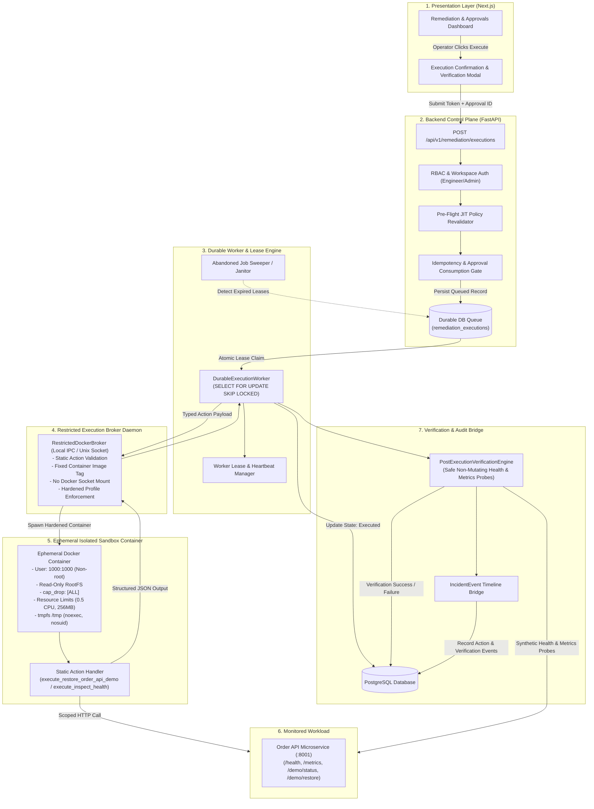
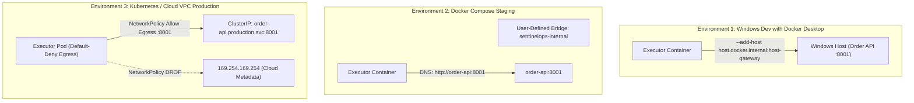
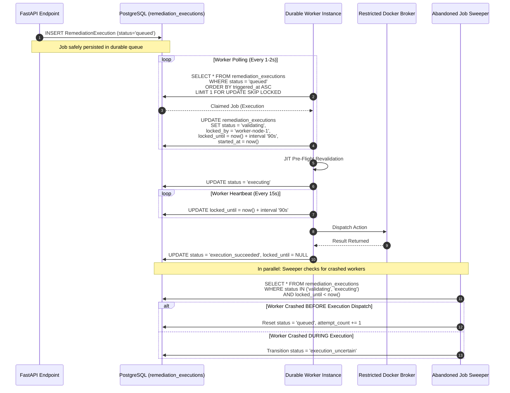
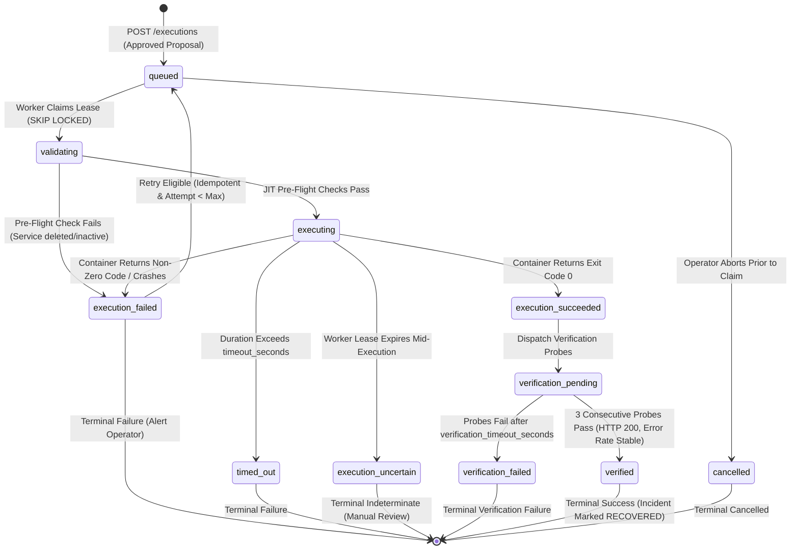
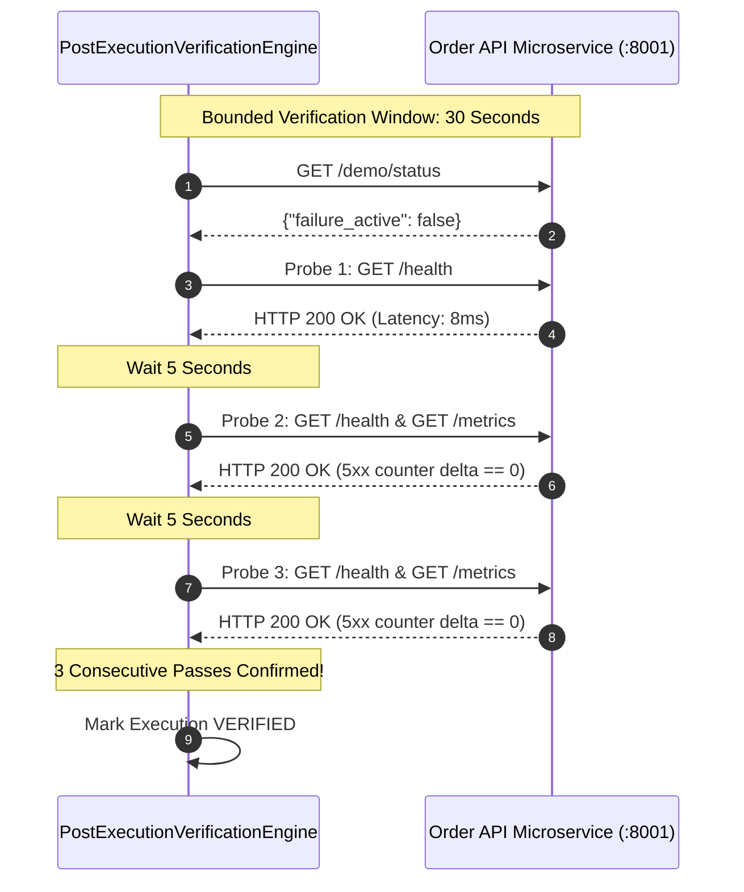
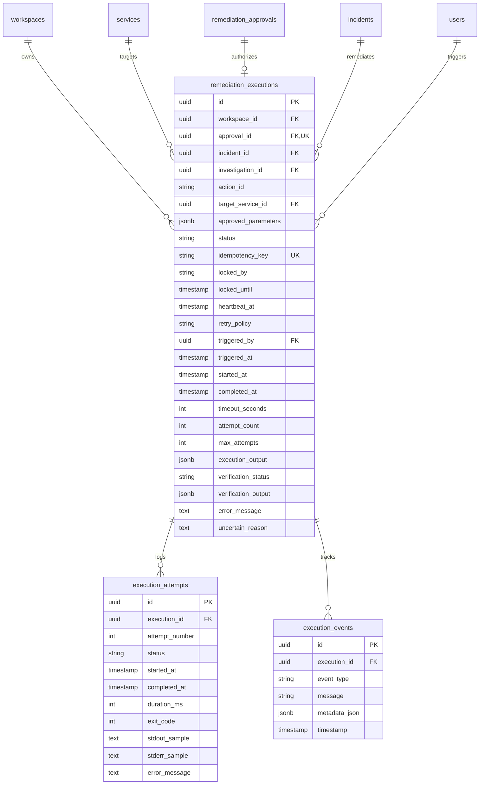
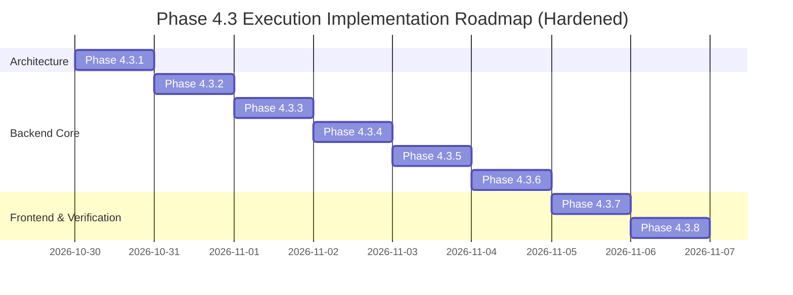

# SentinelOps AI — Phase 4.3: Controlled Remediation Execution Architecture & Threat Model

**Document Status:** Approved Design Specification (Revision 2 — Post-Audit Hardening)
**Phase:** 4.3.1 (Execution Architecture & Threat Model)
**Author:** SentinelOps AI Core Engineering Team
**Date:** October 30, 2026
**Target Milestone:** Phase 4.3 Implementation (Phases 4.3.2 – 4.3.8)

---

## Executive Summary

Phase 4.1 established the deterministic **Remediation Action Registry** and **Policy Engine**, ensuring all proposed recovery actions are strictly allowlisted and validated against safety invariants. Phase 4.2 established the **Human Approval Workflow**, enforcing role-based permissions, two-person integrity for high-risk proposals, database-level partial unique constraints, and immutable audit tracking.

Phase 4.3 defines the **Controlled Remediation Execution Engine**. The execution engine bridges the gap between approved remediation proposals and physical target recovery, following the strict autonomous incident lifecycle:

$$\text{Detect} \longrightarrow \text{Investigate} \longrightarrow \text{Plan} \longrightarrow \text{Authorize} \longrightarrow \mathbf{\text{Execute}} \longrightarrow \mathbf{\text{Verify}} \longrightarrow \text{Document}$$

### Core Safety Tenet
**The AI agent may analyze evidence, deduce root cause, and propose remediation action IDs, but it must NEVER directly authorize, trigger, or execute actions.** Authorization belongs exclusively to the deterministic backend policy engine and authorized human operators. Execution is strictly sandboxed, isolated, parameterized, and followed by automated synthetic verification.

---

## 1. Current Architecture Findings & Corrected Baseline

An inspection of the existing codebase (`D:\Sentinal_AI`) and the findings of the Phase 4.3.1 initial review establish the following technical baseline:

| Architectural Area | Current Implementation | Phase 4.3 Corrected Requirement |
| :--- | :--- | :--- |
| **Action Registry** | [`ActionRegistry`](file:///d:/Sentinal_AI/backend/app/remediation/registry.py) previously contained `restart_order_api`. | **Corrected Action Name**: Renamed to `restore_order_api_demo`. The existing Order API endpoint `/demo/restore` safely resets simulated in-memory failure state; it does **not** restart the OS process or container. Real container restart is reserved for future milestones. |
| **Policy Engine** | [`PolicyEngine`](file:///d:/Sentinal_AI/backend/app/remediation/policy.py) evaluates 10 deterministic rules. | Extended with **Just-In-Time (JIT) pre-flight revalidation** at the exact instant of execution dispatch. |
| **Approval Workflow** | [`ApprovalService`](file:///d:/Sentinal_AI/backend/app/remediation/approval_service.py) enforces two-person integrity and partial unique index `uq_pending_policy_decision`. Approvals stop at `approval_status = "approved"`. | Approved proposals become the **mandatory, single-use prerequisite** for execution. An approved proposal can only ever be consumed by one execution. |
| **Execution Runner** | Zero execution logic exists today. | **Isolated Runner Required**: A dedicated `DockerIsolatedRunner` communicating with a restricted broker. The in-process `MockTestRunner` is strictly classified as a test/dev mock and **cannot** execute mutating actions. |
| **Target Service** | [`Order API`](file:///d:/Sentinal_AI/services/order-api/service/main.py) provides microservice telemetry (`/metrics`, `/health`) and deterministic recovery endpoints (`/demo/restore`). | Actions target service endpoints via a restricted execution broker without host shell access. |
| **Incident Lifecycle** | [`Incident`](file:///d:/Sentinal_AI/backend/app/models/incident.py) models states `detected`, `investigating`, `remediating`, `verifying`, `recovered`, `closed`. | Execution drives incident transitions: `remediating` during execution, `verifying` during health probes, and `recovered` **only** upon successful verification. |

---

## 2. Component Architecture & Security Boundaries

The execution architecture introduces a decoupled, defense-in-depth model with five strict security tiers:



### Security Boundary Guarantees

1. **FastAPI Control Plane $\rightarrow$ Broker Boundary**:
   - The FastAPI backend does **not** have direct access to `/var/run/docker.sock`.
   - The backend communicates with the `RestrictedDockerBroker` via a restricted local Unix socket or internal mTLS IPC channel.
2. **Broker $\rightarrow$ Docker Daemon Boundary**:
   - The broker cannot accept arbitrary container launch requests.
   - It only accepts predefined `action_id` values and uses a hardcoded, immutable image reference (`sentinelops/remediation-executor:v1.0`).
3. **Container Sandbox $\rightarrow$ Host Boundary**:
   - Containers run as unprivileged user `1000:1000`.
   - Root filesystem is mounted read-only (`read_only: true`).
   - All Linux kernel capabilities are dropped (`cap_drop: ["ALL"]`).
   - Host filesystem paths and Docker sockets are **strictly omitted** from container mounts.
4. **Container $\rightarrow$ Network Boundary**:
   - Containers have no default internet route.
   - Egress is restricted exclusively to the target service's designated host/port.

---

## 3. Corrected Local Runner Security Model

### Problem Analysis
In-process local runners (such as running remediation handlers within FastAPI's Python process) provide **zero operating system isolation, zero resource constraints, and zero filesystem sandboxing**. Presenting an in-process runner as a security sandbox is a fundamental architectural defect.

### Redesigned Runner Hierarchy

```
                      ┌────────────────────────────────────────┐
                      │        ExecutionRunnerInterface        │
                      └───────────────────┬────────────────────┘
                                          │
                  ┌───────────────────────┴───────────────────────┐
                  ▼                                               ▼
┌──────────────────────────────────┐            ┌──────────────────────────────────┐
│       DockerIsolatedRunner       │            │          MockTestRunner          │
│   (Production & Staging Engine)  │            │     (Automated CI & Unit Tests)  │
├──────────────────────────────────┤            ├──────────────────────────────────┤
│ - Ephemeral Docker container     │            │ - In-memory mock handlers only   │
│ - Restricted Docker Broker       │            │ - CANNOT run mutating actions    │
│ - Enforces kernel sandboxing     │            │ - Synthetic canned responses     │
│ - Mandatory for mutating actions │            │ - Explicitly marked NOT a sandbox│
└──────────────────────────────────┘            └──────────────────────────────────┘
```

1. **`DockerIsolatedRunner` (Authoritative Production & Staging Engine)**:
   - Mandatory for all real, mutating remediation actions (`restore_order_api_demo`).
   - Dispatches jobs through the `RestrictedDockerBroker` into ephemeral, hardened containers.
   - Enforces kernel-level CPU/memory limits, dropped capabilities, and read-only filesystems.
2. **`MockTestRunner` (Deterministic Unit/CI Test Mock Only)**:
   - **Explicit Classification**: Classified strictly as a unit test fixture, **not** an execution environment.
   - **Mutation Block**: If invoked with any mutating action outside a test environment (`ENV != "test"` or `ALLOW_MOCK_RUNNER != True`), it immediately raises `SecurityConfigurationError` and aborts.
   - Returns deterministic, canned responses for testing the dispatcher, lease engine, and state machine without Docker dependencies.

### Workstation Behavior When Docker Is Unavailable
If Docker is not running or unavailable on a developer's workstation:
- **Mutating Action Behavior**: Attempting to execute `restore_order_api_demo` immediately fails fast with:
  ```json
  {
    "status_code": 503,
    "error": "ExecutionEnvironmentUnavailable",
    "detail": "Docker execution sandbox is not available on this host. Mutating remediation actions require a verified isolated container environment and cannot be executed in-process."
  }
  ```
- **Read-Only Action Behavior**: Read-only diagnostics (`inspect_service_health`) may run via a hardened, rate-limited HTTP client if explicitly permitted by configuration (`ALLOW_LOCAL_DIAGNOSTICS=True`), or return `HTTP 503` if full container isolation is enforced.
- **Fail-Closed Guarantee**: Under no circumstances will SentinelOps AI silently fall back to executing mutating actions on the host OS.

---

## 4. Docker Networking & Dual-Layer SSRF Architecture

### Problem Analysis
A common container networking error is assuming `127.0.0.1` inside a container reaches the host system. Inside a container, `127.0.0.1` is the container's own isolated loopback interface. Furthermore, unrestricted outbound container networking introduces critical SSRF risks (e.g. probing AWS metadata `169.254.169.254` or internal services).

### Concrete Network Implementations



#### 1. Windows Development with Docker Desktop
- The monitored Order API runs on the Windows host at `http://127.0.0.1:8001`.
- The container accesses the host using the Docker Desktop gateway DNS name:
  `http://host.docker.internal:8001`
- The broker passes `--add-host=host.docker.internal:host-gateway` to the container.
- Container egress is strictly constrained via Docker daemon bridge rules allowing connections only to the host gateway on the approved service port (`8001`).

#### 2. Docker-Based Staging (Docker Compose)
- All services and the executor reside on a custom, user-defined internal Docker bridge network (`sentinelops_staging_net`).
- Services communicate using internal service DNS names (e.g., `http://order-api:8001`).
- The bridge network has `internal: true` or default gateway routing disabled to prevent external internet access.
- The executor container cannot resolve external hostnames.

#### 3. Production Deployment (Kubernetes / VPC)
- The executor runs as an ephemeral Kubernetes Job or dedicated pod.
- **Default-Deny Egress NetworkPolicy**: All outbound traffic from the executor namespace is dropped by default:
  ```yaml
  apiVersion: networking.k8s.io/v1
  kind: NetworkPolicy
  metadata:
    name: executor-default-deny-egress
  spec:
    podSelector:
      matchLabels:
        role: remediation-executor
    policyTypes:
    - Egress
    egress:
    - to:
      - podSelector:
          matchLabels:
            app: order-api
      ports:
      - protocol: TCP
        port: 8001
  ```
- Traffic to `169.254.169.254/32` (AWS/GCP/Azure instance metadata) and private subnets is blocked at the network interface.

### Dual-Layer SSRF & Cloud Metadata Protections

```
                       Request from Control Plane
                                   │
                                   ▼
┌────────────────────────────────────────────────────────────────────────┐
│ Layer 1: Application-Level URL Validation (FastAPI & Broker)          │
│ - validate_safe_url enforces http/https only                           │
│ - Rejects embedded credentials (user:pass@host)                        │
│ - Resolves DNS and drops cloud metadata (169.254.169.254, metadata)   │
│ - Rejects private IP ranges (10.0.0.0/8, 172.16.0.0/12, 192.168.0.0/16)│
│   unless explicitly whitelisted for staging internal DNS.              │
└──────────────────────────────────┬─────────────────────────────────────┘
                                   │
                                   ▼
┌────────────────────────────────────────────────────────────────────────┐
│ Layer 2: Network-Level Egress Filtering (Docker / iptables / K8s)      │
│ - Container network namespace has NO default internet route           │
│ - Explicit iptables/NetworkPolicy DROP for 169.254.0.0/16              │
│ - Packets to non-target IP/ports are dropped at the kernel layer       │
└────────────────────────────────────────────────────────────────────────┘
```

---

## 5. Corrected Action Catalog Specification

Phase 4.3 strictly implements two foundational actions. Real Docker container restart is **not** implemented in this milestone.

### Action 1: `restore_order_api_demo`
- **Identifier**: `restore_order_api_demo`
- **Category**: `SERVICE_RECOVERY`
- **Risk Level**: `MEDIUM`
- **Requires Human Approval**: `True` (Mandatory human approval in Phase 4.2 prior to execution)
- **Supported Environments**: `["development"]`
- **Target Workload**: Order API Microservice (`services/order-api`)
- **Operational Effect**: Calls `POST /demo/restore` on the Order API service to reset simulated in-memory failure mode. Does **not** restart OS processes or containers.
- **Parameter Model**:
  ```python
  class RestoreOrderApiDemoParams(BaseModel):
      service_id: str = Field(..., description="Target service UUID belonging to current workspace")
      model_config = ConfigDict(extra="forbid")
  ```
- **Preconditions**:
  1. Service exists in caller's active workspace.
  2. Service is marked `is_active == True`.
  3. Service environment is `development`.
  4. Service health check URL matches registered Order API host and port.
- **Timeout**: 30 seconds.
- **Verification Criteria**:
  - `GET /demo/status` confirms `failure_active == False`.
  - `GET /health` returns `HTTP 200 OK` across 3 consecutive probes over a 15-second window.
  - `GET /metrics` confirms `order_api_http_5xx_errors_total` has completely plateaued.

### Action 2: `inspect_service_health`
- **Identifier**: `inspect_service_health`
- **Category**: `DIAGNOSTICS`
- **Risk Level**: `LOW`
- **Requires Human Approval**: `False` (Eligible for auto-execution or on-demand execution when policy engine permits)
- **Supported Environments**: `["development"]`
- **Target Workload**: Any registered service within the workspace
- **Operational Effect**: Purely read-only diagnostic probe. Fetches `/health` and `/metrics` and parses current error rates and latency. Mutates zero service or host state.
- **Parameter Model**:
  ```python
  class InspectServiceHealthParams(BaseModel):
      service_id: str = Field(..., description="Target service UUID belonging to current workspace")
      model_config = ConfigDict(extra="forbid")
  ```
- **Preconditions**:
  1. Service exists in caller's active workspace.
  2. Service health check URL satisfies SSRF validation.
- **Timeout**: 15 seconds.
- **Verification Criteria**: Structured diagnostic telemetry successfully collected and attached to incident timeline.

### Future Extension: Physical Container Restart
Physical Docker container restarts (e.g. `docker restart <container_id>`) represent a high-risk operational action requiring host container socket interaction. This is intentionally deferred to Phase 4.4, which will introduce a dedicated container supervisor broker with strict mutual TLS and container-ID whitelist filtering.

---

## 6. Restricted Execution Broker Design

The backend FastAPI control plane must **never** receive direct or unrestricted access to the Docker daemon.

```
┌────────────────────────────────────────────────────────────────────────┐
│                        FastAPI Control Plane                           │
│  (DB connection, JWT secrets, Gemini API key, user sessions, host FS)  │
└───────────────────────────────────┬────────────────────────────────────┘
                                    │ Restricted JSON IPC over Unix Socket
                                    │ /var/run/sentinelops/broker.sock
                                    ▼
┌────────────────────────────────────────────────────────────────────────┐
│                    RestrictedDockerBroker Daemon                       │
│                                                                        │
│  1. Static Action Allowlist Check:                                     │
│     - Validates action_id IN ('restore_order_api_demo',                │
│       'inspect_service_health')                                        │
│     - Rejects any unknown or arbitrary command request.                │
│                                                                        │
│  2. Immutable Container Image Tag:                                     │
│     - Hardcoded image: sentinelops/remediation-executor:v1.0           │
│     - Pulling or launching arbitrary images is forbidden.              │
│                                                                        │
│  3. Hardcoded Security Profile Enforcement:                            │
│     - User: 1000:1000                                                  │
│     - Read-Only RootFS: True                                           │
│     - Capabilities: cap_drop: ["ALL"]                                  │
│     - Security Opts: ["no-new-privileges:true"]                        │
│     - Volume Mounts: NONE (Host paths strictly excluded)               │
│     - Docker Socket: NEVER MOUNTED                                     │
│     - tmpfs: /tmp:rw,noexec,nosuid,size=32m                            │
│     - Resource Bounds: 0.5 CPU, 256MB RAM, 50 PIDs                     │
│                                                                        │
│  4. Target Resolution & Network Mapping:                               │
│     - Resolves registered service target to authorized bridge address  │
│     - Injects single target URL into container environment             │
└───────────────────────────────────┬────────────────────────────────────┘
                                    │ Docker API (Narrow Container Create/Run)
                                    ▼
┌────────────────────────────────────────────────────────────────────────┐
│                  Ephemeral Docker Executor Container                   │
│             Entrypoint: python -m executor.runner                      │
│             Static Dispatch: action_id -> Python function              │
└────────────────────────────────────────────────────────────────────────┘
```

### Broker API Contract (Unix Domain Socket)
The broker exposes an extremely narrow, typed RPC interface:

#### Request (`ExecuteActionRequest`):
```json
{
  "execution_id": "4020fbb2-33b6-41b4-b903-8898144ef91a",
  "action_id": "restore_order_api_demo",
  "parameters": {
    "service_id": "55170288-0449-4e48-afc7-fc8b9aac1686"
  },
  "target_url": "http://host.docker.internal:8001/demo/restore",
  "timeout_seconds": 30
}
```

#### Response (`ExecuteActionResult`):
```json
{
  "execution_id": "4020fbb2-33b6-41b4-b903-8898144ef91a",
  "exit_code": 0,
  "duration_ms": 185,
  "stdout_sample": "{\"status\":\"restored\",\"message\":\"Order API is now operating normally.\"}",
  "stderr_sample": "",
  "error_message": null
}
```

If the backend attempts to send an unregistered `action_id`, an arbitrary shell command, or a malicious payload, the broker rejects the request with `BrokerSecurityViolation` and logs a high-severity alert.

---

## 7. Durable Execution Dispatch & Worker Recovery

### The Queued-Execution Crash Problem
If execution requests were simply dispatched to background in-memory tasks (`asyncio.create_task`), a process crash, server restart, or network partition would cause in-flight executions to be permanently lost or left in indeterminate zombie states.

### Database-Backed Durable Queue & Lease Engine

SentinelOps AI utilizes PostgreSQL as a durable, transaction-safe job queue using row-level locking:



### Worker Lease Semantics & Fields
Three columns on `remediation_executions` manage worker leases:
1. `locked_by`: String identifier of the worker instance holding the lease (e.g. `worker-us-east-1a-pid1240`).
2. `locked_until`: UTC timestamp marking when the lease expires (initial lease: 90 seconds).
3. `heartbeat_at`: UTC timestamp of the worker's latest liveness update (sent every 15 seconds).

### Recovery Matrix for Abandoned Jobs

| Failure Scenario | Detection Mechanism | Recovery Action | State Transition |
| :--- | :--- | :--- | :--- |
| **Worker crashes while job is `queued`** | N/A (Job not yet claimed) | Next available worker claims job via `SKIP LOCKED`. | No state change; stays `queued`. |
| **Worker crashes during `validating`** | Sweeper detects `locked_until < now()`. | Job was not dispatched. Safe to retry. If `attempt_count < max_attempts`, re-queue. | `validating` $\rightarrow$ `queued`. |
| **Worker crashes during `executing` (Non-Idempotent Action)** | Sweeper detects `locked_until < now()`. | **Action may have mutated service.** Automatic retry is strictly forbidden. | `executing` $\rightarrow$ **`execution_uncertain`**. Incident remains open; alert operator. |
| **Worker crashes during `executing` (Idempotent Action)** | Sweeper detects `locked_until < now()`. | `restore_order_api_demo` is idempotent. Sweeper allows retry if attempts remaining. | `executing` $\rightarrow$ `queued` (or `execution_uncertain` if attempts exhausted). |
| **Target succeeds, but DB commit fails** | Worker network reconnects or Sweeper sweeps. | Worker detects container finished successfully. Triggers diagnostic probe to reconcile state. | Reconciled to `execution_succeeded` or `execution_uncertain`. |

---

## 8. Approval Consumption & Idempotency Invariants

A human approval proposal must **never** result in two independent mutating executions. The system strictly enforces the following matrix:

| Scenario | Input | Internal State | Exact System Response | Invariant Enforced |
| :--- | :--- | :--- | :--- | :--- |
| **Concurrent Duplicate Click** | Operator double-clicks "Execute" simultaneously. | Both threads query approval with `FOR UPDATE`. | First thread claims lock and inserts execution. Second thread catches unique index collision on `uq_execution_approval` and returns **`HTTP 409 Conflict`**. | Max 1 execution record per approval. |
| **Network Retry with Same Key** | Client retries same request: `(approval_id, key_1)`. | Execution already exists with `(workspace_id, key_1)`. | Detects matching idempotency key. Returns existing execution representation with **`HTTP 200/202`**. | True idempotency on network retries. |
| **Reusing Key on Different Approval** | Client sends `(approval_2, key_1)`. | `key_1` already bound to `approval_1`. | Rejects request with **`HTTP 422 Unprocessable Entity`** ("Idempotency key already in use"). | Key isolation across proposals. |
| **Different Key on Same Approval** | Client sends `(approval_1, key_2)`. | `approval_1` already has an execution. | Rejects request with **`HTTP 409 Conflict`** ("Approval has already been consumed"). | Approval can only be executed once. |
| **Approval Replay** | Operator tries to execute an approval executed yesterday. | `approval_status == 'approved'`, but execution table has entry. | Rejects with **`HTTP 409 Conflict`** ("Approval has already been executed"). | Zero replay of historical approvals. |
| **Expiry Before Dispatch** | Execution submitted after `expires_at`. | `now_utc > approval.expires_at`. | Transitions approval status to `'expired'`. Rejects with **`HTTP 400 Bad Request`**. | Expired approvals cannot be executed. |
| **Expiry After Dispatch** | Approval expires while container is running. | `status == 'executing'` when expiry hits. | Execution continues to completion and verification. | In-flight operations are not aborted mid-mutation. |

---

## 9. Clarified Execution State Machine

The execution state machine explicitly distinguishes **Execution Outcome**, **Verification Outcome**, and **Incident Recovery Outcome**:



### Complete State Definitions (11 Explicit States)

1. **`queued`**: Job successfully ingested and written to durable queue. Awaiting worker lease claim.
2. **`validating`**: Worker claimed lease; synchronously running JIT precondition checks.
3. **`executing`**: Container launched; static action handler actively running.
4. **`execution_succeeded`**: Action handler exited with code 0.
5. **`execution_failed`**: Action handler failed with non-zero exit code or runner crashed.
6. **`timed_out`**: Container execution exceeded timeout envelope; container was terminated via `SIGKILL`.
7. **`execution_uncertain`**: Worker lease expired or connection dropped mid-mutation; outcome cannot be confirmed automatically.
8. **`verification_pending`**: Synthetic verification engine is actively polling the target service.
9. **`verified`**: Target service passed all verification criteria. **Incident transitions to `recovered`**.
10. **`verification_failed`**: Action completed, but service failed post-execution health probes. Incident remains open.
11. **`cancelled`**: Job was aborted by an authorized engineer before worker claim.

### Impact on Incident Lifecycle

| Execution State | Incident Status | Incident Timeline Action |
| :--- | :--- | :--- |
| `queued` $\rightarrow$ `validating` | Transitions to **`remediating`** | `IncidentEvent(event_type="action", message="Remediation execution queued and validating")` |
| `executing` | Remains **`remediating`** | `IncidentEvent(event_type="action", message="Executing action 'restore_order_api_demo'")` |
| `execution_succeeded` | Transitions to **`verifying`** | `IncidentEvent(event_type="action", message="Action execution succeeded; starting verification")` |
| `execution_failed` | Remains **`remediating`** | `IncidentEvent(event_type="action", message="Action execution failed: non-zero exit code")` |
| `timed_out` | Remains **`remediating`** | `IncidentEvent(event_type="action", message="Action execution timed out after 30s")` |
| `execution_uncertain` | Remains **`remediating`** (Flagged: `uncertain`) | `IncidentEvent(event_type="action", message="WARNING: Execution outcome uncertain; manual review required")` |
| `verified` | **Transitions to `recovered`** | `IncidentEvent(event_type="verification", message="Verification succeeded: Service healthy and stable")` |
| `verification_failed` | Reverts to **`remediating`** | `IncidentEvent(event_type="verification", message="Verification failed: Service health check failed")` |

---

## 10. Non-Mutating Verification Safety

### Critical Safety Correction
The initial design proposed creating synthetic orders via `POST /orders` as part of verification. **This was rejected.** Creating dummy orders mutates business databases, skews financial records, and violates read-only verification safety.

### Safe Verification Protocol for `restore_order_api_demo`



1. **Consecutive Probe Requirement**: Verification requires **3 consecutive successful health probes** spaced 5 seconds apart (total window: 15–30s). A single transient 200 OK is insufficient to declare recovery.
2. **Failure Flag Verification**: Probes `GET /demo/status` to assert `failure_active == False`.
3. **Telemetry Stabilization**: Scrapes `GET /metrics` across all three probes to assert that `order_api_http_5xx_errors_total` has completely stopped incrementing ($\Delta = 0$).
4. **Zero State Mutation**: All verification probes use purely read-only HTTP GET requests. Zero database records, orders, or application states are created.

---

## 11. Audit Durability & Secret Redaction

1. **Atomic Transaction Audit Guarantee**:
   - Every execution state transition and its corresponding `ExecutionEvent` and `IncidentEvent` are persisted inside the **exact same database transaction**. If the transaction rolls back, no orphan events are emitted.
2. **Automated Secret Scrubbing**:
   - Stdout, stderr, and output JSON are passed through a strict regex redaction filter prior to database insertion:
     ```python
     REDACTION_PATTERNS = [
         r"(?i)bearer\s+[a-zA-Z0-9_\-\.]+",
         r"(?i)authorization:\s*['\"][^'\"]+['\"]",
         r"(?i)(password|secret|token|api_key)\s*[:=]\s*['\"][^'\"]+['\"]",
     ]
     ```
   - Matches are replaced with `[REDACTED]`.
3. **Output Capping**:
   - `stdout_sample` and `stderr_sample` are capped at 32 KB per attempt to prevent log-dump denial-of-service attacks.
4. **Operator Visibility for Uncertain Outcomes**:
   - If an execution transitions to `execution_uncertain`, the UI renders a prominent persistent warning banner linking to diagnostic tools, ensuring operators are immediately informed of disrupted workers.

---

## 12. Updated Database Schema Design



### SQLAlchemy Model: `RemediationExecution`
```python
class RemediationExecution(Base):
    __tablename__ = "remediation_executions"
    __table_args__ = (
        # Unique constraint guarantees at most one execution per approval
        Index("uq_execution_approval", "approval_id", unique=True),
        Index("uq_execution_idempotency", "workspace_id", "idempotency_key", unique=True),
        Index("ix_execution_queue", "status", "locked_until", "triggered_at"),
    )

    id: Mapped[str] = mapped_column(String(36), primary_key=True, default=lambda: str(uuid.uuid4()))
    workspace_id: Mapped[str] = mapped_column(String(36), ForeignKey("workspaces.id", ondelete="CASCADE"), nullable=False, index=True)
    approval_id: Mapped[str] = mapped_column(String(36), ForeignKey("remediation_approvals.id", ondelete="RESTRICT"), nullable=False)
    incident_id: Mapped[str | None] = mapped_column(String(36), ForeignKey("incidents.id", ondelete="SET NULL"), nullable=True, index=True)
    investigation_id: Mapped[str | None] = mapped_column(String(36), ForeignKey("investigations.id", ondelete="SET NULL"), nullable=True)

    # Action & Target Service Binding
    action_id: Mapped[str] = mapped_column(String(100), nullable=False, index=True)
    target_service_id: Mapped[str | None] = mapped_column(String(36), ForeignKey("services.id", ondelete="SET NULL"), nullable=True, index=True)
    approved_parameters: Mapped[Dict[str, Any]] = mapped_column(JSONType, nullable=False, default=dict)

    # State Machine & Worker Lease
    status: Mapped[str] = mapped_column(String(30), nullable=False, default="queued", index=True)
    idempotency_key: Mapped[str] = mapped_column(String(64), nullable=False)
    locked_by: Mapped[str | None] = mapped_column(String(100), nullable=True)
    locked_until: Mapped[datetime | None] = mapped_column(DateTime(timezone=True), nullable=True, index=True)
    heartbeat_at: Mapped[datetime | None] = mapped_column(DateTime(timezone=True), nullable=True)
    retry_policy: Mapped[str] = mapped_column(String(20), nullable=False, default="idempotent")  # idempotent, non_idempotent

    # Audit & Operators
    triggered_by: Mapped[str] = mapped_column(String(36), ForeignKey("users.id", ondelete="RESTRICT"), nullable=False)
    triggered_at: Mapped[datetime] = mapped_column(DateTime(timezone=True), default=lambda: datetime.now(timezone.utc), nullable=False)
    started_at: Mapped[datetime | None] = mapped_column(DateTime(timezone=True), nullable=True)
    completed_at: Mapped[datetime | None] = mapped_column(DateTime(timezone=True), nullable=True)

    timeout_seconds: Mapped[int] = mapped_column(Integer, default=30, nullable=False)
    attempt_count: Mapped[int] = mapped_column(Integer, default=0, nullable=False)
    max_attempts: Mapped[int] = mapped_column(Integer, default=1, nullable=False)

    # Results & Verification
    execution_output: Mapped[Dict[str, Any] | None] = mapped_column(JSONType, nullable=True)
    verification_status: Mapped[str | None] = mapped_column(String(30), nullable=True)  # pending, verified, failed
    verification_output: Mapped[Dict[str, Any] | None] = mapped_column(JSONType, nullable=True)
    error_message: Mapped[str | None] = mapped_column(Text, nullable=True)
    uncertain_reason: Mapped[str | None] = mapped_column(Text, nullable=True)
```

---

## 13. API Specification

All Phase 4.3 endpoints are mounted under `/api/v1/remediation/executions`.

### 1. `POST /api/v1/remediation/executions`
- **Summary**: Trigger execution of an approved remediation proposal.
- **Role Requirement**: `engineer` or `admin`.
- **Request Body**:
  ```json
  {
    "approval_id": "8e83ea22-c662-408c-aac0-577649cff0e8",
    "idempotency_key": "exec_req_abc12345"
  }
  ```
  *(Zero action parameters accepted from client; copied strictly from approval).*
- **Responses**:
  - `202 Accepted`: Job queued for durable worker.
  - `400 Bad Request`: Approval expired or preconditions failed.
  - `403 Forbidden`: Caller role is Viewer.
  - `404 Not Found`: Approval ID does not exist.
  - `409 Conflict`: Proposal not in `approved` state, approval already executed, or concurrent request active.
  - `503 Service Unavailable`: Docker execution environment unavailable on host.

### 2. `GET /api/v1/remediation/executions`
- **Summary**: List executions for the authorized workspace with pagination and filters.
- **Query Parameters**: `workspace_id` (UUID), `status` (string), `action_id` (string), `limit`, `offset`.
- **Role Requirement**: `viewer`, `engineer`, or `admin`.

### 3. `GET /api/v1/remediation/executions/{id}`
- **Summary**: Retrieve detailed execution state, parameters, outputs, attempt history, and verification probe records.
- **Role Requirement**: `viewer`, `engineer`, or `admin`.

### 4. `POST /api/v1/remediation/executions/{id}/cancel`
- **Summary**: Cancel an execution if still in `queued` state.
- **Role Requirement**: `engineer` or `admin`.

---

## 14. Testing Strategy

1. **Unit Tests (`tests/test_remediation_execution_unit.py`)**:
   - State machine transition invariants (asserting invalid transitions raise exceptions).
   - `MockTestRunner` safety blocks (verifying mutating execution outside tests raises `SecurityConfigurationError`).
   - JIT policy revalidation checks (deactivated service, deleted service, cross-workspace reference).
2. **Idempotency & Concurrency Tests (`tests/test_remediation_execution_concurrency.py`)**:
   - Multi-threaded concurrent requests against same `approval_id` (asserting exactly one 202 and one 409).
   - Replay tests verifying consumed approvals return 409 Conflict.
3. **Durable Queue & Sweeper Tests (`tests/test_remediation_durable_queue.py`)**:
   - `SELECT FOR UPDATE SKIP LOCKED` verification across worker instances.
   - Sweeper lease expiration tests verifying recovery of abandoned `validating` jobs and flagging of `execution_uncertain`.
4. **Verification Safety Tests (`tests/test_remediation_verification.py`)**:
   - Assertion that verification probes execute **zero** POST requests to `/orders`.
   - Verification that 3 consecutive probes are required before status transitions to `verified`.
5. **Live Target Verification (`scratch/verify_live_execution.py`)**:
   - Automated end-to-end recovery test against live Order API microservice on port 8001:
     - Inject failure via `/demo/simulate-failure`.
     - Detect incident and approve `restore_order_api_demo`.
     - Dispatch via broker into container sandbox.
     - Verify Order API `/demo/restore` returns 200 OK.
     - Run 3-probe verification and confirm incident transitions to `recovered`.

---

## 15. Incremental Implementation Roadmap



1. **Phase 4.3.1 (Current)**: Architecture & Threat Model (Design only; complete).
2. **Phase 4.3.2**: Database Models (`RemediationExecution`, `ExecutionAttempt`, `ExecutionEvent`) & Alembic Migration `0007_remediation_executions`.
3. **Phase 4.3.3**: Durable Worker Engine (`SKIP LOCKED`), Worker Lease Heartbeats, and Abandoned Job Sweeper.
4. **Phase 4.3.4**: `RestrictedDockerBroker` daemon, static action dispatchers, and hardened Docker container profile.
5. **Phase 4.3.5**: Non-mutating `PostExecutionVerificationEngine` & automated `Incident` recovery bridge.
6. **Phase 4.3.6**: FastAPI Endpoints (`/api/v1/remediation/executions/*`) with strict idempotency and RBAC.
7. **Phase 4.3.7**: Next.js Frontend Execution Confirmation Modal, Live Progress Drawer, and Uncertain State Banner.
8. **Phase 4.3.8**: Full Test Suite, Security Hardening Audit, and Live Order API Verification Report.

---

## 16. Phase 4.3.6 Hardened Architecture & Security Specification

For the complete, mathematically rigorous specification covering Post-Execution Verification, Journal Append Protocol, Watchdog Recovery, Audit Checkpoint Outbox, Host Attestation, and Dispatch Boundary Fencing, see the dedicated architecture document:
**[PHASE_4_3_6_ARCHITECTURE.md](file:///d:/Sentinal_AI/docs/PHASE_4_3_6_ARCHITECTURE.md)**.

### Summary of Key Hardening Measures:
1. **Docker Fencing Proxy Architecture Settled**: Establishes `sentinelops-dispatch-guardd` as the concrete dispatch-boundary proxy owning the raw Docker socket (`0600 root:root`), with broker communicating exclusively over `/var/run/sentinelops/dispatch-guard.sock` (`0660`). Synchronously validates fencing epochs against PostgreSQL, failing closed (HTTP 503) on outages/restarts. **Strict physical target fencing is explicitly classified as an unresolved infrastructure requirement.**
2. **Strengthened Journal-Marker Proof**: Establishes six mandatory conditions under which absence of `DOCKER_CALL_STARTED` proves non-invocation; mandates fail-closed `HOLD:EXECUTION_UNCERTAIN` if any condition is missing or unverified.
3. **Disentangled Zero-Redispatch Guarantee**: Disentangles stale database write rejection, watchdog redispatch prevention, delayed first dispatch potential, and physical boundary enforcement.
4. **Authoritative Journal Append Protocol**: Inter-process file locking (`operations.journal.lock`), monotonic sequence allocation under lock, looping `os.write()` to handle partial writes, dual `os.fsync()` (file + directory), and safe atomic compaction.
5. **Watchdog Recovery & Fencing Tokens**: Dedicated sweeper transaction recovering expired leases to `HOLD:EXECUTION_UNCERTAIN` and incrementing `fencing_token`. Zombie workers attempting updates with stale fencing tokens are cleanly locked out (0 rows updated). Queued jobs with active ordinary leases are strictly protected from double-claim.
6. **Audit Checkpoint Outbox & HMAC Chains**: Atomic outbox pattern for WORM ledger anchoring (AWS S3 Object Lock), 10-field binary packed HMAC signatures, and cryptographic chaining ($D_n = \text{SHA256}(\text{Payload}_n \,\|\, D_{n-1})$). Operational finalization is decoupled from external ledger availability.
7. **Host Attestation Freshness & Anti-Replay**: Two-stage operator resolution using fresh 32-byte nonces, monotonic host sequence numbers, $\pm 30\text{s}$ clock-skew window, and explicit TPM 2.0 vs. file-backed fallback security tiering.
8. **PostgreSQL Claim Predicate**: 30-case validated SQL predicate with consistent `:now_utc` evaluation, full calendar leap year validation, and fail-closed integrity checks.

---

*End of Design Specification (Revision 10) — Stop after Phase 4.3.6 Architecture.*
