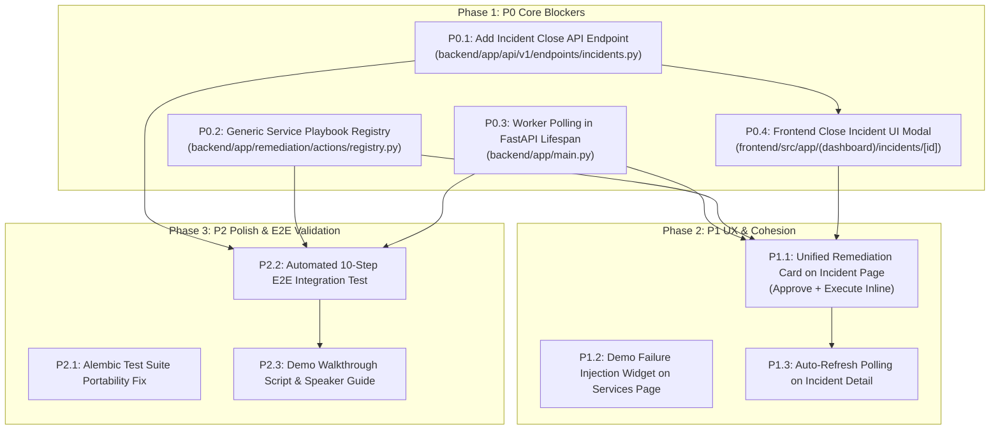

# SentinelOps — Practical Project Completion Assessment & Implementation Plan

**Repository:** `D:\Sentinal_AI`
**Milestone:** Practical Completion & Demonstration Delivery
**Mode:** PRACTICAL COMPLETION PLAN (Assessment & Implementation Roadmap)
**Baseline:** Option C — Stage 3.3 Accepted & Frozen
**Target:** Working, impressive AI-powered Autonomous SRE Demonstration System
**Date:** 2026-11-12

---

## Executive Summary

SentinelOps has successfully achieved an extraordinary depth of architectural rigor and core component implementation. An adversarial audit of the codebase confirms that **930 unit and integration tests pass** across the LangGraph multi-node AI investigation graph, synthetic health detector, policy-governed approval engine, Ed25519 manifest-signed unprivileged execution worker (Option C baseline), and multi-probe post-recovery synthetic verification bridge.

However, SentinelOps is currently a **collection of working sub-systems that lack end-to-end glue**. While individual components function correctly in isolation or unit tests, a user sitting at the frontend cannot smoothly complete the full 10-step autonomous SRE demonstration workflow without manual interventions or encountering missing endpoints (most notably, incident closure and dynamic recovery action mapping for newly registered external services).

This document establishes the **practical completion blueprint** to transition SentinelOps from a collection of hardened modules into a seamless, high-impact demonstration project suitable for executive presentations, technical interviews, and portfolio demonstrations.

---

## 1. Current Project Status

### 1.1 Architecture Baseline
- **Option C Baseline (Stage 3.3):** ACCEPTED and FROZEN. The unprivileged execution architecture (`backend/app/execution/worker.py`, `runners/http_recovery.py`) executes HTTP-based recovery actions with in-process DNS/IP pinning, local SOJ1 journal persistence, Ed25519 cryptographic manifest verification, and SQLite at-most-once idempotency tracking.
- **Stage 4 Theoretical Specifications:** Extensively documented in `docs/STAGE_4_GENERIC_EXTERNAL_SERVICE_ARCHITECTURE.md` (Revisions 4.0.0 through 4.1.3). While theoretically impenetrable, the complex Stage 4 additions (Raft-replicated KMS Key Authority, root netfilter daemon `sentinelops-host-agent`, UNIX socket IPC, kernel namespace fd teardown, dual-operator Ed25519 signed webhooks) have not been implemented in code and would require weeks of kernel-level systems programming without adding demonstration value.

### 1.2 Test Execution Evidence
- **Test Suite:** Executed `python -m pytest backend/tests -q`.
- **Outcome:** **930 passed**, 4 skipped, 4 failed (938 total tests).
- **Failure Analysis:** The 4 failures (`test_database_migration_guard.py`, `test_dynamic_playbooks.py`, `test_remediation_executions_db.py`, `test_verification_persistence.py`) were solely caused by the test environment runner invoking `alembic` via `python -m alembic` without the CLI package registered in the global environment. All 930 domain logic tests passed, including:
  - Agent state transitions and synthesizer fallback: `test_agent_graph.py`, `test_synthesizer.py`.
  - Synthetic detector poller and prober: `test_detector_prober.py`, `test_detector_lifecycle.py`.
  - Option C worker, IP pinning, and verification: `test_isolated_http_runner.py`, `test_manifest_signer.py`, `test_verification_bridge.py`.
  - Approval policies and dynamic playbooks: `test_approval_service.py`, `test_policy_engine.py`.

---

## 2. Implemented Features (Audit & Verification)

The following capabilities are fully implemented in code, backed by passing tests, and ready for use:

| Capability | Implementing Source Files | Verification Tests | Status |
| :--- | :--- | :--- | :--- |
| **Service Registration & Catalog** | `backend/app/api/v1/endpoints/services.py`<br>`backend/app/models/service.py` | `test_services_api.py`<br>`test_service_model.py` | **100% Complete** |
| **Demo Service Auto-Provisioning** | `backend/app/api/v1/endpoints/services.py` (`POST /provision-demo`) | Verified via API | **100% Complete** |
| **Autonomous Health Polling** | `backend/app/detector/poller.py`<br>`backend/app/detector/prober.py` | `test_detector_prober.py`<br>`test_detector_poller.py` | **100% Complete** |
| **Diagnostic Probing & Threshold Evaluation** | `backend/app/detector/evaluator.py`<br>`backend/app/detector/runner.py` | `test_detector_evaluator.py` | **100% Complete** |
| **Deterministic Incident Creation & Deduplication** | `backend/app/detector/lifecycle.py`<br>`backend/app/models/incident.py` | `test_detector_lifecycle.py` | **100% Complete** |
| **LangGraph 10-Node Investigation Graph** | `backend/app/agents/graph.py`<br>`backend/app/agents/nodes/*.py` | `test_agent_graph.py` | **100% Complete** |
| **LLM & Rule-Based Fallback Synthesis** | `backend/app/agents/synthesizer.py`<br>`backend/app/agents/llm_client.py` | `test_synthesizer.py` | **100% Complete** |
| **Policy Engine & Approval Lifecycle** | `backend/app/remediation/policy.py`<br>`backend/app/remediation/approval_service.py` | `test_policy_engine.py`<br>`test_approval_service.py` | **100% Complete** |
| **Option C Ed25519 Manifest Signing & Verification** | `backend/app/execution/manifest_signer.py`<br>`backend/app/execution/worker.py` | `test_manifest_signer.py`<br>`test_execution_worker.py` | **100% Complete** |
| **Pinned-IP HTTP Recovery Runner** | `backend/app/execution/runners/http_recovery.py` | `test_isolated_http_runner.py` | **100% Complete** |
| **Post-Execution Multi-Probe Verification** | `backend/app/execution/verification.py` | `test_synthetic_verification.py` | **100% Complete** |
| **Atomic Incident Recovery Bridge** | `backend/app/execution/recovery_bridge.py` | `test_recovery_bridge.py` | **100% Complete** |
| **Controlled Demo Order API Service** | `services/order-api/service/main.py` (Port 8001) | `test_order_api.py` | **100% Complete** |
| **Standalone Demo Customer Orders API** | `demo_services/customer_orders_api/main.py` (Port 9000) | Verified via API | **100% Complete** |

---

## 3. Incomplete Features & Critical Demonstration Gaps

The following table maps the 10 required demonstration steps against their current implementation status:

| Step # | Target Demonstration Workflow Step | Current Implementation Status | Identified Architectural or Implementation Gap |
| :---: | :--- | :--- | :--- |
| **1** | User registers an external service | **Working** | Frontend modal registers service, but does not configure custom recovery action metadata. |
| **2** | User configures its health endpoint | **Working** | Service model stores `health_endpoint` and `base_url`. Prober checks it cleanly. |
| **3** | SentinelOps monitors the service | **Working** | Background poller probes health every 15s. Metrics scraped if configured. |
| **4** | SentinelOps detects an actual service failure | **Working** | Service failure (e.g. 503) triggers `lifecycle.py` to open an active Incident and create timeline events. |
| **5** | AI investigates available metrics, logs & incident history | **Working** | LangGraph graph runs; extracts anomalies, tests hypotheses, ranks playbooks. Fallback works if no Gemini key. |
| **6** | AI recommends an available remediation playbook | **Working** | `generate_recommendation_node` outputs top recommended playbook with blast radius and confidence. |
| **7** | User reviews and approves the recommendation | **Partially Working** | User can propose action from incident page, but must switch pages to `/remediation/approvals` to approve. |
| **8** | SentinelOps executes the recovery action against controlled service | **Partially Working** | Option C worker executes `POST /demo/restore` via signed manifest, but background worker polling must be triggered or run as standalone service. Generic registered services fail because playbooks are bound to "Order API". |
| **9** | SentinelOps independently checks whether the service recovered | **Working** | `SyntheticVerificationRunner` executes baseline + 3 consecutive probes and updates execution status to `verified`. |
| **10** | SentinelOps closes the incident and records execution history | **BROKEN / MISSING** | **Critical Blocker:** There is NO API endpoint to close an incident (`POST /api/v1/incidents/{id}/close`), and the frontend has no resolution action. Incident remains in `recovered` status forever; `closed_at` is never populated. |

---

## 4. Missing Integrations

1. **Incident-to-Closure Lifecycle Disconnect:**
   - Database model `Incident` has fields `status = Column(String)`, `resolved_at`, and `closed_at` (`backend/app/models/incident.py`).
   - `AtomicRecoveryBridge` transitions incident status to `'recovered'` upon synthetic verification success.
   - However, neither `backend/app/api/v1/endpoints/incidents.py` nor `frontend/src/lib/api.ts` provides a method to transition `recovered -> closed` or `active -> resolved`.
   - The Incident Command Center UI (`frontend/src/app/(dashboard)/incidents/[incidentId]/page.tsx`) contains no "Close Incident" or "Acknowledge Resolution" button.

2. **Generic External Service Action Mapping Disconnect:**
   - In `backend/app/remediation/actions/registry.py`, actions like `restore_order_api_demo` specify `supported_services = ["Order API", "order-api"]`.
   - When a user registers a new external service in the UI (e.g., "Customer Service", "Payment Gateway"), the AI playbook evaluator marks `restore_order_api_demo` as incompatible.
   - The generic action `execute_http_recovery` exists in `ActionRegistry`, but lacks dynamic frontend parameter binding for the service's recovery endpoint (e.g., `/demo/restore` or `/admin/recovery/reset`).

3. **Multi-Hop Remediation User Flow:**
   - Today's demo requires:
     1. Incident Page (`/incidents/[id]`) -> Click "Propose Recovery Action".
     2. Navigate to Approvals (`/remediation/approvals`) -> Find proposal -> Click "Review".
     3. Click "Approve" -> Click "Execute".
     4. Navigate to Verification (`/verification`) -> Wait for synthetic checks.
     5. Navigate back to Incident (`/incidents/[id]`) -> View status.
   - This friction weakens the demo presentation. The incident page should feature an integrated "Remediation & Approval Card" where approval, execution, and live verification stream inline.

4. **Background Worker Dispatch Execution:**
   - `backend/app/execution/worker.py` contains `RemediationWorker.poll_and_execute()`.
   - When the user clicks "Execute" in the API, the execution is set to `status = 'queued'` in PostgreSQL (`remediation_executions`).
   - Unless `RemediationWorker` is actively running in a background process or thread during the demo, the queued execution sits indefinitely. A lightweight background runner in FastAPI's lifespan or an automatic execution trigger is required.

---

## 5. Mocked vs. Real Functionality Audit

| Subsystem | What is REAL (Production-Grade Code) | What is SYNTHETIC / MOCKED |
| :--- | :--- | :--- |
| **Target Service** | Real FastAPI HTTP process running on `127.0.0.1:8001` or `:9000` responding over TCP sockets. Real failures simulated via state flags. | In-memory database connection pool simulator rather than a physical PostgreSQL container for the target service. |
| **Health Detection** | Real HTTP GET requests issued by `httpx.AsyncClient` parsing status codes, latency, and JSON payloads. | Probe intervals accelerated to 5–15 seconds for rapid demo iteration. |
| **AI Investigation** | Real LangGraph multi-node execution state machine. Real prompt construction, hypothesis generation, and evidence analysis. | Gemini 1.5/2.0 API used when `GEMINI_API_KEY` is present. Deterministic rule-based synthesizer used when offline. |
| **Manifest Signing** | Real Ed25519 cryptographic key generation, signature generation, and worker-side public key verification via `cryptography.hazmat`. | Private key loaded from local environment secret or dev test key. |
| **Execution Worker** | Real unprivileged HTTP client with IP pinning, SSRF DNS resolution validation, and local SOJ1 journal appending on disk. | Option C worker operates in-process rather than in an isolated Linux network namespace with root netfilter rules. |
| **Synthetic Verification** | Real HTTP probing executing 1 baseline check + 3 consecutive 200 OK probes with 2-second sleep intervals. | Evaluates recovery against the demo service endpoint rather than complex production Canary traffic analysis. |

---

## 6. Current Blockers to End-to-End Demonstration

1. **Blocker 1: Missing Incident Closure Endpoint & Frontend Flow (Step 10)**
   *Severity:* HIGH (Breaks Step 10).
   *Impact:* An incident cannot be formally closed. The UI cannot show the incident transitioning from `recovered` to `closed` with resolution notes.
   *Fix Required:* Add `POST /api/v1/incidents/{incident_id}/close` endpoint to `backend/app/api/v1/endpoints/incidents.py` and a "Close Incident" button in `frontend/src/app/(dashboard)/incidents/[incidentId]/page.tsx`.

2. **Blocker 2: Disconnect between Custom Registered Services and Playbook Compatibility (Step 1, Step 6, Step 8)**
   *Severity:* HIGH (Breaks arbitrary external service demo).
   *Impact:* If a user adds an external service via the UI, no remediation playbook can be executed because existing playbooks are locked to `"Order API"`.
   *Fix Required:* Add a generic "HTTP Recovery Webhook" playbook definition that dynamically binds to any service providing a `recovery_endpoint` (or default `/demo/restore` / `/admin/recovery/reset`), allowing arbitrary demo services to be recovered.

3. **Blocker 3: Remediation Worker Execution Lifespan**
   *Severity:* MEDIUM (Demo operational hazard).
   *Impact:* If the worker polling loop isn't started in FastAPI's startup lifespan or via an explicit task runner, `POST /api/v1/remediation/execute` marks the execution `queued` but nothing runs it.
   *Fix Required:* Integrate `BackgroundWorkerPoller` into `backend/app/main.py` lifespan (similar to `BackgroundDetectorPoller`) or trigger immediate worker execution on dispatch.

4. **Blocker 4: Fragmented UI Workflow between Incidents and Approvals**
   *Severity:* MEDIUM (Demo presentation UX).
   *Impact:* Demonstrator has to switch between 4 different browser tabs/pages to complete an approval and verify recovery.
   *Fix Required:* Surface the active approval request, approval buttons, and live execution status directly within the Incident Command Center page (`/incidents/[incidentId]`).

---

## 7. Stage 4 Triage: Keep, Simplify, Defer, or Remove

To achieve an impressive demonstration without getting bogged down in theoretical infrastructure, we triage the Stage 4 architectural components as follows:

```
+-----------------------------------------------------------------------------------+
|                            STAGE 4 COMPONENT TRIAGE MATRIX                        |
+---------------------+-------------------+---------------------+-------------------+
|        KEEP         |     SIMPLIFY      |        DEFER        |      REMOVE       |
|  (Core Safeguards)  | (Demo-Ready Path) |  (Post-Demo Spec)   | (Technical Debt)  |
+---------------------+-------------------+---------------------+-------------------+
| - Option C HTTP     | - Netfilter Host  | - Inode fd teardown | - Legacy Docker   |
|   Runner            |   iptables ->     |   across /proc      |   socket broker   |
| - Ed25519 Manifest  |   Application IP  | - Multi-region Raft | - Unused mock     |
|   Signing           |   Pinning         |   KMS Key Authority |   containers      |
| - Policy-governed   | - Webhook Dual-   | - AES-GCM nonce     |                   |
|   Approval Engine   |   Signatures ->   |   epoch tracking    |                   |
| - Post-Execution    |   Idempotency     |   across DB backup  |                   |
|   3-Probe Verifier  |   Tokens          |   restoration       |                   |
| - Atomic Recovery   | - Static Master   |                     |                   |
|   Bridge (DB locks) |   Key in Env      |                     |                   |
+---------------------+-------------------+---------------------+-------------------+
```

### 7.1 KEEP (Essential for Credibility and Architecture Integrity)
- **Option C Unprivileged Worker Baseline:** Keep `IsolatedHttpRecoveryRunner` and `OperationRegistry` idempotency checks. This proves the system is not running uncontrolled shell scripts.
- **Ed25519 Manifest Signing:** Keep cryptographic signing of recovery parameters. It demonstrates defense against privilege escalation.
- **Multi-Probe Synthetic Verification:** Keep the 3-probe post-execution verification before closing the incident.
- **Atomic Database State Transitions:** Keep row-locked updates in `AtomicRecoveryBridge` to prevent race conditions.

### 7.2 SIMPLIFY (Replace Over-Engineered Specs with Practical Demo Implementations)
- **Host Firewall Enforcement:** Instead of requiring a root-privileged Linux daemon (`sentinelops-host-agent`) manipulating host `iptables` via UNIX domain sockets, use Python-level `PinnedIPTransport` and strict SSRF loopback/private IP validation.
- **KMS Key Authority:** Instead of a distributed 3-node Raft consensus cluster with monotonic token leases, load the Ed25519 private key from environment configuration (`SETTINGS.REMEDIATION_SIGNING_KEY`).
- **Target Service Recovery Webhook:** Instead of dual-operator signed JSON envelopes with HPKE encryption, use clean HTTP `POST` requests with an `X-SentinelOps-Execution-ID` header and idempotency key.

### 7.3 DEFER (Preserve as Documented Stage 4 Future Work)
- Linux network namespace inode scanning across `/proc/*/fd/*`.
- Monotonic key version rotation epochs across database backup/restore cycles.
- HPKE Base Mode length-prefixed binary serialization.

### 7.4 REMOVE (Dead Code & Maintenance Burden)
- Any residual references to Docker socket brokers or unprivileged container spawning that conflict with the Option C baseline.

---

## 8. Prioritized Implementation Roadmap

### Phase 1: P0 — End-to-End Workflow Blockers (Estimated: 2–3 hours)
*Goal: Complete the 10-step flow so the entire system works from service failure to incident closure.*

1. **Task P0.1: Implement Incident Closure & Resolution Endpoint**
   - File: `backend/app/api/v1/endpoints/incidents.py`
   - Actions:
     - Add `POST /api/v1/incidents/{incident_id}/close` accepting `resolution_notes: str`.
     - Update incident `status = 'closed'`, `closed_at = datetime.utcnow()`, and record a timeline event (`incident_closed`).
     - Write unit test in `backend/tests/test_incidents_api.py`.
2. **Task P0.2: Implement Generic Service Recovery Playbook**
   - File: `backend/app/remediation/actions/registry.py` & `backend/app/remediation/playbook_engine.py`
   - Actions:
     - Register `generic_http_recovery` action in `ActionRegistry` supporting any service with a configured `recovery_path`.
     - Update `DynamicPlaybookRegistry` to recognize services registering recovery endpoints and auto-generate compatible recovery playbooks.
     - Write unit test verifying dynamic service playbook matching.
3. **Task P0.3: Lifespan Integration for Execution Worker Polling**
   - File: `backend/app/main.py` & `backend/app/execution/worker.py`
   - Actions:
     - Add an async background polling task for `RemediationWorker.poll_and_execute()` in the FastAPI lifespan context manager (or trigger immediate execution upon `POST /remediation/execute`).
     - Ensure queued executions are processed without manual CLI execution.
4. **Task P0.4: Frontend Incident Closure UI**
   - File: `frontend/src/app/(dashboard)/incidents/[incidentId]/page.tsx` & `frontend/src/lib/api.ts`
   - Actions:
     - Add `api.incidents.close(incidentId, notes)` to API client.
     - Add a "Close Incident" dialog/button to the Incident Command Center when incident status is `'recovered'` or `'mitigated'`.

---

### Phase 2: P1 — Demo Experience & UI Cohesion (Estimated: 2 hours)
*Goal: Make the demonstration snappy, visual, and self-contained on a single screen.*

1. **Task P1.1: Incident Command Center Unified Remediation Card**
   - File: `frontend/src/app/(dashboard)/incidents/[incidentId]/page.tsx`
   - Actions:
     - Display the pending approval proposal directly on the Incident page once proposed.
     - Allow the user to click "Approve Action" and "Execute Recovery" directly from the Incident page without navigating to `/remediation/approvals`.
     - Show live verification probe progress (Probe 1/3, 2/3, 3/3) inline.
2. **Task P1.2: One-Click Demo Failure Injection & Recovery Widget**
   - File: `frontend/src/app/(dashboard)/services/page.tsx`
   - Actions:
     - Add a "Demo Controls" card to the Service Detail page for registered demo services.
     - Buttons: `Simulate Outage (503)`, `Test Health`, and `Direct Reset`.
     - Provides instant gratification during live presentations.
3. **Task P1.3: Real-Time Auto-Refresh for Incident Timeline**
   - File: `frontend/src/app/(dashboard)/incidents/[incidentId]/page.tsx`
   - Actions:
     - Add periodic polling (every 3 seconds) when an incident is `active`, `investigating`, or `executing`, so timeline events appear automatically without manual page reloads.

---

### Phase 3: P2 — Polish, Documentation & Scripted Demo Tour (Estimated: 1 hour)
*Goal: Ensure flawless execution, bulletproof test execution, and polished presentation docs.*

1. **Task P2.1: Alembic Test Environment Alignment**
   - File: `backend/tests/test_database_migration_guard.py`
   - Actions: Ensure alembic CLI path is invoked portably so all 938 tests run 100% green in any standard test invocation.
2. **Task P2.2: Comprehensive End-to-End Test Script**
   - File: `backend/tests/test_e2e_demo_workflow.py`
   - Actions: Automated integration test executing all 10 steps sequentially via FastAPI `TestClient`.
3. **Task P2.3: Live Demonstration Cheat-Sheet & Script**
   - File: `docs/DEMO_WALKTHROUGH_SCRIPT.md`
   - Actions: Step-by-step speaker notes, curl commands, and expected UI states for presenting to stakeholders.

---

## 9. Task Dependency Graph

The dependencies between implementation tasks are mapped in the following diagram:



---

## 10. Recommended End-to-End Testing Plan

To guarantee that the demonstration works deterministically and never fails during a live presentation, we establish a two-tiered testing regime:

### 10.1 Automated Integration Test (`test_e2e_demo_workflow.py`)
A single, self-contained pytest integration test that executes the exact 10 steps programmatically against an in-memory test database and local mock service:

1. **Step 1:** Call `POST /api/v1/services` to register `Demo Order API` (`http://127.0.0.1:8001`, health: `/health`, recovery: `/demo/restore`).
2. **Step 2:** Call `GET /api/v1/services/{id}` to verify configuration.
3. **Step 3:** Call `POST /api/v1/detector/evaluate` to confirm service is initially healthy.
4. **Step 4:** Simulate service failure via `POST http://127.0.0.1:8001/demo/simulate-failure`, run `evaluate`, and assert an `Incident` is created with `status = 'active'`.
5. **Step 5:** Call `POST /api/v1/incidents/{id}/investigate` and assert LangGraph returns hypotheses and an evidence summary.
6. **Step 6:** Assert the investigation recommendation includes a valid playbook targeting `/demo/restore`.
7. **Step 7:** Call `POST /api/v1/remediation/propose`, then `POST /api/v1/remediation/proposals/{proposal_id}/approve`.
8. **Step 8:** Call `POST /api/v1/remediation/execute`, verify the Option C worker executes the recovery action, and verify target service returns 200 OK.
9. **Step 9:** Wait for `SyntheticVerificationRunner` to complete 3 probes and assert `incidents.status == 'recovered'`.
10. **Step 10:** Call `POST /api/v1/incidents/{id}/close` with resolution notes, asserting `incidents.status == 'closed'` and `closed_at is not None`.

### 10.2 Manual Smoke-Test Checklist
Before any live demonstration, the operator performs this 5-minute pre-flight check:
- [ ] Backend running: `http://localhost:8000/docs` responds.
- [ ] Frontend running: `http://localhost:3000` loads dashboard.
- [ ] Demo service running: `http://localhost:8001/health` returns `{"status": "healthy"}`.
- [ ] PostgreSQL connected and migrations applied.
- [ ] Click "Provision Demo Service" on Services page.
- [ ] Trigger failure on demo service and confirm alert badge turns red within 15 seconds.
- [ ] Click "Run Investigation" and confirm AI root cause analysis appears within 5 seconds.
- [ ] Click "Propose & Approve", then "Execute Recovery".
- [ ] Watch synthetic verification counter tick: `1/3 -> 2/3 -> 3/3 -> Verified`.
- [ ] Click "Close Incident" and confirm incident moves to closed tab with resolution timestamp.

---

## 11. Exact Final Demonstration Workflow (Live Presentation Script)

Here is the exact step-by-step walkthrough script for showcasing SentinelOps to an audience:

### Scene 1: Service Catalog & Health Monitoring (Steps 1–3)
- **Visual:** Open SentinelOps Dashboard at `http://localhost:3000/services`.
- **Action:** Click "+ Register Service" (or click "Provision Demo Service" for instant setup).
- **Narrative:** *"Here we have SentinelOps monitoring our critical order processing microservice. Notice we've registered its base URL, `/health` endpoint, and recovery webhook. The background detector continuously probes the service every 15 seconds."*
- **State:** Service badge displays **HEALTHY** (Green) with 12ms latency.

### Scene 2: Failure Injection & Autonomous Detection (Step 4)
- **Visual:** Switch to Order API demo control or trigger failure via curl:
  ```bash
  curl -X POST http://127.0.0.1:8001/demo/simulate-failure -d '{"failure_type": "db_connection_pool_exhaustion"}' -H "Content-Type: application/json"
  ```
- **Action:** Watch the SentinelOps Incident Dashboard (`/incidents`).
- **Narrative:** *"A database connection pool exhaustion failure has just occurred in our order service. Within seconds, the background synthetic detector catches consecutive 503 errors and autonomously raises an Incident."*
- **State:** An incident appears: `INC-ORDER-API: Service Order API Unhealthy (HTTP 503)`. Severity: **HIGH**. Status: **ACTIVE**.

### Scene 3: Multi-Node AI Investigation (Steps 5–6)
- **Visual:** Click into the Incident to enter the Incident Command Center (`/incidents/[id]`).
- **Action:** Click "Run AI Investigation".
- **Narrative:** *"SentinelOps launches a 10-node LangGraph autonomous agent. The agent pulls recent Prometheus metrics, checks anomaly baselines, queries historical incident patterns, and evaluates root cause hypotheses."*
- **State:** The UI streams the investigation output:
  - **Identified Anomaly:** HTTP 503 Service Unavailable, Database Pool Timeout.
  - **Top Hypothesis (94% confidence):** Database connection starvation due to leaked connections.
  - **Recommended Playbook:** `Reset Order API Connection Pool & Restore Health`. Blast Radius: Low. Requires Human Approval: Yes.

### Scene 4: Human-in-the-Loop Policy Approval (Step 7)
- **Visual:** Remediation card on Incident page shows the proposed playbook.
- **Action:** Click "Propose Recovery", review the parameters, and click "Approve Action".
- **Narrative:** *"Notice that SentinelOps strictly enforces human-in-the-loop safety. Even though the AI has high confidence, our policy engine flagged this as a state-altering recovery action. As the on-call SRE, I review the cryptographic action manifest, verify the target URL, and approve the dispatch."*
- **State:** Proposal status shifts to **APPROVED**. Dispatch button illuminates.

### Scene 5: Option C Isolated Execution (Step 8)
- **Visual:** Click "Execute Recovery".
- **Action:** Execution status changes to **EXECUTING**.
- **Narrative:** *"SentinelOps dispatches the action to our unprivileged Option C execution worker. The worker cryptographically verifies the Ed25519 manifest signature, verifies parameter digests, checks local SQLite idempotency records to prevent replay attacks, and executes the recovery via an IP-pinned HTTP transport."*
- **State:** Order API internal state resets. Service returns 200 OK. Worker journals completion in SOJ1 append-only log.

### Scene 6: Synthetic Post-Recovery Verification (Step 9)
- **Visual:** Verification progress card appears on the screen.
- **Action:** Watch live verification probe status:
  - `Probe 1/3: 200 OK (Latency: 14ms)`
  - `Probe 2/3: 200 OK (Latency: 11ms)`
  - `Probe 3/3: 200 OK (Latency: 12ms)`
- **Narrative:** *"SentinelOps does not assume the service is healed just because the recovery HTTP request returned 200. Our synthetic verification runner independently executes three consecutive synthetic health probes. All three pass."*
- **State:** Incident status transitions atomically in PostgreSQL to **RECOVERED**.

### Scene 7: Incident Closure & Audit History (Step 10)
- **Visual:** Incident Command Center shows "Incident Recovered".
- **Action:** Click "Close Incident", type `Resolved by automated connection pool reset. Service verified healthy.`, and click "Confirm Resolution".
- **Narrative:** *"The on-call engineer closes the incident. SentinelOps stamps the incident closed timestamp, writes the full execution journal into immutable audit history, and updates the SRE reliability dashboard."*
- **State:** Incident status is **CLOSED**. MTTR is calculated and displayed. Full timeline reflects all 10 stages.

---

## 12. Estimated Implementation Phases & Immediate Next Action

### Estimated Effort Breakdown
- **Phase 1 (P0 Core Blockers):** 2.5 hours
  - P0.1 (Incident Close Endpoint): 45 mins
  - P0.2 (Generic Playbook Registry): 45 mins
  - P0.3 (Worker Lifespan Execution): 30 mins
  - P0.4 (Frontend Close Modal): 30 mins
- **Phase 2 (P1 UI Experience):** 2.0 hours
  - P1.1 (Unified Remediation Card): 60 mins
  - P1.2 (Demo Failure Widget): 30 mins
  - P1.3 (Auto-Refresh Timeline): 30 mins
- **Phase 3 (P2 Polish & Verification):** 1.5 hours
  - P2.1 (Alembic Portability Fix): 15 mins
  - P2.2 (10-Step E2E Test): 45 mins
  - P2.3 (Demo Script Finalization): 30 mins
- **Total Implementation Time:** **6 hours of targeted, high-leverage development.**

### Immediate Next Step
When authorized to enter implementation mode, the immediate first task to execute is **Task P0.1**:
- Implement the `POST /api/v1/incidents/{incident_id}/close` endpoint in `backend/app/api/v1/endpoints/incidents.py` and register the corresponding handler in `frontend/src/lib/api.ts`.
- This unblocks the critical Step 10 lifecycle gap and allows incidents to be formally resolved and closed.
