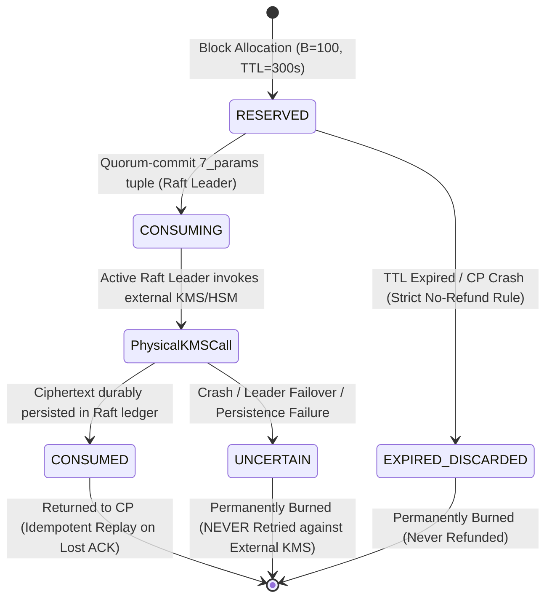

# SentinelOps Stage 4.1.1 — Architecture Revision Report
## Final Security Closure: KMS At-Most-Once Integrity, Revocation Semantics & Trust-Boundary Corrections

**Repository:** `D:\Sentinal_AI`
**Milestone:** Stage 4.1.1 — Final Security Closure
**Baseline:** Option C Stage 3.3 — ACCEPTED & FROZEN
**Mode:** STRICTLY READ-ONLY ARCHITECTURE REVISION
**Implementation Authorization:** NOT GRANTED
**Date:** 2026-11-12
**Target Document:** `docs/STAGE_4_GENERIC_EXTERNAL_SERVICE_ARCHITECTURE.md` (Revision 4.1.1)

---

## 1. Executive Summary & Verdict

This report documents the architectural corrections implemented in Revision 4.1.1 of `docs/STAGE_4_GENERIC_EXTERNAL_SERVICE_ARCHITECTURE.md`, addressing all findings from the independent security review of Stage 4.1.0.

Stage 4.1.1 delivers mathematically consistent, physically enforceable closures for:
1. **PostgreSQL Transaction Durability vs. Client ACK:** Formal separation of the database transaction commit and durability point (`synchronous_commit = 'on'`) from the worker client's receipt of the `CommandComplete('COMMIT')` acknowledgement. Proved that a missing `COMMIT` ACK must never authorize dispatch, and specified fail-closed behavior into permanent uncertain holds on network severance.
2. **Realistic Revocation Guarantees & Race Boundaries:** Reclassified all 8 revocation phases according to physical enforceability. Formally acknowledged that pre-dispatch reads do not eliminate races with subsequent socket calls and that Host Agent socket destruction (`SOCK_DESTROY` / `ss -K`) is best-effort interruption, not proof that zero application bytes were transmitted across the wire.
3. **KMS Physical-Operation Crash Window Closure:** Formally closed the crash window in `sentinelops-key-authority` (TB-9). Enforced the invariant that one token authorizes at most one physical encryption invocation. Defined transition to `UNCERTAIN` for any crash during `CONSUMING`. Mandated that tokens in `UNCERTAIN` are never retried against external KMS/HSM and are permanently burned against the 100,000 ceiling. Specified Raft leader lease fencing.
4. **Comprehensive Version-Compatible PostgreSQL Privilege Audit:** Replaced the incomplete `pg_temp` check with comprehensive catalog audit queries evaluating per-session temporary schemas (`pg_temp%`), database-level `TEMP` and `CREATE` privileges, `PUBLIC` grants, inherited role memberships via `pg_auth_members`, and role attributes.
5. **Exhaustive 7-Step Host Namespace Teardown Protocol:** Expanded host agent teardown to scan and verify `/proc/*/ns/net` inodes, open `/proc/*/fd` references, named bind mounts in `/proc/mounts`, and cgroup processes before allowing node reuse. Formulated tainted node isolation and mandatory rejection of placeholder image digests.
6. **Cryptographically Enforceable Customer Receiver Resolution Protocol:** Expanded `remediation_idempotency_resolutions` table with dual-operator Ed25519 signatures over RFC 8785 canonical payloads, external audit evidence digest and signature verification, append-only rules, and absolute prohibition of re-execution under the same `(execution_id, nonce)` tuple.

### Final Readiness Verdict:
$$\mathbf{PASS\text{ — ready for independent security acceptance audit.}}$$

---

## 2. Finding-by-Finding Correction Matrix

| Finding ID | Architectural Area | Review Finding Summary | Stage 4.1.1 Resolution | Target Document Sections |
| :--- | :--- | :--- | :--- | :--- |
| **REV-410-01** | Database Durability | Ambiguity between DB WAL commit and client ACK receipt | Clarified the distinction between the database's durability point (`synchronous_commit = 'on'`) and the worker's receipt of `CommandComplete('COMMIT')`. Specified that a missing ACK strictly forbids dispatch. Reconnection verifies state; if `CONSUMED` after dropped ACK, fails closed into `execution_uncertain` (`9999-01-01T00:00:00Z`). | Section 3.3, 4.1, 4.2 |
| **REV-410-02** | Revocation Realities | False claim of guaranteed cancellation post-commit | Reclassified the 8 revocation phases. Formally acknowledged that pre-dispatch reads do not eliminate races with socket calls, and `SOCK_DESTROY` (`ss -K`) is best-effort interruption, not proof of zero bytes sent. Categorized Phases 1-4B as Guaranteed, Phase 5 as Conditional, and Phases 6-8 as Uncertain / Best-Effort requiring permanent holds. | Section 3.3, 4.2, 4.3 |
| **REV-410-03** | KMS Operation Crash | Crash during wrap could cause duplicate physical encryption | Specified an enforceable 5-state machine in `sentinelops-key-authority`. Defined invariant: one token authorizes at most one physical encryption. Crash in `CONSUMING` moves token to `UNCERTAIN`. Uncertain tokens are never retried against external KMS. Raft leader lease fencing prevents dual execution. Strict 100,000 ceiling preserved. | Section 2.1, 2.2, 11.2 |
| **REV-410-04** | Catalog Privilege Audit | Incomplete `pg_temp` check in privilege audit | Replaced flawed `pg_temp` string check with comprehensive audit covering `pg_temp%` namespaces, database-level `TEMP` and `CREATE` privileges, `PUBLIC` grants, inherited memberships via `pg_auth_members`, and role attributes. Excluded superusers via `r.rolsuper = FALSE`. CI assertion: 0 rows. | Section 6.2 |
| **REV-410-05** | Host Runtime & Isolation | Incomplete namespace teardown & placeholder digest | Expanded host agent teardown to 7 steps: checking `/proc/*/ns/net` inodes, open `/proc/*/fd` references, bind mounts in `/proc/mounts`, cgroup processes, and restart recovery sweeps. Specified tainted node isolation. Deployment validation enforces rejection of placeholder digests. | Section 2.2, 9.1 |
| **REV-410-06** | Customer Idempotency | Lack of cryptographic verification in manual resolution | Expanded `remediation_idempotency_resolutions` table with dual-operator Ed25519 signatures, RFC 8785 canonical JSON, external evidence payload digests, append-only rules, and absolute prohibition of re-execution under same `(execution_id, nonce)` tuple. | Section 12.2, 12.3 |

---

## 3. Exact KMS Crash and Failover State Machine

### 3.1 The 5-State Machine in `sentinelops-key-authority` (TB-9)



### 3.2 Physical Invariants & Crash Boundaries
1. **At-Most-Once Physical Encryption Invariant:**
   One token authorizes **at most one physical encryption invocation** against the external KMS/HSM.
2. **Behavior on Process Crash at Every Boundary:**
   - **Boundary 1 (Crash while `RESERVED`):** If Control Plane crashes before calling `ConsumeTokenAndWrap()`, the token remains `RESERVED` until its 300s TTL expires, transitioning to `EXPIRED_DISCARDED`. The token is permanently burned and never refunded.
   - **Boundary 2 (Crash before External KMS Call):** Node commits `CONSUMING` to Raft ledger. Process crashes before calling external KMS. On recovery, the authority inspects the ledger: token is in `CONSUMING` without confirmed result. The token transitions immediately to **`UNCERTAIN`**. It is **NEVER invoked against the external KMS**.
   - **Boundary 3 (Crash during External KMS Call):** External KMS may or may not have executed encryption. The authority crashes or loses power. On recovery, the token transitions to **`UNCERTAIN`**. It is **NEVER retried**. The token is permanently burned against the 100,000 ceiling.
   - **Boundary 4 (Crash after External KMS Call, before Raft Persistence):** External KMS completed physical encryption, but authority crashed before durably committing the ciphertext to the Raft quorum. On recovery, the token transitions to **`UNCERTAIN`**. It is **NEVER retried**. The ciphertext is discarded. The Master Key nonce budget is safely decremented.
   - **Boundary 5 (Crash after Durable Raft Persistence, before Client ACK):** Ciphertext is durably committed (`CONSUMED`). Authority crashed while transmitting ACK to Control Plane. Control Plane retries `GetOrConsumeTokenWrap(7_params)`. Authority recognizes identical 7 parameters, returns cached ciphertext from ledger. Zero additional physical encryption invocations occur.
3. **Raft Leader Lease Fencing:**
   Only the established Raft leader with an active lease is authorized to call the external KMS/HSM. If a leader experiences a network partition and loses quorum lease, it is fenced from dispatching external KMS calls. If failover occurs, the new leader marks in-flight `CONSUMING` tokens as `UNCERTAIN` and forbids re-invocation.

---

## 4. Corrected Revocation Guarantee Matrix

| Phase # | Revocation Phase Name | Exact Boundary Point | Physical Mechanism | Provable Guarantee | System Response & State Transition | Final Execution Status | Redispatch Permitted? |
| :--- | :--- | :--- | :--- | :--- | :--- | :--- | :--- |
| **Phase 1** | **Pre-Authorization** | Proposal pending or approved; lease not claimed. | DB row update. | **Provable Zero Bytes on Wire (100%)** | Admin sets `remediation_approvals.status = 'REVOKED'`, execution `revoked_pre_claim`. Zero container or network activity. | `revoked_pre_claim` | **STRICTLY NO** |
| **Phase 2** | **Claimed, Pre-Transaction** | Container launched; before outer `BEGIN`. | Row-lock on `worker_instances`. | **Provable Zero Bytes on Wire (100%)** | Revocation sets `wi.status = 'REVOKED'`. Step 8 outer transaction attempts `FOR UPDATE`, detects revoked worker, aborts. Container destroyed. | `revoked_pre_dispatch` | **STRICTLY NO** |
| **Phase 3** | **Outer Transaction In-Flight** | Inside `consume_dispatch_authorization()`. | 2PL Engine row-lock serialization. | **Provable Zero Bytes on Wire (100%)** | If revocation locks first, worker SP aborts (`WORKER_NOT_ACTIVE`). If worker locks first, revocation blocks until worker commits, then revokes. | `revoked_pre_dispatch` or `aborted_pre_dispatch` | **STRICTLY NO** |
| **Phase 4A** | **Outer Transaction Aborted** | Client rolls back or drops connection. | PostgreSQL WAL rollback. | **Provable Zero Bytes on Wire (100%)** | Zero authorization tokens consumed. No firewall requested. | `claimed` $\to$ `pending` or `aborted` | Yes (if clean rollback) |
| **Phase 4B** | **Committed, Pre-Firewall** | Worker received `COMMIT` ACK; before Host Agent injects rule. | Kernel Netfilter Default `OUTPUT DROP`. | **Provable Zero Bytes on Wire (100%)** | Host Agent queries DB before rule injection; detects `dispatch_revoked == TRUE`, rejects install (`403 Forbidden`). Default `OUTPUT DROP` blocks 100% of egress packets. | `aborted_pre_firewall` | **STRICTLY NO** |
| **Phase 5** | **Firewall Active, Pre-Socket** | Dynamic rule active; before `socket.connect()`. | Worker voluntary pre-dispatch check. | **CONDITIONAL (Zero bytes ONLY if worker halts before socket call)** | Worker Step 10 queries DB, detects `dispatch_revoked == TRUE`. Worker voluntary abort: deletes firewall rule, zero sockets created. If revocation commits after check, transitions to Phase 6. | `aborted_pre_journal` | **STRICTLY NO** |
| **Phase 6** | **Socket Connecting / TLS Handshake** | TCP SYN sent or TLS handshake in-flight. | Netlink `INET_DIAG_REQ_DESTROY` (`ss -K`). | **UNCERTAIN / BEST-EFFORT (No proof of zero bytes)** | Host Agent executes `ss -K`. Kernel sends TCP RST, resets socket with `ECONNABORTED`. Packets left the host. Must fail closed into hold. | `execution_uncertain` (`9999-01-01T00:00:00Z`) | **STRICTLY NO** |
| **Phase 7** | **Mid-`sendall()` Transmission** | Request bytes actively leaving socket. | Netlink `ss -K` / TCP RST. | **UNCERTAIN (Cancellation CANNOT be guaranteed)** | Interruption during `sendall()` cannot prove zero bytes reached gateway. Remote side effect may have commenced. Immediate transition to permanent hold. | `execution_uncertain` (`9999-01-01T00:00:00Z`) | **STRICTLY NO** |
| **Phase 8** | **Post-Send / Awaiting Response** | Request fully sent; awaiting HTTP response. | Rule deletion & `ss -K`. | **UNCERTAIN (Cancellation CANNOT be guaranteed)** | Packets already departed network fabric. Remote server may be executing or completed. Immediate transition to permanent hold. | `execution_uncertain` (`9999-01-01T00:00:00Z`) | **STRICTLY NO** |

---

## 5. Executable PostgreSQL Privilege-Audit Specification

```sql
-- =============================================================================
-- EXECUTABLE VERSION-COMPATIBLE CATALOG PRIVILEGE AUDIT (PostgreSQL 12 - 16+)
-- Evaluates schema CREATE, database-level TEMP/CREATE, PUBLIC grants, and
-- effective inherited role memberships using built-in catalog functions.
-- CI Assertion: Must return exactly 0 rows. Any row fails deployment.
-- =============================================================================

-- Query 1: Audit Unauthorized Schema CREATE Privileges (Excluding Superusers)
WITH candidate_schemas AS (
    SELECT nspname, oid
    FROM pg_catalog.pg_namespace
    WHERE nspname IN ('public', 'pg_catalog')
       OR nspname LIKE 'pg_temp%'
),
non_superuser_roles AS (
    SELECT rolname, oid, rolsuper, rolcanlogin, rolinherit
    FROM pg_catalog.pg_roles
    WHERE rolsuper = FALSE
)
SELECT
    s.nspname AS schema_name,
    r.rolname AS role_name,
    'UNAUTHORIZED_SCHEMA_CREATE' AS violation_type
FROM candidate_schemas s
CROSS JOIN non_superuser_roles r
WHERE pg_catalog.has_schema_privilege(r.oid, s.oid, 'CREATE')
UNION ALL
-- Query 2: Audit Database-Level CREATE and TEMP Privileges for Restricted Roles
SELECT
    d.datname AS database_name,
    r.rolname AS role_name,
    'UNAUTHORIZED_DB_PRIVILEGE' AS violation_type
FROM pg_catalog.pg_database d
CROSS JOIN pg_catalog.pg_roles r
WHERE d.datname = current_database()
  AND r.rolname IN ('sentinelops_worker', 'sentinelops_fn_owner', 'PUBLIC')
  AND (
      pg_catalog.has_database_privilege(r.oid, d.oid, 'CREATE') OR
      pg_catalog.has_database_privilege(r.oid, d.oid, 'TEMP')
  )
UNION ALL
-- Query 3: Audit Role Membership and Escalation Privileges
SELECT
    'ROLE_MEMBERSHIP' AS object_name,
    r.rolname AS role_name,
    'PRIVILEGED_ROLE_MEMBERSHIP' AS violation_type
FROM pg_catalog.pg_roles r
JOIN pg_catalog.pg_auth_members m ON m.member = r.oid
JOIN pg_catalog.pg_roles parent ON parent.oid = m.roleid
WHERE r.rolname IN ('sentinelops_worker', 'sentinelops_fn_owner')
  AND (parent.rolsuper = TRUE OR parent.rolname LIKE 'pg_%')
UNION ALL
-- Query 4: Audit Function Owner and Worker Role Attributes
SELECT
    'ROLE_ATTRIBUTES' AS object_name,
    rolname AS role_name,
    'INVALID_ROLE_ATTRIBUTES' AS violation_type
FROM pg_catalog.pg_roles
WHERE (rolname = 'sentinelops_fn_owner' AND (rolcanlogin = TRUE OR rolsuper = TRUE OR rolcreaterole = TRUE OR rolcreatedb = TRUE))
   OR (rolname = 'sentinelops_worker' AND (rolsuper = TRUE OR rolcreaterole = TRUE OR rolcreatedb = TRUE));
```

---

## 6. Complete Namespace-Reference and Teardown Protocol

The Host Agent (`sentinelops-host-agent`, UID 0) executes an exhaustive 7-step teardown protocol upon execution completion, abort, or failure:
1. **Kernel Socket Destruction (`SOCK_DESTROY`):**
   ```bash
   ip netns exec <worker_ns> ss -K dst <approved_ip> dport = 443
   ```
2. **Conntrack Purge (`conntrack -D`):**
   ```bash
   ip netns exec <worker_ns> conntrack -D -p tcp -d <approved_ip> --dport 443
   ```
3. **Netfilter Rule Removal:** Delete dynamic iptables rules from namespace chains.
4. **Container Termination & Process Eviction:**
   - Issue `docker stop -t 2 sentinelops-worker-<exec_id>-f<token>`.
   - If still running, issue `docker kill sentinelops-worker-...`.
   - Inspect cgroup: Verify `/sys/fs/cgroup/.../cgroup.procs` is empty. If not, issue `kill -9` to residual PIDs.
   - Remove container: `docker rm -f sentinelops-worker-<exec_id>-f<token>`.
5. **Mount Reference Unlinking:**
   - Scan `/proc/mounts` and `/proc/self/mountinfo` for any mount referencing the netns file.
   - Explicitly unmount: `umount -f /var/run/docker/netns/<netns_id>` (if present).
6. **Open File Descriptor Scan & Inode Verification:**
   - Determine target netns inode: `target_inode=$(stat -c '%i' /proc/<worker_pid>/ns/net)`.
   - Query `/proc/*/fd/*` and `/proc/*/ns/net` across all running host processes.
   - Assert zero file descriptors and zero process namespace links reference `net:[target_inode]`.
7. **Host Agent Crash & Restart Recovery Sweep:**
   - On Host Agent boot or restart, scan for orphaned worker containers (`sentinelops-worker-*`) and orphaned dynamic iptables rules (`sentinelops:exec:`).
   - Reconcile against active PostgreSQL leases; any orphaned container or rule without a valid active lease is immediately subjected to the full 7-step teardown.
8. **Tainted Node Isolation:**
   - If at the end of teardown, the netns inode is still referenced, or cgroup processes persist, or any step times out (5.0s):
   - The host node is marked **`TAINTED`**.
   - SRE is alerted, and the node is cordoned in the Control Plane scheduler. No new worker containers may be scheduled on that host until manual administrative reconciliation or reboot.
9. **Immutable Worker Image Digest Verification:**
   - Deployment validation enforces verification against an authoritative build registry manifest. Any placeholder digest (e.g. `7b5f2d...`) is rejected pre-flight.

---

## 7. Cryptographically Enforceable Receiver Resolution Protocol

### 7.1 Schema for `remediation_idempotency_resolutions`
```sql
CREATE TABLE remediation_idempotency_resolutions (
    id UUID PRIMARY KEY DEFAULT gen_random_uuid(),
    execution_id UUID NOT NULL,
    nonce VARCHAR(64) NOT NULL,
    previous_status VARCHAR(30) NOT NULL CHECK (previous_status = 'AMBIGUOUS'),
    new_status VARCHAR(30) NOT NULL CHECK (new_status IN ('COMPLETED', 'FAILED')),

    -- Dual-Operator Authorization & Independent Records
    proposer_operator_id VARCHAR(64) NOT NULL,
    proposer_role VARCHAR(64) NOT NULL CHECK (proposer_role IN ('SecurityAdmin', 'IncidentCommander')),
    proposer_signature TEXT NOT NULL,         -- Ed25519 signature over canonical resolution proposal

    approver_operator_id VARCHAR(64) NOT NULL,
    approver_role VARCHAR(64) NOT NULL CHECK (approver_role IN ('SecurityAdmin', 'IncidentCommander')),
    approver_signature TEXT NOT NULL,         -- Ed25519 signature over canonical resolution approval

    -- Evidence Provenance & Cryptographic Verification
    evidence_source_id VARCHAR(128) NOT NULL,    -- e.g. 'AWS_CLOUDTRAIL:arn:aws:cloudtrail:us-east-1:123456789012:trail/audit'
    evidence_payload_digest CHAR(64) NOT NULL,  -- SHA-256 of raw audit log or state snapshot
    evidence_signing_key_id VARCHAR(128) NOT NULL, -- Key ID / X.509 cert thumbprint of the logging system
    evidence_signature TEXT NOT NULL,           -- Signature generated by external audit source
    evidence_summary TEXT NOT NULL,

    canonical_payload_json TEXT NOT NULL,       -- RFC 8785 Canonical JSON of the resolution record
    resolved_at TIMESTAMPTZ NOT NULL DEFAULT now(),

    CONSTRAINT fk_resolution_key FOREIGN KEY (execution_id, nonce)
        REFERENCES remediation_idempotency_keys(execution_id, nonce),
    CONSTRAINT chk_dual_operators CHECK (proposer_operator_id != approver_operator_id)
);

-- Immutability & Append-Only Enforcement
CREATE RULE no_update_resolutions AS ON UPDATE TO remediation_idempotency_resolutions DO INSTEAD NOTHING;
CREATE RULE no_delete_resolutions AS ON DELETE TO remediation_idempotency_resolutions DO INSTEAD NOTHING;
```

### 7.2 Non-Negotiable Resolution Invariants
1. **Dual-Operator Cryptographic Control:** Proposer and Approver independently sign the RFC 8785 canonical representation using hardware-backed Ed25519 keys.
2. **Cryptographic Evidence Verification:** The evidence payload digest and signature must be verified against the external audit system's trusted public key.
3. **Non-Degradation Invariant:** A timeout, missing acknowledgement, network drop, or unsupported assertion can **NEVER** establish `FAILED`. Transition to `FAILED` is permitted *only* when external audit logs cryptographically prove zero side effects occurred.
4. **Absolute Re-Execution Prohibition:** Even after manual resolution to `FAILED`, the receiver **NEVER** re-executes that `(execution_id, nonce)` request. Replays return the resolved cached outcome with zero remote side effects.

---

## 8. Adversarial Concurrency & Crash Scenarios

### Scenario 1: Outer Commit Drop Followed by Attempted Dispatch
- **Trigger:** Worker issues `COMMIT;` in Step 8, but the connection drops before receiving `CommandComplete('COMMIT')`.
- **System Defense:** Worker cannot confirm commit; dispatch is strictly withheld. Worker reconnects; queries `dispatch_authorizations.status`. Detects `CONSUMED` but fails closed into `status = 'execution_uncertain'` (`9999-01-01T00:00:00Z`). Zero network egress occurs.

### Scenario 2: Partition During KMS Physical Encryption
- **Trigger:** Key Authority leader invokes external KMS, but crashes before persisting ciphertext to Raft ledger.
- **System Defense:** On recovery, token is in `CONSUMING` without durable ciphertext. Authority transitions token to `UNCERTAIN`. Invariant triggers: token in `UNCERTAIN` is NEVER retried against external KMS. The physical 100,000 operation ceiling is strictly preserved.

### Scenario 3: Revocation Racing with Socket Establishment
- **Trigger:** Revocation commits while worker is establishing TCP connection.
- **System Defense:** Host Agent triggers `ss -K`. Kernel sends TCP RST; worker unblocks with `ECONNABORTED`. Because packets left the host, execution transitions to permanent uncertain hold (`9999-01-01T00:00:00Z`). Redispatch is strictly blocked.

### Scenario 4: Inode Reference Persistence After Container Removal
- **Trigger:** A process holds an open file descriptor to the network namespace after container removal.
- **System Defense:** Host Agent scans `/proc/*/fd/*` and `/proc/*/ns/net`, detecting the lingering inode reference. Host Agent sends `SIGKILL`, marks host node as `TAINTED`, and alerts SRE. Node is cordoned from scheduling further executions.

---

## 9. Explicit Remaining Limitations & Residual Risks

| Limitation / Risk ID | Severity | Exact Physical Limitation | Mitigation & Operational Boundary |
| :--- | :--- | :--- | :--- |
| **LIM-411-01** | Low | Network failure during socket transmission is fundamentally indeterminate | Two Generals' Problem: SentinelOps does not claim exactly-once remote side effects. Ambiguous outcomes transition to permanent uncertain hold (`9999-01-01T00:00:00Z`). |
| **LIM-411-02** | Low | Cloud KMS does not support distributed transactions with PostgreSQL | Recoverable sequential ordering (wrap first $\to$ DB second). If DB write fails, token is burned in KMS; physical ceiling preserved. |
| **LIM-411-03** | Low | Customer webhook crash without logging side-effect status | Customer receiver permanent tombstone (`expires_at = NULL`) blocks replays until dual-operator audited resolution. |

---

## 10. Final Readiness Verdict

$$\mathbf{PASS\text{ — ready for independent security acceptance audit.}}$$
