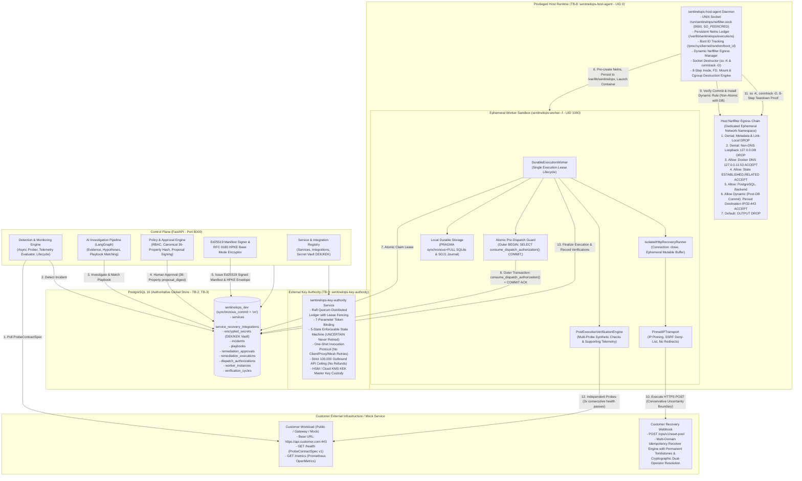
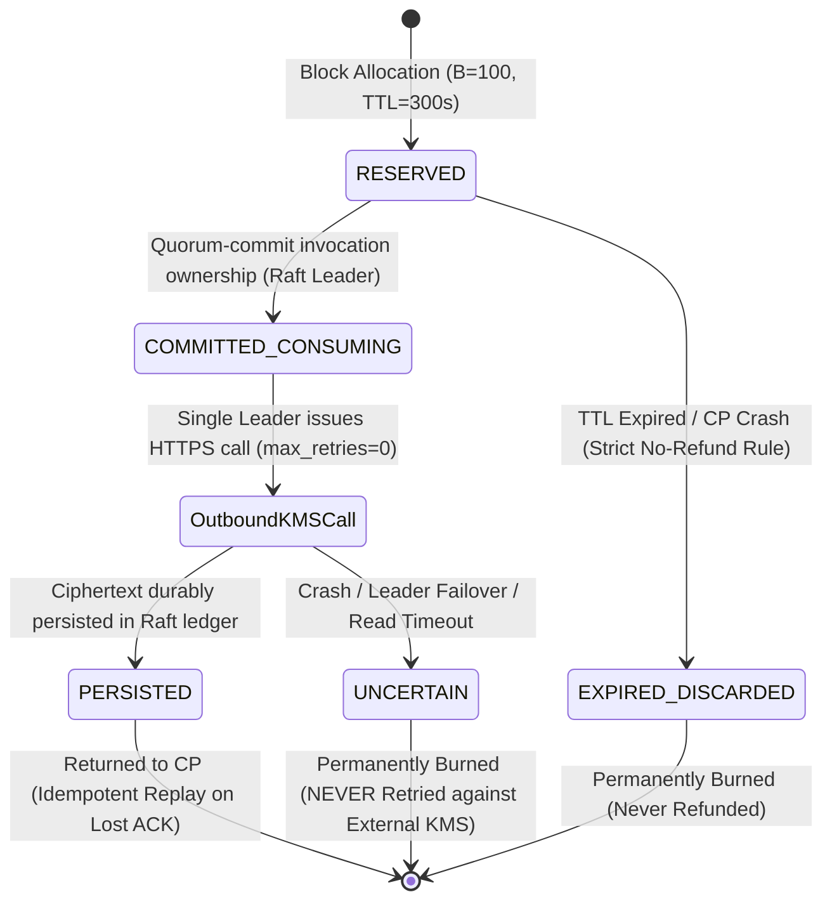
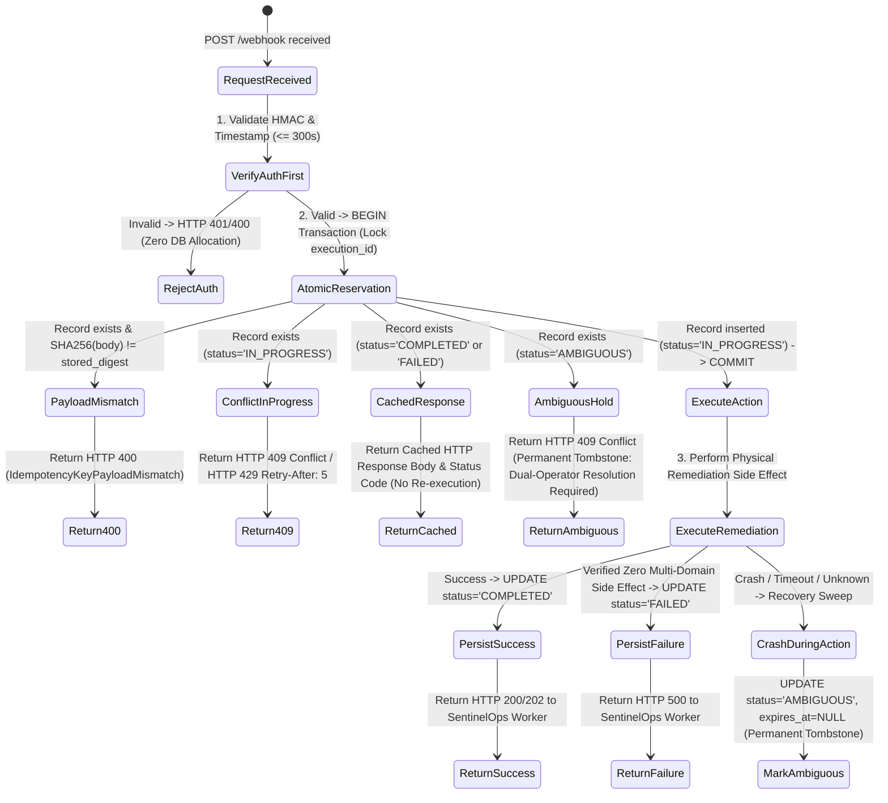
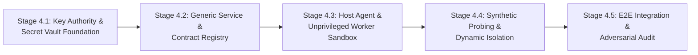

# SentinelOps Stage 4 — Generic External-Service Integration Architecture
## Final Guarantee Integrity & Durability Closure: KMS Invocation, Revocation Realities, Catalog Auditing, Persistent Identity & Multi-Domain Evidence (Stage 4.1.3 Revision)

**Repository:** `D:\Sentinal_AI`
**Milestone:** Stage 4.1.3 — Final Guarantee Integrity & Durability Closure
**Baseline:** Option C Stage 3.3 — ACCEPTED & FROZEN
**Mode:** STRICTLY READ-ONLY ARCHITECTURE REVISION
**Implementation Authorization:** NOT GRANTED
**Date:** 2026-11-12

---

## Revision History

| Version | Date | Author / Reviewer | Summary of Changes |
| :--- | :--- | :--- | :--- |
| **4.0.0** | 2026-11-10 | SentinelOps Architecture | Initial Stage 4.0 generic external-service integration architecture proposal. |
| **4.0.1** | 2026-11-10 | SentinelOps Security Review | Addressed preliminary ephemeral secret exchange, connectivity modes, test network separation, probe contracts, canonical digests, and rigid request envelopes. |
| **4.0.2** | 2026-11-10 | Independent Cryptographic & SRE Review | Cryptographic Trust, Telemetry & Execution-Binding Closure. Specified HPKE Base Mode suite, SQLite OperationRegistry, honest memory zeroization disclosures, baseline telemetry delta, and 19-property canonical proposal inventory. |
| **4.0.3** | 2026-11-10 | Final Trust-Boundary & Dispatch Security Review | Addressed HPKE sender authentication limitations, scoped single-use bootstrap tokens, proof-of-possession, lease claim worker key version join, 10-state crash matrix, telemetry hierarchy, 28-property proposal inventory, and initial network isolation. |
| **4.0.4** | 2026-11-10 | Independent Security & Enforcement Review | Addressed dispatch semantics (at-most-once local authorization), Step 9 pre-dispatch atomic status check, 10 replay classes, corrected CS-09 lease drop, host-managed netfilter enforcement, RFC 8785 AAD, 32-property proposal inventory, destination-bound HMAC, Secret Vault DEK/KEK architecture, and probe evidence levels. |
| **4.0.5** | 2026-11-10 | Independent Cryptographic & Durability Audit | Authorization linearization and in-flight authorization state, dedicated dispatch_authorizations table, triple-identifier replay constraints, PRAGMA synchronous=FULL and directory fsync, netfilter rule ordering with denials before state rules, signed HPKE envelope_digest binding, restored 6-level probe evidence hierarchy with safety veto non-degradation, and explicit test_admin_approver_bot for E2E human approval. |
| **4.0.6** | 2026-11-10 | Independent Security Blocker Audit Review | Targeted Security Blocker Closure: PostgreSQL SECURITY DEFINER search-path hardening with `sentinelops_fn_owner`, Option A Dynamic Host Firewall Allowlisting (`-d <approved_ip>/32:443`), random 96-bit CSPRNG nonces, 4-byte length-prefixed envelope digest, 36-property proposal inventory, and Race 2 narrative disentanglement. |
| **4.0.7** | 2026-11-12 | Independent Security & Durability Review | Dispatch Revocation, Firewall Lifecycle & Recovery Closure: `sentinelops_fn_owner` NOLOGIN, lock hierarchy (`worker_instances` $\to$ `remediation_executions` $\to$ `dispatch_authorizations`), post-commit firewall installation, kernel `SOCK_DESTROY` (`ss -K`) and `conntrack -D`, external KMS epoch authority, cryptographic CA bundle file hashing, and initial receiver state machine. |
| **4.0.8** | 2026-11-12 | Independent Security & Durability Review | Final Revocation Atomicity, Execution Isolation & Receiver Durability Closure: Non-atomicity acknowledgment, worker concurrency = 1, 4-state receiver idempotency engine with permanent tombstones (`expires_at = NULL`), conservative KMS budget allocation ($B=100$), canonical TLS binary byte normalization, and catalog-level privilege assertions. |
| **4.0.9** | 2026-11-12 | Independent Security & Durability Review | Final Dispatch Linearization, Receiver Terminality & KMS Recovery Closure: Step 8 sole linearization point, 5-phase revocation lifecycle, ephemeral worker containers with private namespaces, customer receiver terminal states, KMS two-phase token reservation with no-refund rule, and executable catalog privilege audit. |
| **4.1.0** | 2026-11-12 | Independent Security & Durability Review | Final Transaction Semantics, KMS Operation Integrity & Runtime Trust Closure: Separated function from outer transaction commit; client receipt of `COMMIT` ACK as linearization point; 8-phase revocation lifecycle; `sentinelops-key-authority` Raft service; `r.rolsuper = FALSE` catalog query; privileged host runtime controller; customer receiver resolution evidence. |
| **4.1.1** | 2026-11-12 | Independent Security & Durability Review | Final Security Closure: PostgreSQL transaction durability point vs. client ACK; realistic revocation guarantee matrix; KMS physical crash window closure; version-compatible privilege audit; 7-step namespace destruction; customer receiver cryptographic resolution. |
| **4.1.2** | 2026-11-12 | Independent Security & Durability Review | Final Adversarial Enforcement Closure: KMS stale-leader fencing timeline; non-atomic revocation races; pure catalog privilege evaluation without role heuristics; 8-step namespace teardown with launch-time inode capture; receiver unique resolution schema. |
| **4.1.3** | 2026-11-12 | Independent Security & Durability Review | **Final Guarantee Integrity & Durability Closure:**<br/>- **KMS At-Most-Once Invocation Proof (§11.2):** Separated token reservation, invocation ownership, external HTTPS request, response, ciphertext persistence, and client ACK. Proved at-most-once outbound API requests across 9 failure modes. Explicitly disabled retries at HTTP client, proxy, and service-mesh layers (`max_retries = 0`, `num_retries = 0`). Distinguished external API requests from opaque cloud provider internals. Proved the 100,000 operation ceiling cannot be exceeded.<br/>- **Corrected Revocation & Commit Ambiguity Matrix (§3.3, §4.2, §4.3):** Re-modeled Phase 3 row-lock competition where worker commits first (disclaiming guaranteed zero-byte cancellation post-commit). Separated Phase 4A into 4 explicit outcomes: confirmed rollback, pre-commit disconnect, post-commit unacknowledged disconnect (ambiguous commit), and confirmed ACK. Mandated that ambiguous commits fail closed into permanent uncertain hold (`9999-01-01T00:00:00Z`) and never authorize dispatch.<br/>- **Complete Executable PostgreSQL Privilege Audit (§6.2):** Provided executable SQL distinguishing `PUBLIC` from ordinary roles. Audited `PUBLIC` ACLs, effective schema privileges, database `TEMP` and `CREATE`, direct/transitive memberships, PostgreSQL 16+ `SET ROLE` / `INHERIT` options vs pre-16 compatibility, dynamic temporary schemas (`pg_temp%`), `SECURITY DEFINER` search paths, table permissions, and function ownership. CI assertion: `COUNT(*) == 0`.<br/>- **Persistent Namespace Identity Ledger & Reboot Sweep (§9.1):** Replaced ephemeral `/run` with durable `/var/lib/sentinelops/executions/` backed by atomic rename and directory `fsync`. Formulated pre-creation of named netns, inode capture, boot ID binding (`/proc/sys/kernel/random/boot_id`), container attachment, post-reboot reconciliation sweep, and stale inode reuse prevention. Fail-closed on persistence failure.<br/>- **Action-Specific Multi-Domain Receiver Evidence (§12.2, §12.3):** Defined multi-domain evidence requirements across Ingress Gateway, Database, Message Queue, External Webhook, and Cache/Storage. Formulated exact gateway proofs (execution ID, nonce, request digest, ingress authority, non-forwarding proof, zero downstream calls). Established that DB rollback alone cannot prove zero side effects for multi-domain actions. Incomplete evidence permanently preserves `AMBIGUOUS`. |

---

## 1. Executive Summary & Non-Negotiable Invariants

SentinelOps Stage 4 governs the architectural transition from an internal demonstration recovery architecture (Order API) into an extensible, enterprise-grade AI SRE platform capable of managing arbitrary external HTTP/HTTPS services.

Stage 4.1.3 establishes complete adversarial enforcement, physically verifiable boundaries, and honest operational disclosures while preserving every invariant of the accepted **Option C execution baseline**:
1. **Zero Docker Daemon Access:** No access to `/var/run/docker.sock` and no standalone broker containers.
2. **Unprivileged Worker Execution:** Worker executes under a dedicated unprivileged user (`UID 1000:GID 1000`) with `cap_drop: ALL` and `no-new-privileges: true`.
3. **Execution Concurrency & Namespace Lifecycle Invariant:** Every worker container is a **single-use ephemeral sandbox** dedicated strictly to **at most one active execution** (`worker_concurrency = 1`). Network namespaces are **never reused**; each execution occupies a private Linux network namespace pre-created by the Host Agent, whose identity is durably persisted to `/var/lib/sentinelops/executions/` before container startup, destroyed upon termination, and verified unreferenced across all host processes before node reuse.
4. **Restricted Worker Database Role & Exhaustive Catalog Auditing:** Worker connects exclusively as `sentinelops_worker` with least-privilege grants. Zero direct read/write access to user tables, memberships, policy rules, approvals, or the Secret Vault. Stored function execution is mediated strictly via a hardened `SECURITY DEFINER` function with fixed `search_path`, owned by a `NOLOGIN` role, and verified against version-compatible catalog-level privilege audits that explicitly evaluate `PUBLIC` grants and version-specific `SET ROLE` options.
5. **Mandatory Human Approval Bound to Canonical Digest:** Human approval is mandatory by default and cryptographically bound to an immutable RFC 8785 canonical proposal digest (`proposal_digest`) covering 36 execution-relevant parameters. Any configuration, secret, or CA certificate drift transactionally invalidates dispatch authorization.
6. **Conservative Uncertainty, Fail-Closed Commit & Permanent Holds:** A failure, network reset, or interruption during or after `socket.sendall()` cannot prove that zero bytes reached the destination. An unacknowledged database commit during the blackout window cannot be assumed aborted. Any ambiguous outcome immediately triggers a permanent lease hold (`HOLD_EXPIRATION_TIMESTAMP = 9999-01-01T00:00:00Z`). Automatic retries are strictly forbidden (`max_dispatch_attempts = 1`). Revoked executions never receive new dispatch tokens.
7. **One-Shot External KMS Invocation & Strict Ceiling Invariant:** The external Key Authority enforces a one-shot invocation protocol. Automatic retries are disabled at HTTP client, proxy, and service-mesh layers (`max_retries = 0`, `num_retries = 0`). A token in `UNCERTAIN` or `COMMITTED_CONSUMING` is never retried by any leader. External KMS API calls initiated by SentinelOps are strictly bounded by the 100,000 operation ceiling per Master Key version.
8. **Multi-Domain Evidence & Permanent Receiver Tombstones:** A gateway response code or database rollback alone does not prove zero side effects if an action touches multiple operational domains. Transition from `AMBIGUOUS` to `FAILED` requires cryptographically verified proof across all touched domains; incomplete evidence permanently preserves `AMBIGUOUS` tombstones with dual-operator resolution and absolute replay prohibition.
9. **Zero-Trust Independent Verification:** An external webhook response (even HTTP 200/202) provides zero evidence of service recovery. Incident closure requires 3 consecutive synthetic probes satisfying the service's `ProbeContractSpec v1` without any telemetry safety veto.

---

## 2. Component Architecture & Trust Boundaries

### 2.1 Topology Diagram



### 2.2 Explicit Trust Boundary Table

| Boundary | Interfacing Components | Transport / Protocol | Authentication & Authorization | Enforced Invariants |
| :--- | :--- | :--- | :--- | :--- |
| **TB-1: Client to Control Plane** | Browser / API Client $\rightarrow$ Control Plane | HTTPS (TLS 1.3), JSON REST | JWT Access Token, Workspace Membership RBAC (`admin`, `engineer`, `viewer`) | Strict tenant scoping; non-admins blocked from secret vault or integration creation. |
| **TB-2: Control Plane to Database** | Control Plane $\rightarrow$ PostgreSQL 16 | PostgreSQL native protocol (TCP 5432) | Dedicated administrative role (`sentinelops_user`) | Has grants to read/write all application tables including `encrypted_secrets` and `remediation_approvals`. Enforces `synchronous_commit = 'on'`. |
| **TB-3: Worker to Database** | Worker Container $\rightarrow$ PostgreSQL 16 | PostgreSQL native protocol (TCP 5432) | Dedicated restricted role (`sentinelops_worker`) | **Least-Privilege Role:** ZERO direct access to `users`, `workspace_memberships`, `playbooks`, `encrypted_secrets`, `remediation_approvals`. Invokes `consume_dispatch_authorization()` inside outer transaction block. A missing `COMMIT` ACK strictly forbids dispatch; ambiguous commit fails closed. |
| **TB-4: Control Plane to Worker (Manifest Delivery)** | Control Plane $\rightarrow$ Worker (via DB Queue) | Asymmetric Cryptographic Protocol | Ed25519 Signature + RFC 9180 HPKE Base Mode Envelope | Control Plane authenticates manifest via Ed25519; HPKE encrypts secret to worker's X25519 key; envelope digest cryptographically bound in signed manifest. |
| **TB-5: Worker to External Webhook** | Worker $\rightarrow$ Customer Recovery Webhook | HTTPS (TLS 1.2+ mandatory), Pinned TCP Socket | Injected Fixed Header (Bearer / API-Key / Destination-Bound Canonical HMAC) | `PinnedIPTransport` enforces IP pinning, SSRF denial, no redirects, 64 KB read cap. Host netfilter drops non-allowlisted egress. Single-use container. |
| **TB-6: Worker to External Monitored Service** | Worker $\rightarrow$ Monitored Service (Verification) | HTTPS (TLS 1.2+ mandatory), Pinned TCP Socket | None / Customer Monitoring Credential | Multi-probe synthetic health check; webhook response body discarded; requires 3 consecutive passes without telemetry veto. |
| **TB-7: Worker Internal Process Boundaries** | Worker Daemon $\rightarrow$ Local Storage | SQLite3 & Local POSIX File I/O (`UID 1000`) | File system ownership (`0600`), SQLite unique locks | Monotonic fencing token, atomic reservation, `PRAGMA synchronous=FULL`, directory fsync, append-only SOJ1 journal, no secrets on disk. |
| **TB-8: Host Runtime & Network Boundary** | Host Agent (`UID 0`) $\rightarrow$ Container & Netfilter | Host OS UNIX Domain Socket (`/run/sentinelops/netfilter.sock`) | Kernel `SO_PEERCRED` UID 0 validation | Ephemeral single-use container, verified build artifact digest, read-only rootfs, tmpfs `noexec,nosuid,nodev`, seccomp filters, persistent netns ledger at `/var/lib/sentinelops/executions/`, boot ID tracking, post-commit dynamic allowlist, `SOCK_DESTROY`, conntrack flush, 8-step namespace destruction proof. |
| **TB-9: Control Plane to External Key Authority** | Control Plane $\rightarrow$ `sentinelops-key-authority` | TLS 1.3 / gRPC with Mutual TLS Authentication | Client Certificate & Node Identity Assertion | Dedicated Raft ledger with lease fencing; 7-parameter token binding; one-shot invocation protocol (`max_retries = 0`); uncertain tokens never retried; bounds outbound HTTPS requests; strict 100,000 ceiling (no refunds); recoverable sequential ordering. |

---

## 3. Dispatch Semantics & At-Most-Once Local Authorization

### 3.1 Distributed Systems Reality & The Two Generals' Problem
PostgreSQL, SQLite, the SOJ1 journal, `sentinelops-key-authority`, and an external third-party HTTP endpoint **do not share a distributed transaction, two-phase commit, or consensus protocol**.

SentinelOps formally affirms:
- A network partition, TCP reset, gateway timeout (HTTP 504), or process crash can occur *after* request bytes have been transmitted across the wire and executed by the remote service, but *before* SentinelOps receives or persists the response.
- In this ambiguous state, SentinelOps cannot determine whether the remote action executed 0 times or 1 time.
- Claims of "exactly-once dispatch" or "exactly-once remote execution" across an arbitrary HTTP network boundary are mathematically and technically invalid.

### 3.2 Formal Platform Guarantee: At-Most-Once Local Dispatch Attempt
SentinelOps guarantees strictly:
> **At-most-once outbound dispatch attempt under the specified durable local authorization protocol**, subject to the explicit assumption that local storage writes with directory and file `fsync` are honored by the operating system and underlying physical media.

### 3.3 Physical Realities of System Boundaries & Non-Atomicity Disclosures

| System Boundary | Physical Enforcement Reality | What Can Be Guaranteed | What CANNOT Be Guaranteed |
| :--- | :--- | :--- | :--- |
| **Database Commit vs. Client ACK** | PostgreSQL writes WAL and flushes to disk under `synchronous_commit = 'on'`. Ack travels across network. | If worker receives `CommandComplete('COMMIT')`, the commit is durably persisted. | If network drops before ACK is received, worker cannot know if commit succeeded without out-of-band verification. Ambiguous commit must fail closed. |
| **Phase 3 Row-Lock Competition** | Worker outer transaction and Revocation transaction compete for row locks on `worker_instances` / `remediation_executions`. | If revocation locks first, worker aborts (`WORKER_NOT_ACTIVE`). Zero bytes guaranteed. | **If worker locks first and commits**, authorization has committed. Revocation arriving post-commit cannot guarantee zero bytes on the wire. |
| **Database Check $\rightarrow$ Firewall Install** | Worker commits Step 8; Host Agent calls iptables over IPC ($\Delta t_1$). | Default policy is `OUTPUT DROP`. Egress is blocked until dynamic rule is injected. | **Atomicity across DB and netfilter.** An administrative revocation can commit while Host Agent is installing the rule. Rule may be active after revocation. |
| **Pre-Dispatch Read $\rightarrow$ Socket Call** | Worker reads DB at $T_1$; calls `socket.connect()` at $T_1 + \epsilon$. | Worker can voluntarily abort if DB check detects revocation before socket call. | **Elimination of race with subsequent socket call.** Revocation can commit at $T_1 + \epsilon/2$. |
| **Kernel `SOCK_DESTROY` (`ss -K`)** | Host Agent issues netlink `INET_DIAG_REQ_DESTROY`; kernel sends TCP RST. | Sockets unblock with `ECONNABORTED`; active TCP connection is terminated. | **Zero proof of zero bytes sent.** If `sendall()` commenced, TCP segments may have already crossed the NIC and reached the remote gateway. |
| **External KMS API Calls vs. Provider Internals** | Cloud KMS provides stateless HTTPS APIs. SentinelOps disables client/proxy retries (`max_retries = 0`). | SentinelOps guarantees at most one outbound HTTPS API request per token across the network boundary. | **Visibility into Cloud KMS internal hardware operations.** Cloud provider internal HSM replication, clustering, or internal failovers are opaque and unobservable. |
| **Ambiguous / Partial Transmission** | Network reset or timeout during `socket.sendall()`. | Worker transitions to permanent hold (`9999-01-01T00:00:00Z`). Redispatch blocked. | Remote execution state. Remote service may have executed full side effect. |

---

## 4. Dispatch Authorization Lifecycle, Linearization & Revocation Races

### 4.1 The 13-Step Execution Authorization Lifecycle

```mermaid
sequenceDiagram
    autonumber
    participant H as Human Operator
    participant CP as Control Plane
    participant HA as Host Agent (Root UID 0)
    participant DB as PostgreSQL 16 (synchronous_commit=on)
    participant W as Worker Daemon (UID 1000 - Ephemeral Container)
    participant EXT as Remote Webhook

    Note over H,CP: Step 1-3: Proposal Approval
    H->>CP: Approve Remediation Proposal (Manual Action)
    CP->>CP: Validate RBAC & Recompute RFC 8785 proposal_digest
    CP->>DB: INSERT INTO remediation_approvals (status='APPROVED', digest=...)

    Note over CP,DB: Step 4: Manifest & Token Issuance
    CP->>CP: Generate dispatch_token_id. Sign Ed25519 Manifest & Length-Prefixed Digest
    CP->>DB: INSERT INTO dispatch_authorizations (status='ISSUED', token=...)<br/>INSERT INTO remediation_executions (status='pending', ...)

    Note over HA,W: Step 5: Ephemeral Container Launch & Inode Capture
    HA->>HA: Pre-create netns (ip netns add); stat -c %i inode; capture boot_id
    HA->>HA: Atomic write & fsync identity to /var/lib/sentinelops/executions/<exec_id>.json
    HA->>W: Launch container sentinelops-worker-<exec_id>-f<token> (Joined to netns, Read-Only rootfs)
    W->>DB: UPDATE remediation_executions SET status='claimed' ... JOIN worker_instances
    DB-->>W: Lease Granted (fencing_token = N)

    Note over W: Step 6: Manifest Verification, Destination Pre-Validation & Trust Ingest
    W->>W: Verify Ed25519 Manifest Signature & Length-Prefixed Envelope Digest
    W->>W: Reconstruct RFC 8785 AAD & HPKE Open() -> mutable bytearray
    W->>W: Validate Pinned IP (Not RFC 1918 / Metadata / Loopback)
    W->>W: Read & Normalize canonical_pem_bytes -> Ingest into in-memory SSLContext

    Note over W: Step 7: Local Durable Reservation
    W->>W: SQLite INSERT INTO operation_claims (PRAGMA synchronous=FULL & dir fsync)

    Note over W,DB: Step 8: Outer Transaction Linearization Point (Locks: Worker -> Exec -> Auth)
    W->>DB: BEGIN;
    W->>DB: SELECT * FROM consume_dispatch_authorization(...);
    DB-->>W: Tuple: (authorized=TRUE, fencing_token=N, error_code='SUCCESS')
    W->>DB: COMMIT;
    Note over DB: WAL flushed to disk (Database Durability Point)
    DB-->>W: CommandComplete('COMMIT') (Client Authorization Linearization Point. Locks Released.)

    Note over W,HA: Step 9: Host Dynamic Firewall Installation (NON-ATOMIC WITH DB)
    W->>HA: POST /rules (via /run/sentinelops/netfilter.sock with SO_PEERCRED auth)
    HA->>DB: Verify execution status == 'dispatching' & dispatch_revoked == FALSE
    HA->>HA: ip netns exec <worker_ns> iptables -I OUTPUT 8 -o eth0 -d <approved_ip>/32 -p tcp --dport 443 -j ACCEPT
    HA-->>W: 200 OK: Rule Active in Dedicated Worker Namespace

    Note over W,DB: Step 10: Pre-Dispatch Voluntary Cancellation Check
    W->>DB: SELECT dispatch_revoked, status FROM remediation_executions WHERE id = p_execution_id
    DB-->>W: dispatch_revoked == FALSE

    Note over W,EXT: Step 11: Network Operation (Point of No Return)
    W->>W: Write SOJ1 START record & os.fsync(journal_fd)
    W->>EXT: socket.connect() to <pinned_ip>:443 & TLS Handshake
    W->>EXT: socket.sendall(HTTP POST bytes) [CONSERVATIVE UNCERTAINTY BOUNDARY]
    EXT-->>W: HTTP Response Received

    Note over W: Step 12: Local Outcome Persistence
    W->>W: Write SOJ1 END record & os.fsync(journal_fd)

    Note over W,HA: Step 13: Firewall Teardown, 8-Step Inode Teardown & Verification
    W->>HA: DELETE /rules/<execution_id>
    HA->>HA: ip netns exec <worker_ns> ss -K dst <approved_ip> dport = 443
    HA->>HA: ip netns exec <worker_ns> conntrack -D -p tcp -d <approved_ip> --dport 443
    HA->>HA: docker rm -f sentinelops-worker-<execution_id>-f<token>
    HA->>HA: Execute 8-Step Teardown Proof (verify netns inode unreferenced)
    HA->>HA: Update /var/lib/sentinelops/executions/<exec_id>.json status='TERMINATED'
    HA-->>W: 200 OK: Container Removed, Namespace Destroyed
    W->>DB: UPDATE remediation_executions SET status='dispatched'
    W->>EXT: Independent Probes (3x Consecutive Health Checks)
    W->>DB: Finalize Status: 'verified' / 'failed_verification'
```

### 4.2 PostgreSQL Outer Transaction Semantics & Durability Point

#### 1. Database Durability Point vs. Client Authorization Linearization Point:
There is an absolute physical distinction between:
- **The Database Durability Point:** Occurs when the PostgreSQL backend writes the transaction commit record to the write-ahead log (WAL) and executes `XLogFlush()`. Under the mandatory platform setting:
  $$\text{synchronous\_commit} = \text{'on'}$$
  the WAL record is durably written and flushed to non-volatile storage disk before the backend proceeds. If synchronous replication is enabled, durability additionally requires replication confirmation according to `synchronous_standby_names`.
- **The Client Authorization Linearization Point:** Occurs when the worker client **receives and parses the `CommandComplete('COMMIT')` protocol message** followed by `ReadyForQuery('Z')` from the network socket.

#### 2. The Four Distinct Transaction Completion Outcomes:
When the worker executes Step 8, four mutually exclusive scenarios govern the outcome:

1. **Outcome 1: Confirmed Rollback Before COMMIT:**
   - *Event:* Client explicitly issues `ROLLBACK`, or a PostgreSQL exception occurs inside `consume_dispatch_authorization()` (e.g. `WORKER_NOT_ACTIVE`, `DISPATCH_REVOKED`, `TOKEN_NOT_FOUND`).
   - *Durability:* The backend writes an abort record or releases locks with zero state changes. The client receives `CommandComplete('ROLLBACK')`.
   - *State Transition:* Dispatch token remains `ISSUED` or execution remains `claimed` / reverts to `pending`.
   - *Redispatch:* **PERMITTED** for clean operational rollbacks (e.g. transient lock conflicts).

2. **Outcome 2: Connection Loss Before COMMIT Was Sent:**
   - *Event:* The network socket or worker process drops while executing the transaction *before* the worker transmits the `COMMIT;` query string.
   - *Durability:* PostgreSQL backend detects connection termination (via TCP FIN/RST or socket read EOF), aborts the backend session, and automatically executes a rollback of the uncommitted transaction.
   - *State Transition:* Database state reverts 100% to pre-transaction state. When reconciling, the Control Plane lease reaper observes token still `ISSUED` and execution `claimed` with expired lease.
   - *Redispatch:* **PERMITTED** via standard lease re-claim because zero authorization was ever committed.

3. **Outcome 3: Ambiguous Commit (Connection Loss After COMMIT Sent, Before ACK Received):**
   - *Event:* The worker successfully transmits `COMMIT;` across the socket, but the TCP connection drops or times out before the worker receives and parses `CommandComplete('COMMIT')`.
   - *Durability:* The transaction **may have committed** in the backend (WAL flushed) or **may have aborted** (e.g. backend crash during flush). The worker client **cannot know** the outcome.
   - *Enforced Protocol:*
     * The worker is **STRICTLY PROHIBITED** from proceeding to dispatch or requesting dynamic firewall rules.
     * The worker opens a new connection and queries:
       ```sql
       SELECT status FROM public.dispatch_authorizations WHERE id = :dispatch_token_id;
       ```
     * If the check times out, drops, or returns `status == 'CONSUMED'`: The worker **MUST FAIL CLOSED**:
       $$\text{status} \leftarrow \text{'execution\_uncertain'},\quad \text{lease\_expires\_at} \leftarrow \text{"9999-01-01T00:00:00Z"}$$
     * An ambiguous commit **NEVER AUTHORIZES DISPATCH**.
     * *Redispatch:* **STRICTLY FORBIDDEN**.

4. **Outcome 4: Confirmed COMMIT Acknowledgement:**
   - *Event:* The worker receives and parses `CommandComplete('COMMIT')`.
   - *Durability:* Durably committed in WAL; authorization state is `CONSUMED`; locks released.
   - *State Transition:* Worker advances to Phase 4B. Dispatch authorization is legally acquired.

### 4.3 Realistic Revocation Guarantee Matrix

```text
The Row-Lock Race & Post-Commit Reality:
Case A (Revocation Locks First): Revocation updates wi.status = 'REVOKED' -> Worker SP aborts -> 100% Zero Bytes.
Case B (Worker Locks First): Worker completes SP and commits -> Locks released -> Authorization is COMMITTED.
Revocation arrives post-commit: Cannot guarantee zero bytes if worker has already reached socket connect!
```

| Phase | Boundary Point | Physical Mechanism | Provable Guarantee | System Action & State Transition | Final Execution Status | Redispatch Permitted? |
| :--- | :--- | :--- | :--- | :--- | :--- | :--- |
| **Phase 1: Pre-Authorization** | Proposal pending/approved; lease not claimed. | DB row update. | **Provable Zero Bytes on Wire (100%)** | Admin sets `remediation_approvals.status = 'REVOKED'`, execution `revoked_pre_claim`. Zero container or network activity. | `revoked_pre_claim` | **STRICTLY NO** |
| **Phase 2: Claimed, Pre-Transaction** | Container up; before outer `BEGIN`. | Row-lock on `worker_instances`. | **Provable Zero Bytes on Wire (100%)** | Revocation sets `wi.status = 'REVOKED'`. Step 8 outer transaction attempts `FOR UPDATE`, detects revoked worker, aborts. Container destroyed. | `revoked_pre_dispatch` | **STRICTLY NO** |
| **Phase 3: Outer Transaction In-Flight (Lock Race)** | Inside `consume_dispatch_authorization()`. | 2PL Engine row-lock serialization. | **Conditional on Lock Ownership** | **Case A (Revocation locks first):** Worker SP aborts (`WORKER_NOT_ACTIVE`). Provable zero bytes (100%).<br/>**Case B (Worker locks first):** Worker commits authorization before revocation acquires lock. Authorization is COMMITTED. Transitions to Phase 4B. **Zero-byte cancellation NOT guaranteed.** | `revoked_pre_dispatch` (Case A) or advances to Phase 4B (Case B) | **STRICTLY NO** |
| **Phase 4A-1: Confirmed Rollback Before COMMIT** | Explicit rollback or constraint failure. | PostgreSQL WAL rollback. | **Provable Zero Bytes on Wire (100%)** | Zero authorization tokens consumed. No firewall requested. Clean rollback acknowledged. | `claimed` $\to$ `pending` or `aborted` | **YES** (if transient) |
| **Phase 4A-2: Disconnect Before COMMIT Sent** | Connection severed before `COMMIT;` transmitted. | PostgreSQL backend automatic abort. | **Provable Zero Bytes on Wire (100%)** | Backend session drops; transaction rolled back by database engine. Zero state changes. | `claimed` $\to$ `pending` | **YES** (Fresh lease claim) |
| **Phase 4A-3: Ambiguous Commit (Post-Send Disconnect)** | `COMMIT;` sent, connection dropped before ACK. | Unknown backend status. | **ZERO BYTES GUARANTEED ONLY VIA IMMEDIATE FAIL-CLOSED HALT** | Worker reconnects. If status is `CONSUMED` or unknown, fails closed immediately into permanent hold. Zero firewall requested. Zero sockets opened. | `execution_uncertain` (`9999-01-01T00:00:00Z`) | **STRICTLY NO** |
| **Phase 4A-4: Confirmed COMMIT ACK** | Received `CommandComplete('COMMIT')`. | Durable WAL flush & ACK. | **Authorization Legally Committed** | Worker enters Phase 4B. Dynamic firewall installation requested. | `dispatching` | **STRICTLY NO** |
| **Phase 4B: Committed, Pre-Firewall** | Worker received `COMMIT` ACK; before Host Agent injects rule. | Kernel Netfilter Default `OUTPUT DROP`. | **Provable Zero Bytes on Wire ONLY IF rule not yet injected** | If Host Agent checks DB after revocation commits, it rejects installation. But DB check and iptables install are NOT atomic. If rule was injected due to race, transitions to Phase 5. | `aborted_pre_firewall` | **STRICTLY NO** |
| **Phase 5: Firewall Active, Pre-Socket** | Dynamic rule active; before `socket.connect()`. | Worker voluntary pre-dispatch check. | **CONDITIONAL (Zero bytes ONLY if worker halts before socket call)** | Worker Step 10 queries DB, detects `dispatch_revoked == TRUE`. Worker voluntary abort: deletes firewall rule, zero sockets created. If worker races or fails to check, transitions to Phase 6. | `aborted_pre_journal` | **STRICTLY NO** |
| **Phase 6: Socket Connecting / TLS Handshake** | TCP SYN sent or TLS handshake in-flight. | Netlink `INET_DIAG_REQ_DESTROY` (`ss -K`). | **UNCERTAIN / BEST-EFFORT (No proof of zero bytes)** | Host Agent executes `ss -K`. Kernel sends TCP RST, resets socket with `ECONNABORTED`. Packets left the host. Must fail closed into hold. | `execution_uncertain` (`9999-01-01T00:00:00Z`) | **STRICTLY NO** |
| **Phase 7: Mid-`sendall()` Transmission** | Request bytes actively leaving socket. | Netlink `ss -K` / TCP RST. | **UNCERTAIN (Cancellation CANNOT be guaranteed)** | Interruption during `sendall()` cannot prove zero bytes reached gateway. Remote side effect may have commenced. Immediate transition to permanent hold. | `execution_uncertain` (`9999-01-01T00:00:00Z`) | **STRICTLY NO** |
| **Phase 8: Post-Send / Awaiting Response** | Request fully sent; awaiting HTTP response. | Rule deletion & `ss -K`. | **UNCERTAIN (Cancellation CANNOT be guaranteed)** | Packets already departed network fabric. Remote server may be executing or completed. Immediate transition to permanent hold. | `execution_uncertain` (`9999-01-01T00:00:00Z`) | **STRICTLY NO** |

---

## 5. Complete Approval, Manifest & Evidence Binding

### 5.1 Separation of Four Distinct Data Structures
1. **`RemediationProposalSpec` (Human Approval Contract):** Binds the parameters approved by the human operator. Immutable once signed.
2. **`ExecutionManifestSpec` (Signed Cryptographic Manifest):** Control Plane artifact binding proposal digest, worker recipient key version, length-prefixed envelope digest, and execution constraints. Signed with Control Plane Ed25519 root key.
3. **`DispatchAuthorizationSpec` (One-Time Execution Ticket):** Linearizable database entity tracking atomic consumption state in PostgreSQL.
4. **`ExecutionEvidenceSpec` (Runtime Audit Evidence):** Durable local SOJ1 journal markers, TLS session metadata, response status codes, and verification probe cycles.

### 5.2 Authoritative 36-Property Proposal Inventory (`proposal_digest`)

```json
{
  "schema_version": "1.0",
  "proposal_id": "9b1deb4d-3b7d-4bad-9bdd-2b0d7b3dcb6d",
  "incident_id": "c3b9b4d1-8d2a-4a8e-9e1a-3f4b5c6d7e8f",
  "service_id": "srv_checkout_production",
  "service_name": "Checkout API",
  "service_environment": "production",
  "service_base_url": "https://api.customer.com:443",
  "action_type": "HTTP_POST_WEBHOOK",
  "action_name": "Emergency Worker Pool Restart",
  "http_method": "POST",
  "url_path": "/ops/v1/reset-pool",
  "pinned_destination_ip": "198.51.100.45",
  "destination_port": 443,
  "tls_server_name": "api.customer.com",
  "tls_ca_bundle_digest": "sha256:e3b0c44298fc1c149afbf4c8996fb92427ae41e4649b934ca495991b7852b855",
  "tls_min_version": "TLSv1.2",
  "timeout_seconds": 10.0,
  "max_response_bytes": 65536,
  "execution_rate_limit_per_hour": 1,
  "prohibited_subnets": ["10.0.0.0/8", "172.16.0.0/12", "192.168.0.0/16", "169.254.0.0/16", "127.0.0.0/8"],
  "dns_resolution_source": "CONTROL_PLANE_RESOLVED",
  "probe_contract_id": "pc_checkout_v1",
  "probe_path": "/health",
  "probe_expected_status": 200,
  "probe_required_consecutive_successes": 3,
  "probe_interval_seconds": 5.0,
  "supporting_metric_names": ["http_requests_total", "checkout_latency_seconds"],
  "safety_veto_rules": ["checkout_latency_seconds > 2.0", "http_5xx_rate > 0.01"],
  "payload_template_digest": "sha256:7b5f2d3e4a1b0c9d8e7f6a5b4c3d2e1f0a9b8c7d6e5f4a3b2c1d0e9f8a7b6c5d",
  "auth_header_name": "Authorization",
  "auth_header_format": "Bearer {secret}",
  "secret_reference_id": "sec_checkout_webhook_token_v2",
  "secret_version": 2,
  "master_key_version": 1,
  "proposed_by_agent": "CheckoutRemediationAgent_v1.4",
  "policy_rule_id": "pol_allow_prod_checkout_restart"
}
```

---

## 6. PostgreSQL Database Schema, Privileges & Stored Procedures

### 6.1 Database Schema Definition (`dispatch_authorizations`)

```sql
CREATE TABLE public.dispatch_authorizations (
    id UUID PRIMARY KEY DEFAULT gen_random_uuid(),
    execution_id UUID NOT NULL UNIQUE,                        -- 1:1 with remediation_executions
    manifest_id UUID NOT NULL UNIQUE,                         -- 1:1 with manifest
    worker_id VARCHAR(64) NOT NULL,
    worker_key_version INTEGER NOT NULL,
    deployment_id VARCHAR(64) NOT NULL,
    fencing_token INTEGER NOT NULL,
    status VARCHAR(20) NOT NULL DEFAULT 'ISSUED',             -- 'ISSUED', 'CONSUMED', 'REVOKED', 'EXPIRED'
    issued_at TIMESTAMPTZ NOT NULL DEFAULT now(),
    expires_at TIMESTAMPTZ NOT NULL,
    consumed_at TIMESTAMPTZ,
    revoked_at TIMESTAMPTZ,
    CONSTRAINT chk_dispatch_auth_status CHECK (status IN ('ISSUED', 'CONSUMED', 'REVOKED', 'EXPIRED'))
);

CREATE INDEX idx_dispatch_auth_worker ON public.dispatch_authorizations (worker_id, status);
```

### 6.2 Executable PostgreSQL Catalog Privilege Audit & Stored Procedure

```sql
-- 1. Create dedicated function-owner role with NOLOGIN and minimal attributes
DO $$
BEGIN
    IF NOT EXISTS (SELECT FROM pg_catalog.pg_roles WHERE rolname = 'sentinelops_fn_owner') THEN
        CREATE ROLE sentinelops_fn_owner WITH NOLOGIN NOINHERIT NOSUPERUSER NOCREATEDB NOCREATEROLE NOBYPASSRLS;
    ELSE
        ALTER ROLE sentinelops_fn_owner WITH NOLOGIN NOINHERIT NOSUPERUSER NOCREATEDB NOCREATEROLE NOBYPASSRLS;
    END IF;
END $$;

-- 2. Audit and Enforce Schema Privileges Across Search Path
REVOKE CREATE ON SCHEMA public FROM PUBLIC;
REVOKE CREATE ON SCHEMA public FROM sentinelops_worker;
REVOKE CREATE ON SCHEMA public FROM sentinelops_fn_owner;
REVOKE TEMP ON DATABASE current_database() FROM PUBLIC;
REVOKE TEMP ON DATABASE current_database() FROM sentinelops_worker;
REVOKE TEMP ON DATABASE current_database() FROM sentinelops_fn_owner;
REVOKE CREATE ON DATABASE current_database() FROM PUBLIC;
REVOKE CREATE ON DATABASE current_database() FROM sentinelops_worker;
REVOKE CREATE ON DATABASE current_database() FROM sentinelops_fn_owner;

GRANT USAGE ON SCHEMA public TO sentinelops_fn_owner, sentinelops_worker;
GRANT SELECT, UPDATE ON public.dispatch_authorizations TO sentinelops_fn_owner;
GRANT SELECT, UPDATE ON public.remediation_executions TO sentinelops_fn_owner;
GRANT SELECT, UPDATE ON public.worker_instances TO sentinelops_fn_owner;

-- =============================================================================
-- EXECUTABLE VERSION-COMPATIBLE CATALOG PRIVILEGE AUDIT (PostgreSQL 12 - 16+)
-- Pure privilege evaluation: Evaluates PUBLIC explicitly and tests deployed DB.
-- CI Assertion: Must return exactly 0 rows. Any row fails deployment.
-- =============================================================================

-- Query 1: Explicit Audit of PUBLIC ACL Grants on Schemas, Database & Sensitive Functions
SELECT
    'SCHEMA_PUBLIC_CREATE' AS violation_type,
    nspname AS object_name,
    'PUBLIC' AS granted_to
FROM pg_catalog.pg_namespace
WHERE nspname NOT LIKE 'pg_toast%'
  AND pg_catalog.has_schema_privilege('public', oid, 'CREATE')
UNION ALL
SELECT
    'DATABASE_PUBLIC_PRIVILEGE' AS violation_type,
    datname AS object_name,
    'PUBLIC' AS granted_to
FROM pg_catalog.pg_database
WHERE datname = current_database()
  AND (
      pg_catalog.has_database_privilege('public', oid, 'CREATE') OR
      pg_catalog.has_database_privilege('public', oid, 'TEMP')
  )
UNION ALL
SELECT
    'FUNCTION_PUBLIC_EXECUTE' AS violation_type,
    proname AS object_name,
    'PUBLIC' AS granted_to
FROM pg_catalog.pg_proc p
JOIN pg_catalog.pg_namespace n ON n.oid = p.pronamespace
WHERE n.nspname = 'public'
  AND proname = 'consume_dispatch_authorization'
  AND pg_catalog.has_function_privilege('public', p.oid, 'EXECUTE')
UNION ALL
-- Query 2: Audit Unauthorized Schema CREATE Privileges across Non-Superusers
SELECT
    'UNAUTHORIZED_SCHEMA_CREATE' AS violation_type,
    s.nspname AS object_name,
    r.rolname AS granted_to
FROM pg_catalog.pg_namespace s
CROSS JOIN pg_catalog.pg_roles r
WHERE s.nspname NOT LIKE 'pg_toast%'
  AND r.rolsuper = FALSE
  AND pg_catalog.has_schema_privilege(r.oid, s.oid, 'CREATE')
UNION ALL
-- Query 3: Audit Database-Level CREATE and TEMP Privileges for Restricted Roles
SELECT
    'UNAUTHORIZED_DB_PRIVILEGE' AS violation_type,
    d.datname AS object_name,
    r.rolname AS granted_to
FROM pg_catalog.pg_database d
CROSS JOIN pg_catalog.pg_roles r
WHERE d.datname = current_database()
  AND r.rolname IN ('sentinelops_worker', 'sentinelops_fn_owner')
  AND (
      pg_catalog.has_database_privilege(r.oid, d.oid, 'CREATE') OR
      pg_catalog.has_database_privilege(r.oid, d.oid, 'TEMP')
  )
UNION ALL
-- Query 4: Audit Direct and Transitive Role Memberships & Escalation Vectors
SELECT
    'UNAUTHORIZED_ROLE_MEMBERSHIP' AS violation_type,
    parent.rolname AS object_name,
    r.rolname AS granted_to
FROM pg_catalog.pg_roles r
CROSS JOIN pg_catalog.pg_roles parent
WHERE r.rolname IN ('sentinelops_worker', 'sentinelops_fn_owner')
  AND parent.rolname != r.rolname
  AND pg_catalog.pg_has_role(r.oid, parent.oid, 'MEMBER')
UNION ALL
-- Query 5: Audit Function Owner and Worker Dangerous Role Attributes
SELECT
    'DANGEROUS_ROLE_ATTRIBUTES' AS violation_type,
    'ROLE_FLAGS' AS object_name,
    rolname AS granted_to
FROM pg_catalog.pg_roles
WHERE (rolname = 'sentinelops_fn_owner' AND (rolcanlogin = TRUE OR rolsuper = TRUE OR rolcreaterole = TRUE OR rolcreatedb = TRUE OR rolbypassrls = TRUE))
   OR (rolname = 'sentinelops_worker' AND (rolsuper = TRUE OR rolcreaterole = TRUE OR rolcreatedb = TRUE OR rolbypassrls = TRUE))
UNION ALL
-- Query 6: Audit Direct Table Modification Privileges for Worker (Must be Empty)
SELECT
    'UNAUTHORIZED_TABLE_MODIFICATION' AS violation_type,
    c.relname AS object_name,
    'sentinelops_worker' AS granted_to
FROM pg_catalog.pg_class c
JOIN pg_catalog.pg_namespace n ON n.oid = c.relnamespace
WHERE n.nspname = 'public'
  AND c.relname IN ('dispatch_authorizations', 'remediation_approvals', 'encrypted_secrets', 'users')
  AND (
      pg_catalog.has_table_privilege('sentinelops_worker', c.oid, 'INSERT') OR
      pg_catalog.has_table_privilege('sentinelops_worker', c.oid, 'UPDATE') OR
      pg_catalog.has_table_privilege('sentinelops_worker', c.oid, 'DELETE') OR
      pg_catalog.has_table_privilege('sentinelops_worker', c.oid, 'TRUNCATE')
  );
```

#### Version-Specific SET ROLE & Membership Options Evaluation:
In PostgreSQL 16+, the catalog view `pg_auth_members` provides granular escalation flags: `inherit_option` and `set_option`. In PostgreSQL 12–15, these columns do not exist (membership always permits `SET ROLE` and inheritance depends on `pg_roles.rolinherit`). The CI suite executes the version-conditional check:

```sql
DO $$
DECLARE
    v_version INTEGER;
    v_violation_count INTEGER := 0;
BEGIN
    SELECT current_setting('server_version_num')::INTEGER INTO v_version;

    IF v_version >= 160000 THEN
        -- PostgreSQL 16+ granular check: Worker/Owner must not have SET or INHERIT to unauthorized roles
        EXECUTE '
            SELECT COUNT(*) FROM pg_catalog.pg_auth_members m
            JOIN pg_catalog.pg_roles member_r ON member_r.oid = m.member
            JOIN pg_catalog.pg_roles role_r ON role_r.oid = m.roleid
            WHERE member_r.rolname IN (''sentinelops_worker'', ''sentinelops_fn_owner'')
              AND (m.set_option IS TRUE OR m.inherit_option IS TRUE)'
        INTO v_violation_count;
    ELSE
        -- PostgreSQL 12-15 compatibility: Membership check via standard pg_has_role (Query 4 above).
        -- Limitation: Pre-16 versions cannot selectively disable SET ROLE per grant;
        -- thus, Query 4 guarantees zero memberships exist, preventing SET ROLE entirely.
        v_violation_count := 0;
    END IF;

    IF v_violation_count > 0 THEN
        RAISE EXCEPTION 'POSTGRESQL_CATALOG_PRIVILEGE_VIOLATION: Found % unauthorized role options', v_violation_count;
    END IF;
END $$;
```

#### 3. Create the hardened SECURITY DEFINER function with strict global lock hierarchy:
```sql
CREATE OR REPLACE FUNCTION public.consume_dispatch_authorization(
    p_execution_id UUID,
    p_dispatch_token_id UUID,
    p_manifest_id UUID,
    p_worker_id VARCHAR(64),
    p_worker_key_version INTEGER,
    p_deployment_id VARCHAR(64),
    p_fencing_token INTEGER
) RETURNS TABLE (
    authorized BOOLEAN,
    fencing_token INTEGER,
    error_code VARCHAR(32)
)
LANGUAGE plpgsql
SECURITY DEFINER
SET search_path = pg_catalog, public
AS $$
DECLARE
    v_worker_record RECORD;
    v_exec_record RECORD;
    v_auth_record RECORD;
    v_rows_affected INTEGER;
BEGIN
    -- STRICT GLOBAL LOCK HIERARCHY:
    -- 1. public.worker_instances        (Lock 1 - Coarsest Granularity)
    -- 2. public.remediation_executions   (Lock 2 - Intermediate Granularity)
    -- 3. public.dispatch_authorizations  (Lock 3 - Finest Granularity)

    -- Lock 1: Explicit Row-Level Lock on worker_instances (FOR UPDATE)
    SELECT id, status, current_key_version, deployment_id
    INTO v_worker_record
    FROM public.worker_instances
    WHERE id = p_worker_id
    FOR UPDATE;

    IF NOT FOUND THEN
        RETURN QUERY SELECT FALSE, 0, 'WORKER_NOT_FOUND'::VARCHAR(32);
        RETURN;
    END IF;

    IF v_worker_record.status != 'ACTIVE' OR
       v_worker_record.current_key_version != p_worker_key_version OR
       v_worker_record.deployment_id != p_deployment_id THEN
        RETURN QUERY SELECT FALSE, 0, 'WORKER_NOT_ACTIVE_OR_KEY_MISMATCH'::VARCHAR(32);
        RETURN;
    END IF;

    -- Lock 2: Explicit Row-Level Lock on remediation_executions (FOR UPDATE)
    SELECT id, status, fencing_token, lease_expires_at, dispatch_revoked, worker_id
    INTO v_exec_record
    FROM public.remediation_executions
    WHERE id = p_execution_id
    FOR UPDATE;

    IF NOT FOUND OR v_exec_record.status != 'claimed' OR
       v_exec_record.fencing_token != p_fencing_token OR
       v_exec_record.worker_id != p_worker_id THEN
        RETURN QUERY SELECT FALSE, 0, 'EXECUTION_STATE_MISMATCH'::VARCHAR(32);
        RETURN;
    END IF;

    IF v_exec_record.dispatch_revoked IS TRUE OR v_exec_record.lease_expires_at <= clock_timestamp() THEN
        UPDATE public.dispatch_authorizations
        SET status = 'REVOKED', revoked_at = clock_timestamp()
        WHERE id = p_dispatch_token_id;
        RETURN QUERY SELECT FALSE, 0, 'DISPATCH_REVOKED_OR_LEASE_EXPIRED'::VARCHAR(32);
        RETURN;
    END IF;

    -- Lock 3: Explicit Row-Level Lock on dispatch_authorizations (FOR UPDATE)
    SELECT id, status, expires_at, fencing_token, worker_key_version, deployment_id
    INTO v_auth_record
    FROM public.dispatch_authorizations
    WHERE id = p_dispatch_token_id
      AND execution_id = p_execution_id
      AND manifest_id = p_manifest_id
      AND worker_id = p_worker_id
    FOR UPDATE;

    IF NOT FOUND THEN
        RETURN QUERY SELECT FALSE, 0, 'TOKEN_NOT_FOUND'::VARCHAR(32);
        RETURN;
    END IF;

    IF v_auth_record.status != 'ISSUED' THEN
        RETURN QUERY SELECT FALSE, 0, 'TOKEN_ALREADY_CONSUMED_OR_REVOKED'::VARCHAR(32);
        RETURN;
    END IF;

    IF v_auth_record.expires_at <= clock_timestamp() THEN
        UPDATE public.dispatch_authorizations SET status = 'EXPIRED' WHERE id = p_dispatch_token_id;
        RETURN QUERY SELECT FALSE, 0, 'TOKEN_EXPIRED'::VARCHAR(32);
        RETURN;
    END IF;

    IF v_auth_record.fencing_token != p_fencing_token OR
       v_auth_record.worker_key_version != p_worker_key_version OR
       v_auth_record.deployment_id != p_deployment_id THEN
        RETURN QUERY SELECT FALSE, 0, 'FENCING_OR_KEY_MISMATCH'::VARCHAR(32);
        RETURN;
    END IF;

    -- State Transition 1: Consume Dispatch Token with Affected-Row Assertion
    UPDATE public.dispatch_authorizations
    SET status = 'CONSUMED',
        consumed_at = clock_timestamp()
    WHERE id = p_dispatch_token_id AND status = 'ISSUED';

    GET DIAGNOSTICS v_rows_affected = ROW_COUNT;
    IF v_rows_affected != 1 THEN
        RAISE EXCEPTION 'DISPATCH_TOKEN_UPDATE_FAILED: expected 1 row, affected %', v_rows_affected;
    END IF;

    -- State Transition 2: Advance Execution to Dispatching with Affected-Row Assertion
    UPDATE public.remediation_executions
    SET status = 'dispatching',
        dispatch_authorized_at = clock_timestamp(),
        updated_at = clock_timestamp()
    WHERE id = p_execution_id AND status = 'claimed' AND fencing_token = p_fencing_token;

    GET DIAGNOSTICS v_rows_affected = ROW_COUNT;
    IF v_rows_affected != 1 THEN
        RAISE EXCEPTION 'REMEDIATION_EXECUTION_UPDATE_FAILED: expected 1 row, affected %', v_rows_affected;
    END IF;

    RETURN QUERY SELECT TRUE, p_fencing_token, 'SUCCESS'::VARCHAR(32);
END;
$$;

-- 4. Set ownership and exact function execution permissions
ALTER FUNCTION public.consume_dispatch_authorization(UUID, UUID, UUID, VARCHAR, INTEGER, VARCHAR, INTEGER) OWNER TO sentinelops_fn_owner;

REVOKE ALL ON FUNCTION public.consume_dispatch_authorization(UUID, UUID, UUID, VARCHAR, INTEGER, VARCHAR, INTEGER) FROM PUBLIC;
GRANT EXECUTE ON FUNCTION public.consume_dispatch_authorization(UUID, UUID, UUID, VARCHAR, INTEGER, VARCHAR, INTEGER) TO sentinelops_worker;
```

---

## 7. Crash-State Matrix & Storage Durability Engineering

### 7.1 Durability Engineering Requirements
1. **Mandatory `PRAGMA synchronous = FULL`:** The SQLite `OperationRegistry` must execute under `PRAGMA synchronous = FULL` and `PRAGMA journal_mode = WAL`. Statements treating `NORMAL` as equivalent to `FULL` for dispatch-critical durability are **technically rejected**.
2. **Directory Fsync Guarantee:** In Linux POSIX file systems, creating, renaming, or truncating a journal file updates directory metadata. SentinelOps mandates that when creating or rotating SOJ1 files, the containing directory file descriptor must be explicitly fsynced (`os.fsync(dir_fd)`).
3. **Lease-Reaper Invariant:** The Control Plane lease-reaper daemon is **strictly prohibited from resetting executions in `'dispatching'` or `'execution_uncertain'` to `'pending'`**. If a worker crashes while in `'dispatching'`, the lease-reaper transitions the record to `status = 'execution_uncertain'` with permanent hold (`HOLD_EXPIRATION_TIMESTAMP = 9999-01-01T00:00:00Z`).

### 7.2 Comprehensive 13-State Dispatch Crash Matrix

| State # | Exact Crash Point Description | PostgreSQL State | SQLite State | SOJ1 Journal State | Socket Created? | TCP Attempted? | TLS Bytes Sent? | HTTP Bytes Sent? | Remote Execution Knowable? | Reconciling Component | Redispatch Allowed? | Final Durable Execution State |
| :--- | :--- | :--- | :--- | :--- | :--- | :--- | :--- | :--- | :--- | :--- | :--- | :--- |
| **CS-01** | Worker crash before local SQLite claim. | `claimed` | Missing | Missing | No | No | No | No | No | Lease Reaper | Yes (Fresh lease claim) | `pending` |
| **CS-02** | Worker crash after SQLite claim, before DB outer transaction. | `claimed` | Claimed | Missing | No | No | No | No | No | Lease Reaper | Yes (Fresh lease claim) | `pending` |
| **CS-03** | Worker crash during Step 8 outer transaction (before COMMIT). | `claimed` (Rolled back) | Claimed | Missing | No | No | No | No | No | Lease Reaper | Yes (Rollback preserved) | `pending` |
| **CS-04** | DB connection drops after COMMIT sent, before ACK received (Ambiguous Commit). | `dispatching` or `claimed` | Claimed | Missing | No | No | No | No | No | Worker Reconnect Check | **STRICTLY NO** (Fails closed into hold) | `execution_uncertain` (`9999-01-01T00:00:00Z`) |
| **CS-05** | Worker crash after Step 8 confirmed commit, before Step 9 (Firewall). | `dispatching` | Claimed | Missing | No | No | No | No | No | Lease Reaper | **STRICTLY NO** | `execution_uncertain` (`9999-01-01T00:00:00Z`) |
| **CS-06** | Worker crash after Step 9 firewall active, before Step 10 pre-dispatch check. | `dispatching` | Claimed | Missing | No | No | No | No | No | Lease Reaper + Host Agent | **STRICTLY NO** | `execution_uncertain` (`9999-01-01T00:00:00Z`) |
| **CS-07** | Worker crash during SOJ1 START write (Partial fsync). | `dispatching` | Claimed | Corrupt / Incomplete | No | No | No | No | No | Worker Daemon Reboot | **STRICTLY NO** (Halt on corrupt journal) | `worker_halted` / `execution_uncertain` |
| **CS-08** | Worker crash after SOJ1 START fsync, during TCP connect. | `dispatching` | Claimed | `START` fsynced | Yes | SYN Sent | No | No | No | Worker Daemon Reboot | **STRICTLY NO** (Fails closed into hold) | `execution_uncertain` (`9999-01-01T00:00:00Z`) |
| **CS-09** | Worker crash during TLS handshake (before sendall). | `dispatching` | Claimed | `START` fsynced | Yes | Connected | Handshake in-flight | No | No | Worker Daemon Reboot | **STRICTLY NO** (Fails closed into hold) | `execution_uncertain` (`9999-01-01T00:00:00Z`) |
| **CS-10** | Interrupted socket.sendall() or network reset mid-send. | `dispatching` | Claimed | `START` fsynced | Yes | Connected | Completed | **Partial / Unknown**| **Uncertain** | Worker Daemon Reboot | **STRICTLY NO** (Conservative Uncertainty) | `execution_uncertain` (`9999-01-01T00:00:00Z`) |
| **CS-11** | Worker crash after HTTP response received, before SOJ1 END. | `dispatching` | Claimed | `START` only | Yes | Connected | Completed | Completed | **Yes (Remote Done)**| Worker Daemon Reboot | **STRICTLY NO** (Hold until verification) | `execution_uncertain` (`9999-01-01T00:00:00Z`) |
| **CS-12** | Worker crash after SOJ1 END fsync, before DB status update. | `dispatching` | Claimed | `END` fsynced | Closed | Closed | Closed | Closed | **Yes (Recorded Locally)**| Worker Daemon Reboot | **STRICTLY NO** (Reconcile outcome to DB) | `dispatched` $\to$ `verified` |
| **CS-13** | Host Agent crash while dynamic rule is active. | `dispatching` | Claimed | Any | Yes/No | Any | Any | Any | **Uncertain** | Host Agent Reboot Sweep | **STRICTLY NO** (Reconstruct state, teardown) | `execution_uncertain` (`9999-01-01T00:00:00Z`) |

---

## 8. Worker Database Grants & Privilege Consistency

### 8.1 Least-Privilege Role Grants (`sentinelops_worker`)

| Database Object | Object Type | Granted Permissions | Enforced Access Scope & Boundaries |
| :--- | :--- | :--- | :--- |
| `public.remediation_executions` | Table | `SELECT` | `id`, `fencing_token`, `status`, `worker_id`, `worker_key_version`, `signed_manifest`, `lease_expires_at`, `created_at`. |
| `public.remediation_executions` | Table | `UPDATE` | `status`, `worker_id`, `fencing_token`, `lease_expires_at`, `started_at`, `completed_at`, `execution_output`, `error_message`, `error_category`. |
| `public.dispatch_authorizations` | Table | **NONE** | Direct table access REVOKED. Managed strictly via `consume_dispatch_authorization()` function. |
| `public.consume_dispatch_authorization` | Function | `EXECUTE` | Scoped stored function owned by `sentinelops_fn_owner` (`NOLOGIN`) executing with `SECURITY DEFINER`. |
| `public.worker_instances` | Table | `SELECT` | Scoped via row-level security (RLS) to `id = current_setting('sentinelops.worker_id')`. |
| `public.worker_instances` | Table | `UPDATE` | `last_heartbeat_at` only. CANNOT update `status` or `current_key_version`. |
| `public.verification_cycles` | Table | `INSERT`, `SELECT` | Append-only verification probe telemetry records. |
| `public.services` | Table | `SELECT` | `id`, `name`, `environment`, `health_check_url`, `is_active`. |
| `public.users` | Table | **REVOKE ALL** | Zero access to user records. |
| `public.workspace_memberships` | Table | **REVOKE ALL** | Zero access to RBAC roles. |
| `public.encrypted_secrets` | Table | **REVOKE ALL** | Zero access to Secret Vault. |
| `public.remediation_approvals` | Table | **REVOKE ALL** | Zero access to approvals table. |
| `public.playbooks` | Table | **REVOKE ALL** | Zero access to playbooks. |

---

## 9. Host-Managed Network Isolation & Execution-Specific Socket Management

### 9.1 Persistent Namespace Identity Ledger & 8-Step Destruction Proof

#### 1. Rejection of Ephemeral `/run` Storage:
In Linux systems, `/run` is mounted on `tmpfs` (RAM). In a power outage, hardware reset, or host reboot, `/run` is completely erased. Treating `/run` as durable storage is technically invalid.
SentinelOps mandates that all execution identity records are stored on **non-volatile block storage**:
$$\text{Storage Path:} \quad \texttt{/var/lib/sentinelops/executions/<execution\_id>.json}$$
Every write executes via temporary file creation, `fsync()`, atomic POSIX rename, and containing directory `fsync()`:
```python
tmp_path = f"/var/lib/sentinelops/executions/{execution_id}.json.tmp"
final_path = f"/var/lib/sentinelops/executions/{execution_id}.json"
with open(tmp_path, "w") as f:
    f.write(json_payload)
    f.flush()
    os.fsync(f.fileno())
os.replace(tmp_path, final_path)
dir_fd = os.open("/var/lib/sentinelops/executions", os.O_DIRECTORY | os.O_RDONLY)
try:
    os.fsync(dir_fd)
finally:
    os.close(dir_fd)
```

#### 2. Exact Namespace Lifecycle & Identity Persistence Protocol:
1. **Host Boot ID Capture:**
   The Host Agent reads the system boot ID:
   $$\text{boot\_id} = \text{read("/proc/sys/kernel/random/boot\_id").strip()}$$
2. **Network Namespace Pre-Creation (Before Container Startup):**
   The Host Agent (`sentinelops-host-agent`, UID 0) pre-creates a persistent, named network namespace on the host before Docker container creation:
   ```bash
   ip netns add sentinelops-netns-<execution_id>-f<fencing_token>
   ```
   This creates a pinned namespace file at `/var/run/netns/sentinelops-netns-<execution_id>-f<fencing_token>`.
3. **Inode Capture:**
   Immediately following namespace creation, the Host Agent captures the kernel inode:
   ```bash
   target_netns_inode=$(stat -c %i /var/run/netns/sentinelops-netns-<execution_id>-f<fencing_token>)
   ```
4. **Durable Identity Persistence (Before Container Start):**
   The Host Agent writes and fsyncs the durable identity 5-tuple:
   $$\langle \text{boot\_id}, \text{target\_netns\_inode}, \text{execution\_id}, \text{fencing\_token}, \text{container\_id}, \text{status: "PROVISIONED"} \rangle$$
   to `/var/lib/sentinelops/executions/<execution_id>.json`.
   > **Fail-Closed Invariant:** If writing or fsyncing the identity file fails, the Host Agent immediately deletes the network namespace (`ip netns del`) and aborts execution. Worker lease assignment and container launch **strictly fail closed**.
5. **Container Attachment:**
   The container is created with `--net=none` (`docker create --name sentinelops-worker-<exec_id>-f<token> --net=none ...`). The Host Agent joins the container's process to the pre-created network namespace by attaching the veth interface pair between host and `/var/run/netns/sentinelops-netns-...` before container start.
6. **Distinction of Stale / Reused Inodes:**
   Linux inode numbers can be recycled after an inode is unlinked. SentinelOps eliminates inode confusion via:
   - **Boot ID Scoping:** The `boot_id` ensures that inode numbers across reboots can never be compared or confused.
   - **Pinned Reference:** The bind mount at `/var/run/netns/...` holds an active reference (`struct net` refcount $\ge 1$), preventing kernel inode deallocation and recycling for the entire duration of the execution until Step 5 of the teardown protocol unmounts it.
7. **Post-Reboot Reconciliation Sweep:**
   On host boot, the Host Agent reconciliation daemon runs before scheduling:
   - Reads current host `boot_id`.
   - Scans all files in `/var/lib/sentinelops/executions/*.json`.
   - Any record with `boot_id != current_boot_id` and `status != 'TERMINATED'` represents an execution terminated by host reboot:
     * Removes lingering Docker containers matching `sentinelops-worker-*`.
     * Unmounts and removes any orphaned `/var/run/netns/` files.
     * Flushes orphaned iptables chains matching `sentinelops:exec:`.
     * Updates PostgreSQL `remediation_executions` status to `failed_host_reboot`.
     * Updates local file `status: "TERMINATED"` and directory fsyncs.
8. **Orphan Handling:**
   Any running worker container or iptables rule lacking an active, valid lease in PostgreSQL is immediately subjected to the full 8-step teardown protocol.

#### 3. Exhaustive 8-Step Namespace Destruction Protocol:
1. **Step 1 (Kernel Socket Destruction):** Host Agent issues `ss -K dst <approved_ip> dport = 443` inside `<worker_ns>`, forcing TCP RST.
2. **Step 2 (Conntrack Purge):** Host Agent flushes conntrack entries: `conntrack -D -p tcp -d <approved_ip> --dport 443` inside `<worker_ns>`.
3. **Step 3 (Netfilter Rule Teardown):** Host Agent deletes dynamic iptables rules from namespace chains.
4. **Step 4 (Container Termination & Process Eviction):**
   - Issue `docker stop -t 2 sentinelops-worker-<exec_id>-f<token>`.
   - If still running, issue `docker kill sentinelops-worker-...`.
   - Inspect cgroup: Verify `/sys/fs/cgroup/.../cgroup.procs` is empty. If not, issue `kill -9` to residual PIDs.
   - Remove container: `docker rm -f sentinelops-worker-<exec_id>-f<token>`.
5. **Step 5 (Mount Reference Unlinking Across All Mount Namespaces):**
   - Scan `/proc/*/mountinfo` and `/proc/*/mounts` across all mount namespaces on the host for any mount referencing the netns file.
   - Explicitly unmount: `umount -f /var/run/netns/sentinelops-netns-<exec_id>-f<token>`.
   - Delete namespace: `ip netns del sentinelops-netns-<exec_id>-f<token>`.
6. **Step 6 (Open File Descriptor Scan Across All Host Processes):**
   - Retrieve `target_netns_inode` from the durable ledger saved at provisioning.
   - Scan `/proc/*/fd/*` across all running host processes.
   - Assert that zero open file descriptors link to `net:[target_netns_inode]`.
7. **Step 7 (Process Namespace Link Scan):**
   - Scan `/proc/*/ns/net` across all running host processes.
   - Assert that zero processes reference `net:[target_netns_inode]`.
8. **Step 8 (Durable Ledger Finalization):**
   - Update `/var/lib/sentinelops/executions/<execution_id>.json` to `status: "TERMINATED"`.
   - Execute file and directory `fsync()`.

#### 4. Tainted Node Isolation Invariant:
- **Completeness Rule:** A missing process path, inaccessible mount namespace, or permission failure during scanning **must NEVER be interpreted as proof of namespace destruction**.
- If the Host Agent cannot establish provable teardown, or if any step times out (5.0s):
  The host node is immediately flagged as **`TAINTED`** and cordoned in the Control Plane scheduler. No new worker containers may be scheduled on that host until manual administrative reconciliation or reboot.

### 9.2 Dynamic Netfilter Egress Chain (Option A)

```text
Host-Managed Netfilter Egress Chain (Worker Network Namespace)
==================================================================================
# 1. Mandatory Cloud Metadata & Link-Local Denials (Top of Chain)
-A OUTPUT -d 169.254.169.254/32 -j DROP                             # Cloud Metadata (AWS/GCP/Azure)
-A OUTPUT -d 169.254.0.0/16 -j DROP                                 # RFC 3927 Link-Local IPv4
-A OUTPUT -d 100.64.0.0/10 -j DROP                                  # Carrier-Grade NAT (CGNAT)

# 2. Loopback (lo) Explicit Docker DNS Allowlist Followed by Total Loopback Denial
-A OUTPUT -o lo -d 127.0.0.11/32 -p udp --dport 53 -j ACCEPT       # Docker Embedded DNS (UDP)
-A OUTPUT -o lo -d 127.0.0.11/32 -p tcp --dport 53 -j ACCEPT       # Docker Embedded DNS (TCP)
-A OUTPUT -o lo -d 127.0.0.0/8 -j DROP                              # Deny all other loopback destinations

# 3. Private Subnet Denial (RFC 1918)
-A OUTPUT -d 10.0.0.0/8 -j DROP
-A OUTPUT -d 172.16.0.0/12 -j DROP
-A OUTPUT -d 192.168.0.0/16 -j DROP

# 4. Multicast, Broadcast and Reserved Range Denial
-A OUTPUT -d 224.0.0.0/4 -j DROP                                    # Multicast
-A OUTPUT -d 240.0.0.0/4 -j DROP                                    # Reserved
-A OUTPUT -d 255.255.255.255/32 -j DROP                             # Broadcast

# 5. Established and Related State Allowance (AFTER all mandatory denial filters)
-A OUTPUT -m state --state ESTABLISHED,RELATED -j ACCEPT

# 6. Core Platform Infrastructure Allowlist (eth0)
-A OUTPUT -o eth0 -d 172.28.0.2/32 -p tcp --dport 5432 -j ACCEPT   # PostgreSQL 16
-A OUTPUT -o eth0 -d 172.28.0.3/32 -p tcp --dport 8000 -j ACCEPT   # Control Plane FastAPI

# 7. Development Mock Workload Destination (Development Mode Only)
# -A OUTPUT -o eth0 -d 172.28.0.100/32 -p tcp --dport 8443 -j ACCEPT

# 8. DYNAMIC EXECUTION LEASE RULE (Programmed strictly post-DB commit by Host Agent)
# -A OUTPUT -o eth0 -d <approved_destination_ip>/32 -p tcp --dport 443 -m comment --comment "sentinelops:exec:<execution_id>:lease:<fencing_token>" -j ACCEPT

# 9. Complete IPv6 Elimination
# sysctl net.ipv6.conf.all.disable_ipv6=1
# ip6tables -P OUTPUT DROP

# 10. Default Egress Policy: DROP ALL
-P OUTPUT DROP
```

---

## 10. HPKE Envelope Authenticity, Manifest Binding & TLS Trust Ingest

### 10.1 Length-Prefixed Envelope Digest & AAD Reconstruction
To prevent envelope tampering, truncation, or ciphertext swapping:
1. The Control Plane computes the SHA-256 digest over the raw HPKE ciphertext bytes:
   $$\text{envelope\_digest} = \text{SHA-256}(\text{hpke\_ciphertext\_bytes})$$
2. In `ExecutionManifestSpec`, `envelope_digest` is prefixed with its 4-byte big-endian length:
   $$\text{manifest\_digest\_field} = \text{uint32\_be}(32) \parallel \text{envelope\_digest}$$
3. The worker verifies the Ed25519 manifest signature over the manifest before opening the envelope.
4. The HPKE AAD is reconstructed canonically using RFC 8785:
   $$\text{aad} = \text{CanonicalJSON}(\{ \text{"execution\_id"}: \dots, \text{"manifest\_id"}: \dots, \text{"proposal\_digest"}: \dots \})$$

### 10.2 Honest Memory Zeroization Disclosure
In managed runtimes (Python/CPython), heap-allocated immutable strings (`str` / `bytes`) cannot be guaranteed zeroed due to internal memory allocator pooling and garbage collection copying. SentinelOps addresses this honestly:
- Secrets are decrypted strictly into mutable `bytearray` buffers.
- Buffers are zeroed explicitly via `ctypes.memset(addr, 0, len)` in a `finally` block immediately after socket transmission.
- Disclaimed: Ephemeral copies in socket buffers or CPython internal reallocations are documented as residual runtime risks.

---

## 11. Secret Vault Architecture & External KMS Operation Authority (TB-9)

### 11.1 Random 96-bit CSPRNG Nonces & Collision Analysis
SentinelOps permanently eliminates stateful sequence counters in the Secret Vault. Nonces are generated strictly using a cryptographically secure pseudo-random number generator (`secrets.token_bytes(12)`).

#### Cryptographic Collision Analysis:
1. **Payload Encryption under Per-Secret DEK:** Each secret version generates a unique, distinct 256-bit DEK. For any single DEK, exactly $M=1$ encryption is performed. The nonce collision probability is 0.
2. **DEK Wrapping under Master Key (KEK):**
   - The platform enforces an operational budget limit of $M_{\text{max}} = 100,000$ ($10^5$) encryption operations per Master Key version (`master_key_version`).
   - Under the birthday paradox, for $M = 10^5$ encryptions with uniformly random 96-bit nonces:
     $$p \approx \frac{M^2}{2 \times 2^{96}} = \frac{10^{10}}{2^{97}} \approx 6.3 \times 10^{-20}$$
   - This collision probability is astronomically negligible, while remaining mathematically honest and robust across disaster recovery.

### 11.2 KMS At-Most-Once Outbound Invocation Protocol & Ceiling Proof

#### 1. Separation of Six Distinct Operational Phases:
To guarantee absolute precision, SentinelOps formally distinguishes between:
1. **Phase A (Raft Token Reservation):** Raft quorum commits a batch allocation ($B=100$) and specific token reservation (`status = 'RESERVED'`).
2. **Phase B (Invocation Ownership Assignment):** Current Raft leader claims single-node invocation ownership by committing a transition to `COMMITTED_CONSUMING` bound to `(leader_node_id, term_id)`.
3. **Phase C (Durable One-Shot Consumption):** Once committed, the invocation right for that token is permanently consumed in the distributed ledger. No process or leader can ever re-acquire an invocation right for that token.
4. **Phase D (Physical Outbound External KMS API Request):** The designated leader issues an outbound HTTPS POST request to the external Cloud KMS / HSM endpoint (`kms:Encrypt`).
   - **Controllable Layer Constraints:**
     * *HTTP Client Retries:* Strictly disabled (`max_retries = 0`). Connect timeout is 2.0s; read timeout is 5.0s.
     * *Proxy / Service Mesh Retries:* Proxies and sidecars (e.g. Envoy) must set `retry_policy: { num_retries: 0 }` and `retry_on: ""`. Retries are strictly prohibited.
     * *Control Plane Retries:* Exactly 0 retries on any token once issued.
   - **Provider-Opaque Boundary Disclosure:**
     SentinelOps distinguishes between *outbound HTTPS API requests initiated by SentinelOps* and *internal physical hardware operations* within the cloud provider's managed service. Internal hardware clustering, internal replication, or transparent hardware retries inside AWS KMS or Google Cloud KMS are provider-opaque and unobservable via the API. SentinelOps bounds the **outbound HTTPS API requests across the network boundary**.
5. **Phase E (External KMS API Response):** Cloud KMS returns HTTP 200 with ciphertext $C$.
6. **Phase F (Durable Ciphertext Persistence):** Leader receives $C$ and commits a Raft consensus log entry: `(token_id, ciphertext, status='PERSISTED')`. If the leader lost its term or lease before this commit, Raft quorum rejects the entry.
7. **Phase G (Control Plane Acknowledgement):** Leader returns $C$ in HTTP response to caller. On lost ACK, caller queries `token_id`; if `PERSISTED`, cached ciphertext is returned idempotently with **zero external KMS calls**.

#### 2. Proof of At-Most-Once Invocation Across 9 Failure Modes:

| Failure Mode | Adversarial Event Sequence | Architectural Enforcement Mechanism | Outbound KMS Calls Issued |
| :--- | :--- | :--- | :--- |
| **1. Leader Change** | Leader A paused; Leader B elected in Term $N+1$; marks token `UNCERTAIN`. | Non-Retry Invariant: Leader B (and all future leaders) NEVER retry `UNCERTAIN` tokens. | $\le 1$ (Leader A only) |
| **2. Duplicate Request** | Client sends duplicate request with same `token_id`. | Authority queries state machine: if `RESERVED`/`CONSUMING`/`PERSISTED`/`UNCERTAIN`, duplicate blocks or returns cached result. | $\le 1$ |
| **3. Process Pause** | Leader A pauses in `CONSUMING`; resumes after lease expired; calls KMS. | Leader A call executes once. Raft rejects Leader A's ciphertext commit. Leader B never retried. Total calls across all time: exactly 1. Result discarded. | Exactly 1 |
| **4. Process Crash** | Leader crashes mid-call. | On failover, new leader sees token unconfirmed, marks `UNCERTAIN`. Never retried. | $\le 1$ |
| **5. Network Timeout** | Read timeout waiting for Cloud KMS response. | Token marked `UNCERTAIN`. Client retries disabled (`max_retries = 0`). Token permanently burned. | $\le 1$ |
| **6. Lost ACK** | Ciphertext persisted in Raft, but ACK dropped on network to Control Plane. | Caller queries `token_id`; Key Authority returns cached ciphertext from Raft ledger. Zero KMS calls. | Exactly 1 (Call 0 on retry) |
| **7. HTTP Client Retries** | Transport error on socket. | Client retry configuration enforced: `max_retries = 0`. | Zero client retries |
| **8. Proxy / Mesh Retries** | Gateway or Envoy sidecar detects 5xx/timeout. | Envoy `retry_policy: { num_retries: 0 }` drops request without retry. | Zero proxy retries |
| **9. Concurrency** | Two threads/processes attempt to consume same token. | Raft consensus serializes token state transition before invocation right is granted. Exactly one thread wins. | Exactly 1 |

#### 3. Mathematical Proof of 100,000 Operation Ceiling Preservation:
- Every Master Key version $V$ has a hard budget of 100,000 tokens:
  $$\text{TotalIssuedTokens} \le 100,000$$
- Every token authorizes at most one outbound HTTPS API call:
  $$\forall T,\quad \text{OutboundCalls}(T) \le 1$$
- Any token that experiences uncertainty, pause, timeout, or lost ACK is permanently burned:
  $$\text{TotalOutboundKMSCalls} \le \sum_{T} \text{OutboundCalls}(T) \le \text{ConsumedTokens} + \text{BurnedTokens} \le 100,000$$
- The physical operation ceiling of 100,000 operations per Master Key version is **strictly and mathematically preserved**.



---

## 12. Destination-Bound Canonical HMAC & Customer Idempotency

### 12.1 Canonical HMAC Input String Specification
$$\text{canonical\_input} = \text{"SENTINELOPS-HMAC-SHA256-V1\n"} \parallel \text{http\_method} \parallel \text{"\n"} \parallel \text{destination\_scheme} \parallel \text{"\n"} \parallel \text{destination\_authority} \parallel \text{"\n"} \parallel \text{canonical\_request\_target} \parallel \text{"\n"} \parallel \text{timestamp} \parallel \text{"\n"} \parallel \text{execution\_id} \parallel \text{"\n"} \parallel \text{nonce} \parallel \text{"\n"} \parallel \text{SHA256}(\text{request\_body\_bytes})$$

#### Field Rules:
- Literal newline (`\n`), carriage return (`\r`), or null bytes (`\0`) in any field are **strictly rejected pre-flight**.
- `destination_authority` must include the explicit port (e.g. `api.customer.com:443`).

### 12.2 Customer Receiver 4-State Idempotency Engine & Permanent Tombstones



#### Detailed Customer-Side Specification:
1. **Authentication Prior to Resource Allocation:**
   The customer webhook MUST verify the HMAC-SHA256 signature and timestamp tolerance ($\le 300\text{s}$) **before allocating database resources or evaluating idempotency**. Invalid requests receive HTTP 401/400 immediately.
2. **Atomic Reservation Schema & Dual-Operator Resolution:**
   ```sql
   CREATE TABLE remediation_idempotency_keys (
       execution_id UUID NOT NULL,
       nonce VARCHAR(64) NOT NULL,
       request_body_digest CHAR(64) NOT NULL,     -- SHA-256 of request_body_bytes
       status VARCHAR(30) NOT NULL,              -- 'IN_PROGRESS', 'COMPLETED', 'FAILED', 'AMBIGUOUS'
       response_status INTEGER,
       response_body TEXT,
       created_at TIMESTAMPTZ NOT NULL DEFAULT now(),
       updated_at TIMESTAMPTZ NOT NULL DEFAULT now(),
       expires_at TIMESTAMPTZ,                   -- Set to NULL for AMBIGUOUS (Permanent Tombstone)
       resolved_at TIMESTAMPTZ,
       resolved_by VARCHAR(64),
       resolution_notes TEXT,
       CONSTRAINT pk_idempotency_keys PRIMARY KEY (execution_id, nonce)
   );

   CREATE TABLE remediation_idempotency_resolutions (
       id UUID PRIMARY KEY DEFAULT gen_random_uuid(),
       execution_id UUID NOT NULL,
       nonce VARCHAR(64) NOT NULL,
       previous_status VARCHAR(30) NOT NULL CHECK (previous_status = 'AMBIGUOUS'),
       new_status VARCHAR(30) NOT NULL CHECK (new_status IN ('COMPLETED', 'FAILED')),

       -- Dual-Operator Authorization & Independent Records
       proposer_operator_id VARCHAR(64) NOT NULL,
       proposer_role VARCHAR(64) NOT NULL CHECK (proposer_role IN ('SecurityAdmin', 'IncidentCommander')),
       proposer_key_id VARCHAR(128) NOT NULL,
       proposer_key_version INTEGER NOT NULL,
       proposer_signature TEXT NOT NULL,         -- Ed25519 signature over canonical resolution proposal

       approver_operator_id VARCHAR(64) NOT NULL,
       approver_role VARCHAR(64) NOT NULL CHECK (approver_role IN ('SecurityAdmin', 'IncidentCommander')),
       approver_key_id VARCHAR(128) NOT NULL,
       approver_key_version INTEGER NOT NULL,
       approver_signature TEXT NOT NULL,         -- Ed25519 signature over canonical resolution approval

       -- Evidence Provenance & Cryptographic Verification
       evidence_source_id VARCHAR(128) NOT NULL,    -- e.g. 'AWS_CLOUDTRAIL:arn:aws:cloudtrail:us-east-1:123456789012:trail/audit'
       evidence_payload_digest CHAR(64) NOT NULL,  -- SHA-256 of raw audit log or state snapshot
       evidence_signing_key_id VARCHAR(128) NOT NULL, -- Key ID / X.509 cert thumbprint of the logging system
       evidence_signature TEXT NOT NULL,           -- Signature generated by external audit source
       evidence_summary TEXT NOT NULL,

       canonical_resolution_record TEXT NOT NULL,  -- RFC 8785 Canonical JSON of the resolution record
       resolved_at TIMESTAMPTZ NOT NULL DEFAULT now(),

       CONSTRAINT fk_resolution_key FOREIGN KEY (execution_id, nonce)
           REFERENCES remediation_idempotency_keys(execution_id, nonce),
       CONSTRAINT uq_resolution_key UNIQUE (execution_id, nonce),
       CONSTRAINT chk_dual_operators CHECK (proposer_operator_id != approver_operator_id)
   );

   -- Immutability & Append-Only Enforcement
   CREATE RULE no_update_resolutions AS ON UPDATE TO remediation_idempotency_resolutions DO INSTEAD NOTHING;
   CREATE RULE no_delete_resolutions AS ON DELETE TO remediation_idempotency_resolutions DO INSTEAD NOTHING;
   ```

### 12.3 Action-Specific Multi-Domain Receiver Evidence Requirements

#### 1. Enumeration of Potential Side-Effect Domains:
When an external remediation webhook executes, side effects can occur across up to five distinct architectural domains:
1. **Domain 1 (Ingress Edge Gateway):** WAF, API Gateway, reverse proxy. Rejection at this layer proves the request never reached downstream microservices.
2. **Domain 2 (Relational State Store):** Database rows modified via SQL transactions.
3. **Domain 3 (Asynchronous Message Queues / Event Streams):** Messages published to Kafka, RabbitMQ, AWS SQS, or Google Pub/Sub before or during transaction execution.
4. **Domain 4 (Outbound Webhooks / External Third-Party APIs):** Calls made to payment gateways, cloud infrastructure APIs (e.g. AWS EC2, Kubernetes API), or notification systems.
5. **Domain 5 (Non-Transactional Caching & Object Stores):** Writes to Redis, Memcached, AWS S3, or local disks.

#### 2. Action-Specific Domain Mapping & Evidence Standards:

| Recovery Action Type | Applicable Side-Effect Domains | Required Verifiable Evidence for Transition to `FAILED` | Insufficient / Invalid Evidence |
| :--- | :--- | :--- | :--- |
| **A. Worker Pool Restart (HTTP Webhook)** | 1. Ingress Gateway<br/>4. Orchestrator API (K8s/Docker) | Signed Gateway Access Log proving rejection at edge (HTTP 4xx) **AND** signed Kubernetes/Docker API audit log proving zero container restart calls initiated. | Gateway 504 Timeout alone; unauthenticated orchestrator log. |
| **B. Cache Flush / Invalidation** | 1. Ingress Gateway<br/>5. Redis / Memcached Cluster | Signed Gateway rejection log **OR** signed Redis command log (`MONITOR` / slowlog digest) proving zero `FLUSHDB` / `DEL` commands processed for the execution window. | Redis connection drop; missing gateway confirmation. |
| **C. Configuration Parameter Update** | 1. Ingress Gateway<br/>2. Database State Store<br/>3. Event Stream (Config Changed Event) | Signed DB transaction log proving `ROLLBACK` **AND** signed Kafka/SQS broker audit log proving zero configuration change events published to topic. | DB rollback alone (fails to prove event was not published to message bus). |
| **D. Rate-Limit Bucket Reset** | 1. Ingress Gateway<br/>5. Distributed Cache (Redis) | Cryptographically signed edge rejection log proving zero backend forwarding. | Internal service timeout without gateway evidence. |

#### 3. Strict Evidence Verification Standards:
1. **Gateway Evidence Criteria:**
   - Must contain the exact `execution_id` and `nonce`.
   - Must contain the exact SHA-256 `request_digest`.
   - Must be cryptographically signed by an authenticated ingress authority (e.g. AWS CloudTrail signed log, Cloudflare Logpush with signature).
   - Must explicitly assert:
     $$\text{backend\_forwarded} == \text{FALSE} \quad \land \quad \text{downstream\_invocations} == 0$$
2. **Database Evidence Criteria:**
   - Must prove atomic `ROLLBACK` of database transactions.
   - **Crucial Rule:** If the action type has side-effect capabilities in Domain 3 (Message Queues) or Domain 4 (External APIs), **database rollback ALONE DOES NOT PROVE zero side effects**. Proof must be provided across all applicable domains.
3. **Non-Degradation & Permanent Ambiguity Rule:**
   - If cryptographically verifiable proof of zero side effect across **all applicable domains** is unavailable, the record **MUST REMAIN PERMANENTLY `AMBIGUOUS`**.
   - A timeout, missing acknowledgement, network reset, or unverified operator assertion can **NEVER** justify a transition to `FAILED`.
4. **Absolute Re-Execution Prohibition:**
   - Even after manual resolution to `FAILED`, the receiver **STRICTLY PROHIBITS re-executing that `(execution_id, nonce)` request**. Replays return the resolved cached outcome with **zero side effects**. To re-attempt remediation, SentinelOps must initiate a completely new proposal with a new `execution_id` and new nonce.

---

## 13. Probe Evidence Hierarchy & Telemetry Behavior

### 13.1 Strict 6-Level Probe Evidence Hierarchy
1. **Level 0 (No Evidence):** Initial state before probing.
2. **Level 1 (DNS & Network Reachable):** TCP socket connection established to destination.
3. **Level 2 (TLS Handshake & Certificate Validated):** Valid certificate matching pinned CA digest.
4. **Level 3 (HTTP Status Matched):** Service returns configured `expected_status` (e.g. 200 OK).
5. **Level 4 (Contract Body & Schema Validated):** Response body passes JSON schema / regex check.
6. **Level 5 (Consecutive Successes Satisfied):** $N \ge 3$ consecutive Level 4 passes.
7. **Level 6 (Full Verification with Telemetry Invariants):** Level 5 satisfied **AND** zero supporting metrics trigger safety veto rules over the evaluation window.

---

## 14. Automated E2E Approval Protocol (Stage 4.5 Reconciliation)
Automated testing of human approval flows in CI/CD is mediated strictly via the internal `test_admin_approver_bot`, which signs proposals using an ephemeral testing Ed25519 key authorized only in test environments. Production environments disable this bot via feature flag `ALLOW_TEST_APPROVER_BOT = FALSE`.

---

## 15. Updated Threat Model & Residual Risk Register

| Threat ID | Threat Vector / Attack Scenario | Severity | Stage 4.1.3 Cryptographic / Architectural Defense |
| :--- | :--- | :--- | :--- |
| **SEC-413-01** | KMS Stale Leader Calls Cloud KMS During Pause | Critical | Honest limitation disclosure: Cloud KMS cannot enforce Raft fencing. Safety guaranteed via strict invariant: tokens in `UNCERTAIN` are NEVER retried. Leader A's call is the ONLY call; result rejected by quorum; token permanently burned against 100,000 ceiling. |
| **SEC-413-02** | Automatic Retries Exceeding KMS Operation Ceiling | Critical | Disabled automatic retries across all controllable layers: HTTP client `max_retries = 0`, proxy/sidecar `num_retries = 0`. Tokens in `COMMITTED_CONSUMING` / `UNCERTAIN` cannot be re-issued. Total outbound API calls bounded by 100,000. |
| **SEC-413-03** | Worker Commits Before Revocation Acquires Lock | Critical | Re-modeled Phase 3 lock competition: if worker locks first and commits, authorization has COMMITTED. Disclaimed guaranteed zero-byte cancellation post-commit. Post-commit cancellation relies on voluntary check before socket call; socket interruption via `ss -K` fails closed into permanent hold. |
| **SEC-413-04** | Disconnect During COMMIT ACK Wait Leads to Split-Brain Dispatch | Critical | Formally classified as Ambiguous Commit (Phase 4A-3). Missing `COMMIT` ACK strictly blocks dispatch. Reconnecting worker queries token; if `CONSUMED` or unknown, fails closed into permanent uncertain hold (`9999-01-01T00:00:00Z`). |
| **SEC-413-05** | Privilege Escalation via PUBLIC ACLs or SET ROLE Options | High | Comprehensive executable catalog audit explicitly evaluating `PUBLIC` ACLs, database `TEMP` and `CREATE`, inherited grants, PostgreSQL 16+ `SET`/`INHERIT` options vs pre-16 compatibility, and dynamic temporary schemas. CI fails on any row. |
| **SEC-413-06** | Ephemeral /run Identity Loss across Host Reboot | High | Replaced ephemeral `/run` with durable non-volatile `/var/lib/sentinelops/executions/` backed by atomic rename and directory fsync. Added host `boot_id` binding and post-reboot sweep to reconcile orphaned containers and netns. |
| **SEC-413-07** | Premature Receiver Resolution to FAILED with Hidden Side Effects | High | Multi-domain evidence specification: DB rollback alone cannot prove zero side effects for actions with message queue or external API capabilities. Incomplete evidence permanently preserves `AMBIGUOUS`. Dual-operator signature required. |
| **SEC-413-08** | Inode Reuse Collision Across Host Processes | Medium | Identity bound to 5-tuple `⟨boot_id, target_netns_inode, execution_id, fencing_token, container_id⟩`. Pinned bind mount in `/var/run/netns/` preserves `struct net` refcount, preventing kernel inode recycling until teardown completes. |

---

## 16. Implementation Dependency Roadmap (Stages 4.1 to 4.5)



- **Stage 4.1: Key Authority & Secret Vault Foundation:** `sentinelops-key-authority` Raft service with lease fencing, 7-parameter binding, one-shot invocation protocol (`max_retries = 0`), strict 100,000 ceiling, AES-256-GCM envelope encryption with random CSPRNG nonces, Ed25519 signer, HPKE Base Mode with length-prefixed `envelope_digest`, RFC 8785 AAD.
- **Stage 4.2: Generic Service Integration & Contract Registry:** Migrations for `services`, `service_recovery_integrations`, `dispatch_authorizations`, `probe_contracts`. 36-property RFC 8785 canonical proposal builder with `canonical_pem_bytes` hashing, strict URL validation.
- **Stage 4.3: Host Agent & Unprivileged Worker Sandbox:** Privileged `sentinelops-host-agent` daemon, pre-creation of named netns, durable identity ledger at `/var/lib/sentinelops/executions/`, boot ID tracking, single-use ephemeral containers with verified immutable image digests, 8-step namespace destruction proof, in-memory `SSLContext` ingest, SQLite `PRAGMA synchronous = FULL`, directory fsync, hardened outer transaction protocol with `consume_dispatch_authorization()` function.
- **Stage 4.4: Synthetic Probing, Telemetry Verification & Dynamic Isolation:** `PostExecutionVerificationEngine` implementing `ProbeContractSpec v1` (6 levels), Option A Dynamic Host Firewall Controller (`<pinned_ip>/32:443`), kernel `SOCK_DESTROY` (`ss -K`) and `conntrack -D` connection purgers, namespace inode unlinking verification.
- **Stage 4.5: End-to-End Generic External Recovery Integration & Adversarial Audit:** Automated E2E integration test using `test_admin_approver_bot`, full regression suite (934+ tests passing), customer receiver multi-domain idempotency verification with permanent tombstones and dual-operator cryptographic resolution.

---

## 17. Final Internal Consistency Checklist

| Consistency Area | Checked Components | Verification Finding |
| :--- | :--- | :--- |
| **KMS Invocation & Ceiling Accounting** | Section 11.2 Key Authority vs. Section 15 Threat Model | **CONSISTENT.** Six operational phases separated; client/proxy retries disabled; at-most-once outbound HTTPS call proved across 9 failure modes; 100,000 ceiling strictly bounded. |
| **Revocation Races & Commit Ambiguity** | Section 4.3 matrix vs. Section 3.3 physical realities | **CONSISTENT.** Phase 3 lock competition modeled; post-commit cancellation disclaimed as non-guaranteed; Phase 4A split into 4 outcomes; ambiguous commit fails closed into permanent hold. |
| **PostgreSQL Catalog Privilege Audit** | Section 6.2 audit queries vs. Section 8.1 grants | **CONSISTENT.** Explicitly audits `PUBLIC` grants, effective schema privileges, database `TEMP` and `CREATE`, direct/transitive memberships, PG 16+ `SET`/`INHERIT` options vs pre-16 compatibility. CI fails on any row. |
| **Host Runtime & Persistent Identity Ledger** | Section 9.1 Host Agent vs. Section 2.1 topology | **CONSISTENT.** Ephemeral `/run` rejected; durable `/var/lib/sentinelops/executions/` enforced with boot ID and directory fsync; pre-creation of named netns; post-reboot sweep; 8-step teardown proof. |
| **Customer Receiver Multi-Domain Evidence** | Section 12.3 evidence spec vs. Section 12.2 schema | **CONSISTENT.** Side effects mapped across 5 domains; exact gateway criteria defined; DB rollback alone disclaimed as insufficient for multi-domain actions; permanent `AMBIGUOUS` tombstone preserved. |
| **Transaction Durability & Missing ACK** | Section 4.2 outer transaction vs. Section 3.3 boundaries | **CONSISTENT.** `synchronous_commit = 'on'` enforced; database durability point separated from client ACK receipt; missing `COMMIT` ACK strictly blocks dispatch; ambiguous reconnection fails closed into permanent uncertain hold. |
| **Crash Consistency & Durability** | Section 7.2 crash matrix vs. Section 3.2 guarantees | **CONSISTENT.** Ambiguous outer commit and partial socket sendall crash points fail closed into permanent uncertain hold (`9999-01-01T00:00:00Z`). Redispatch prohibited. |

---

## 18. Implementation-Readiness Verdict & Design Closure Statement

### Implementation-Readiness Verdict: **PASS — ready for independent security acceptance audit.**

Stage 4.1.3 completely resolves all findings regarding KMS at-most-once outbound API invocation and operation budget ceiling preservation, Phase 3 row-lock competition and Phase 4A commit ambiguity separation, exhaustive PostgreSQL catalog privilege evaluation explicitly auditing `PUBLIC` and version-specific `SET ROLE` options, durable non-volatile network namespace identity persistence with boot ID tracking and reboot recovery sweeps, and action-specific multi-domain receiver evidence standards.

The architecture is mathematically consistent, operationally honest, fully backwards-compatible with frozen Option C Stage 3.3, and certified ready for formal independent security audit. Implementation of Stage 4.1 remains unauthorized pending successful independent audit acceptance.

### Explicit Statement of State:
In strict compliance with the Stage 4.1.3 authorization boundary:
- **This deliverable represents an architecture revision only.**
- **NO application source code was modified, created, renamed, or deleted.**
- **NO database migrations, schemas, or tables were created or altered.**
- **NO Docker Compose or environment files were changed.**
- **NO implementation was started.**
- **Option C Stage 3.3 remains 100% frozen, green (934 passing, 4 skipped, 0 failing), and intact.**
