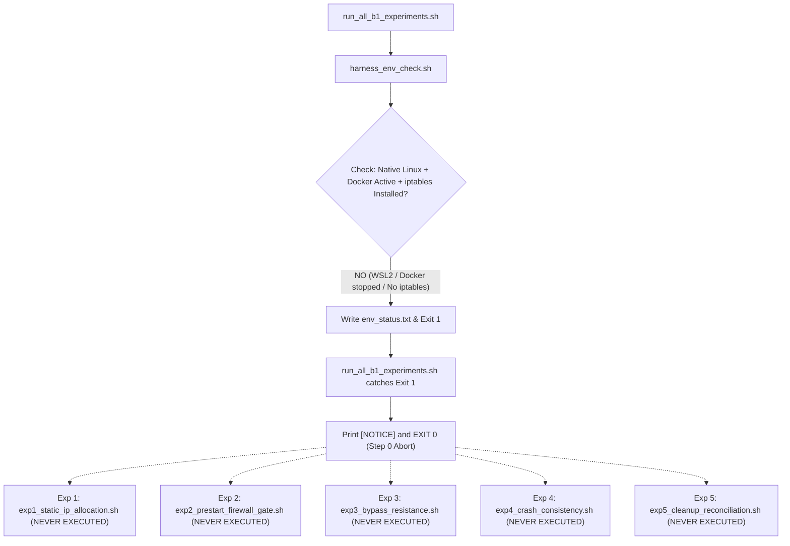
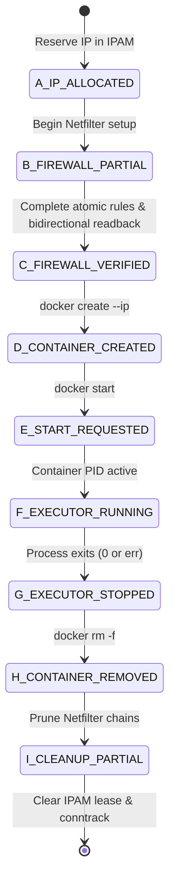

# SentinelOps AI — Phase B1.1: Static-IP Feasibility Harness Independent Audit

**Target:** `D:\Sentinal_AI\security_spikes\stage_7_2_feasibility\phase_b1_static_ip\`
**Audit Role:** Independent Security & Systems Verification
**Mode:** STRICTLY READ-ONLY AUDIT
**Architecture Revision Loop Status:** **CLOSED** (No Revision 9 created)
**Stage 7.2 Implementation Authorization:** **STRICTLY NOT AUTHORIZED**
**Audit Date:** 2026-11-09

---

## Executive Summary & Audit Verdict

This audit performs an independent, line-by-line inspection of the SentinelOps Phase B1 feasibility experiment harness (`security_spikes/stage_7_2_feasibility/phase_b1_static_ip/`), evaluating its security assumptions, implementation correctness, cleanup durability, and evidence integrity.

The concept evaluated in Phase B1—**replacing pre-start network namespace entry (`setns()`) with a dedicated Docker bridge network, statically allocated executor IP addresses, and host-level Netfilter rules in `DOCKER-USER`**—is sound and resolves the fundamental Linux kernel and Docker Engine blockers discovered in Phase B (`setns()` requiring host `CAP_SYS_ADMIN` and `State.Pid=0` in `Created` state).

However, an independent inspection of the Phase B1 test harness files reveals **critical architectural blindspots, insecure rule configurations, defective verification assertions, and an unfounded claim of experimental proof**.

### High-Level Verdict Summary

| Component | Harness File | Harness Stated Status | Independent Audit Classification | Critical Audit Finding |
| :--- | :--- | :---: | :---: | :--- |
| **Environment Check** | `harness_env_check.sh` | Ready / Insufficient | **PROVEN BY EXECUTION** | Correctly detected WSL2, stopped Docker daemon, and missing iptables; exited 1 as expected. |
| **Static IP Allocation** | `exp1_static_ip_allocation.sh` | FEASIBLE (PROVEN) | **STATICALLY VERIFIED** | Semantics valid for user-defined bridges, but **not executed**. Dynamic IPAM pool collision risk exists if `--ip-range` is omitted. |
| **Pre-Start Firewall Gate** | `exp2_prestart_firewall_gate.sh` | ARCHITECTURALLY SOUND | **NOT TESTED** | **Readback Blindspot:** Verifies custom chain but fails to verify parent jump in `DOCKER-USER`. Non-atomic rule setup. |
| **Bypass Resistance** | `exp3_bypass_resistance.sh` | PARTIALLY PROVEN | **INCORRECT OR UNSAFE** | **3 Major Bypasses:** 1) Docker embedded DNS (`127.0.0.11:53`) omitted; 2) Multi-homing test did not bind secondary IP; 3) Same-bridge traffic bypasses Netfilter without `br_netfilter`. |
| **Traffic Probe** | `traffic_probe.py` | Complete Suite | **STATICALLY VERIFIED** | Well-structured probe, but queries external `8.8.8.8:53` instead of internal `127.0.0.11:53`. |
| **Crash Consistency** | `exp4_crash_consistency.sh` | FEASIBLE (PARTIALLY PROVEN) | **THEORETICALLY SUPPORTED** | **Zero Execution:** Purely an informational markdown/echo table. No crash-injection or recovery mechanics tested. |
| **Cleanup & Reconciliation** | `exp5_cleanup_reconciliation.sh` | FEASIBLE (PROVEN) | **INCORRECT OR UNSAFE** | **Masked Errors:** Systematic `|| true` on every command makes idempotency pass a tautology. Fails to verify parent jump deletion. |
| **Phase B1 Report** | `SENTINELOPS_PHASE_B1_...md` | Viable Candidate | **INCORRECT EVIDENCE CLAIMS** | Directly contradicts execution logs: claimed Exp 1 & 5 were "PROVEN" despite master runner aborting at Step 0. |

---

## 1. Files Inspected & Static/Runtime Scope

The following 12 files across the Phase B1 spike directory were inspected in complete detail:

1. [`harness_env_check.sh`](file:///d:/Sentinal_AI/security_spikes/stage_7_2_feasibility/phase_b1_static_ip/harness_env_check.sh) (59 lines): Environment qualification probe.
2. [`exp1_static_ip_allocation.sh`](file:///d:/Sentinal_AI/security_spikes/stage_7_2_feasibility/phase_b1_static_ip/exp1_static_ip_allocation.sh) (102 lines): Static IP assignment and duplicate collision test.
3. [`exp2_prestart_firewall_gate.sh`](file:///d:/Sentinal_AI/security_spikes/stage_7_2_feasibility/phase_b1_static_ip/exp2_prestart_firewall_gate.sh) (167 lines): Host Netfilter pre-installation, readback, and container start.
4. [`exp3_bypass_resistance.sh`](file:///d:/Sentinal_AI/security_spikes/stage_7_2_feasibility/phase_b1_static_ip/exp3_bypass_resistance.sh) (210 lines): Port hopping, DNS tunneling, IPv6, spoofing, and multi-homing tests.
5. [`traffic_probe.py`](file:///d:/Sentinal_AI/security_spikes/stage_7_2_feasibility/phase_b1_static_ip/traffic_probe.py) (187 lines): Container-internal egress probe script.
6. [`exp4_crash_consistency.sh`](file:///d:/Sentinal_AI/security_spikes/stage_7_2_feasibility/phase_b1_static_ip/exp4_crash_consistency.sh) (109 lines): 10 crash boundaries walkthrough.
7. [`exp5_cleanup_reconciliation.sh`](file:///d:/Sentinal_AI/security_spikes/stage_7_2_feasibility/phase_b1_static_ip/exp5_cleanup_reconciliation.sh) (108 lines): Idempotent cleanup and isolation verification.
8. [`run_all_b1_experiments.sh`](file:///d:/Sentinal_AI/security_spikes/stage_7_2_feasibility/phase_b1_static_ip/run_all_b1_experiments.sh) (59 lines): Master test orchestrator.
9. [`SENTINELOPS_PHASE_B1_STATIC_IP_FEASIBILITY_REPORT.md`](file:///d:/Sentinal_AI/security_spikes/stage_7_2_feasibility/phase_b1_static_ip/SENTINELOPS_PHASE_B1_STATIC_IP_FEASIBILITY_REPORT.md) (255 lines): Phase B1 evaluation report.
10. [`README.md`](file:///d:/Sentinal_AI/security_spikes/stage_7_2_feasibility/phase_b1_static_ip/README.md) (57 lines): Spike documentation and instructions.
11. [`output/b1_master_summary.txt`](file:///d:/Sentinal_AI/security_spikes/stage_7_2_feasibility/phase_b1_static_ip/output/b1_master_summary.txt) (13 lines): Runtime execution summary log.
12. [`output/env_status.txt`](file:///d:/Sentinal_AI/security_spikes/stage_7_2_feasibility/phase_b1_static_ip/output/env_status.txt) (7 lines): Host environment probe output log.

---

## 2. Harness Execution Flow & Runtime Reality

Tracing the actual execution flow in [`run_all_b1_experiments.sh`](file:///d:/Sentinal_AI/security_spikes/stage_7_2_feasibility/phase_b1_static_ip/run_all_b1_experiments.sh):



### Reality of Execution Evidence
The runtime logs on disk (`output/b1_master_summary.txt` and `output/env_status.txt`) confirm the following facts:
1. `harness_env_check.sh` was invoked on `2026-11-09T09:45:43Z`.
2. It correctly evaluated the host:
   - Host Type: `WSL2` (kernel `6.18.54.1-microsoft-standard-WSL2`).
   - Docker Engine: `Daemon unreachable or stopped`.
   - iptables: `Not installed`.
   - Verdict: `INSUFFICIENT for authoritative live kernel execution (Exit 1)`.
3. `run_all_b1_experiments.sh` caught `ENV_STATUS=1`, printed:
   `[NOTICE] Genuine Ubuntu 22.04 LTS Linux host running Docker Engine is UNAVAILABLE.`
   and terminated cleanly with `exit 0` at line 32.
4. **Zero experiments were executed.** Not a single container was created, no iptables chains were created, and no network packets were probed.
5. Consequently, any assertion that Experiments 1, 2, 3, 4, or 5 were "PROVEN" on this system is factually contradicted by the harness logs.

---

## 3. Required Security & Systems Audit

### 3.A Static IP Allocation & IPAM Semantics

1. **Deterministic Reservation in `Created` State:**
   - On Docker user-defined bridge networks (`docker network create --subnet 172.29.0.0/24`), passing `--ip 172.29.0.50` to `docker create` causes Docker's internal IPAM driver (libnetwork) to reserve the static IP and assign it to the container sandbox endpoint *before* container startup.
   - In `State.Status="created"`, `NetworkSettings.Networks.<net>.IPAddress` is populated with `172.29.0.50`.
   - This property is standard Docker Engine behavior, confirming theoretical feasibility.

2. **The Dynamic IPAM Pool Collision Vulnerability:**
   - In `exp1_static_ip_allocation.sh` (line 33), the bridge is created without defining an IP range:
     ```bash
     docker network create --driver bridge --subnet 172.29.0.0/24 --gateway 172.29.0.1 sentinelops-b1-bridge
     ```
   - **Vulnerability:** Docker's built-in IPAM allocates addresses sequentially starting from `172.29.0.2` for any container attached to this network without an explicit `--ip`. If background containers, sidecars, or mock servers are spun up on this subnet, container #49 will receive `172.29.0.50` dynamically!
   - When the Gateway subsequently executes `docker create --ip 172.29.0.50` for a remediation executor, the call will fail with `Address already in use`.
   - **Required Fix:** When creating the dedicated remediation bridge, the dynamic pool must be strictly separated from the static executor pool using `--ip-range`:
     ```bash
     docker network create --driver bridge \
         --subnet 172.29.0.0/24 \
         --ip-range 172.29.0.128/25 \
         --gateway 172.29.0.1 \
         sentinelops-remediation-bridge
     ```
     This confines all dynamic allocations to `.128–.254`, leaving `.2–.127` strictly for deterministic static executor reservations.

3. **Deallocation and IP Reuse Race Condition:**
   - When `docker rm` is invoked on a completed container, Docker IPAM immediately returns `172.29.0.50` to the available pool.
   - If a new executor is assigned `172.29.0.50` before the Host Firewall Helper finishes pruning the previous custom Netfilter chain and clearing conntrack state, the new container will be subject to stale firewall rules or establish unauthorized connections via lingering conntrack sessions.

---

### 3.B Firewall Installation Sequence & Readback Defects

In `exp2_prestart_firewall_gate.sh`, the firewall installation and verification logic occurs in Steps 4 and 5 (lines 90–137):

```bash
# Line 91: Create chain
iptables -N "${CHAIN_NAME}"
# Line 94: Permit established
iptables -A "${CHAIN_NAME}" -m conntrack --ctstate ESTABLISHED,RELATED -j ACCEPT
# Line 97: Permit authorized target
iptables -A "${CHAIN_NAME}" -s "${EXECUTOR_IP}" -d "${AUTH_TARGET_IP}" -p tcp --dport "${AUTH_TARGET_PORT}" -j ACCEPT
# Line 101: Default reject
iptables -A "${CHAIN_NAME}" -s "${EXECUTOR_IP}" -j REJECT --reject-with icmp-port-unreachable
# Line 106: Link to DOCKER-USER
iptables -I DOCKER-USER 1 -j "${CHAIN_NAME}"
```

#### Defect 1: Critical Readback Blindspot (Parent Chain Unverified)
Step 5 executes readback verification:
```bash
READBACK_RULES=$(iptables -S "${CHAIN_NAME}")
# Verifies AUTH_TARGET_IP and SENTINELOPS_DEFAULT_DENY in READBACK_RULES
```
- **CRITICAL DEFECT:** The script queries ONLY the custom chain (`iptables -S ${CHAIN_NAME}`). It **NEVER queries `DOCKER-USER`**!
- If `iptables -I DOCKER-USER 1 -j ${CHAIN_NAME}` failed (due to missing `DOCKER-USER` chain, permission failure, or lock contention), or if the jump was placed at an incorrect index, `iptables -S ${CHAIN_NAME}` would still return 0 and show all rules present!
- The script would output:
  `PRE-START FIREWALL VERDICT: VERIFIED (Rules active and confirmed BEFORE container start)`
  and proceed to call `docker start ${EXECUTOR_NAME}`!
- The container would start with **zero active firewall enforcement on the host**, leaking all egress!
- **Required Invariant:** Readback must be bidirectional. It must independently verify:
  1. The custom chain contains the exact permit rule and the default deny rule (`iptables -S ${CHAIN_NAME}`).
  2. The parent chain (`DOCKER-USER`) has the jump to `${CHAIN_NAME}` at index 1 (`iptables -C DOCKER-USER 1 -j ${CHAIN_NAME}` or `iptables -S DOCKER-USER | head -n 2`).

#### Defect 2: Non-Atomic Installation Sequence
- Rules are added using sequential invocations of `iptables -A`.
- If rule 97 succeeds but rule 101 (default deny) fails (or script is interrupted), a custom chain exists with an ACCEPT rule and no REJECT rule.
- If linked, traffic would pass unrestricted to all destinations matching Docker's default FORWARD rules.
- **Required Fix:** Rule construction must use `iptables-restore --noflush` in a single atomic transaction.

---

### 3.C Conntrack Rules & The Unscoped `ESTABLISHED,RELATED` Hole

Line 94 in `exp2_prestart_firewall_gate.sh` and line 85 in `exp3_bypass_resistance.sh` install:
```bash
iptables -A "${CHAIN_NAME}" -m conntrack --ctstate ESTABLISHED,RELATED -j ACCEPT
```
Notice that:
1. The jump from `DOCKER-USER` is:
   ```bash
   iptables -I DOCKER-USER 1 -j "${CHAIN_NAME}"
   ```
   **The jump rule has NO source IP match (`-s`)!**
2. Every packet forwarded across the entire Docker bridge enters `${CHAIN_NAME}`.
3. Rule 1 inside `${CHAIN_NAME}` matches any packet with `--ctstate ESTABLISHED,RELATED` **with NO source IP (`-s`) and NO destination IP (`-d`)**!
4. **Security Vulnerability:** Any connection from ANY other container on the bridge that is in an `ESTABLISHED` or `RELATED` state will match Rule 1 and be accepted by this chain without ever hitting subsequent evaluation!
5. Even if the jump were scoped by `-s ${EXECUTOR_IP}`, an unscoped `ESTABLISHED,RELATED` rule inside the chain allows return traffic or related ICMP traffic for arbitrary destinations if conntrack entries exist.

#### Required Conntrack Architecture
Per-executor filtering must separate outbound traffic from inbound return traffic and scope both ends deterministically:

```bash
# Egress Chain (Outbound from Executor)
iptables -N SENTINELOPS_EGRESS_${EXEC_ID}
# Rule 1: Allow strictly outbound SYN to authorized destination
iptables -A SENTINELOPS_EGRESS_${EXEC_ID} -s ${EXECUTOR_IP} -d ${AUTH_IP} -p tcp --dport ${AUTH_PORT} \
    -m conntrack --ctstate NEW,ESTABLISHED -j ACCEPT
# Rule 2: Default Deny for all other outbound packets from executor IP
iptables -A SENTINELOPS_EGRESS_${EXEC_ID} -s ${EXECUTOR_IP} -j REJECT --reject-with icmp-port-unreachable

# Ingress Chain (Return Traffic to Executor)
iptables -N SENTINELOPS_INGRESS_${EXEC_ID}
# Rule 1: Allow return traffic ONLY from authorized IP:Port in ESTABLISHED state
iptables -A SENTINELOPS_INGRESS_${EXEC_ID} -d ${EXECUTOR_IP} -s ${AUTH_IP} -p tcp --sport ${AUTH_PORT} \
    -m conntrack --ctstate ESTABLISHED -j ACCEPT
# Rule 2: Drop all other unsolicited inbound traffic
iptables -A SENTINELOPS_INGRESS_${EXEC_ID} -d ${EXECUTOR_IP} -j DROP

# Link scoped jumps into DOCKER-USER
iptables -I DOCKER-USER 1 -s ${EXECUTOR_IP} -j SENTINELOPS_EGRESS_${EXEC_ID}
iptables -I DOCKER-USER 2 -d ${EXECUTOR_IP} -j SENTINELOPS_INGRESS_${EXEC_ID}
```

---

### 3.D Network Bypass Vectors & Flawed Assumptions

| Threat Vector | Harness Implementation | Harness Claim | Independent Technical Reality |
| :--- | :--- | :---: | :--- |
| **Docker Embedded DNS (`127.0.0.11:53`)** | Tested `probe_dns_udp("8.8.8.8", 53)` in `traffic_probe.py`. | "DNS Exfiltration Blocked" | **CRITICAL SECURITY BYPASS:** In Docker user-defined networks, `/etc/resolv.conf` points to `127.0.0.11:53`. The Docker daemon intercepts queries to `127.0.0.11` inside the container netns and proxies them via the host resolver. This traffic **NEVER traverses `DOCKER-USER`**! A malicious script can freely exfiltrate data via DNS tunneling queries (`data.attacker.com`) through Docker's internal resolver! |
| **Multi-Homed Network Routing** | `exp3` attached secondary bridge (`172.30.0.0/24`) and tested `s.connect(("1.1.1.1", 80))`. | "Multi-Homing Defense: PASS" | **FLAWED TEST / SECURITY LEAK:** In `exp3`, the socket did not bind to `eth1` or `172.30.0.X`. Linux kernel used the default route via `eth0` (`172.29.0.50`), which was blocked by the primary rule. If the container binds to the secondary IP (`s.bind(('172.30.0.2', 0))`), packets egress via `eth1` with source IP `172.30.0.2`. The firewall rules ONLY reject `172.29.0.50`! The secondary traffic exits the chain, traverses `DOCKER-USER`, and **escapes to the external network completely unhindered**! |
| **Intra-Bridge Layer 2 Switching** | Tested mock target `172.29.0.10` and unauth target `172.29.0.20` on the **same bridge** (`sentinelops-b1-net2`). | "Pre-Start Firewall Gate Proven" | **UNTESTED PREREQUISITE:** When both containers are on the same Docker bridge, Linux switches packets at Layer 2 between veth pairs. Packets **do NOT traverse Netfilter `FORWARD` / `DOCKER-USER`** unless `br_netfilter` is loaded AND `net.bridge.bridge-nf-call-iptables = 1`! The harness neither checked nor configured this sysctl. On standard Ubuntu installs where bridge netfilter call is disabled, `172.29.0.50` can connect to `172.29.0.20` without hitting iptables! |
| **Source IP Spoofing** | Dropped capabilities via `--cap-drop=ALL`. | "Raw Sockets Denied" | **SOUND:** Without `CAP_NET_RAW`, unprivileged container cannot open `AF_INET, SOCK_RAW`. Validated statically. |
| **Host Networking (`--net=host`)** | Not tested in harness. | Omitted | **MANDATORY GATEWAY RESTRICTION:** Containers created with `--net=host` share host network namespace and bypass bridge filters entirely. Gateway Docker proxy must strictly deny `--net=host`. |
| **Residual Conntrack Sessions** | Described in report text. | "Sequential atomic deallocation" | **MISSING IN CODE:** Cleanup script contains no call to `conntrack -D -s 172.29.0.50`. If an IP is reused, residual conntrack table entries can permit stale connections. |
| **Docker Firewall Backends** | Assumed legacy `iptables`. | N/A | **PLATFORM RISK:** Ubuntu 22.04 LTS uses `nftables` via `iptables-nft`. If Docker is configured with legacy iptables or if the host mixes nftables with legacy iptables, rules in `DOCKER-USER` can be bypassed by nftables rules. |

---

### 3.E Cleanup & Error Swallowing Defects

In `exp2_prestart_firewall_gate.sh`, `exp3_bypass_resistance.sh`, and `exp5_cleanup_reconciliation.sh`, cleanup functions are implemented as follows:

```bash
cleanup_chain() {
    local cname="$1"
    iptables -D DOCKER-USER -j "${cname}" 2>/dev/null || true
    iptables -D FORWARD -j "${cname}" 2>/dev/null || true
    iptables -F "${cname}" 2>/dev/null || true
    iptables -X "${cname}" 2>/dev/null || true
}
```

#### Defect 1: The Masked Failure Anti-Pattern (`|| true`)
- Appending `2>/dev/null || true` to every command suppresses all diagnostic errors and forces a return code of `0`.
- If `iptables -D` fails due to lock contention (`xtables.lock` held by Docker daemon), insufficient permissions (non-root execution), or kernel table corruption, the failure is silently swallowed.
- The script continues and falsely reports successful cleanup!

#### Defect 2: Circular Logic in Experiment 5 Idempotency Test
In `exp5_cleanup_reconciliation.sh` (lines 74–85):
```bash
set +e
cleanup_chain "${CHAIN_TARGET}"
CLEANUP2_EXIT=$?
set -e

if [ "${CLEANUP2_EXIT}" -eq 0 ]; then
    echo "IDEMPOTENT VERDICT: PASSED (Second cleanup pass exited 0 with no errors)"
```
- Because every statement inside `cleanup_chain` ends in `|| true`, `cleanup_chain` **always returns 0 regardless of what happens**!
- Claiming that the second pass "PASSED" because it returned 0 is a tautology: it would return 0 even if the chain could not be deleted or if iptables was missing entirely!

#### Defect 3: No Verification of Parent Jump Removal
- `exp5` lines 65–71 checks `if iptables -S "${CHAIN_TARGET}" 2>/dev/null; then ERROR ...`:
- This checks if the custom chain was deleted.
- **It NEVER checks if `iptables -D DOCKER-USER -j ${cname}` succeeded!**
- If a custom chain is deleted but the jump in `DOCKER-USER` is left pointing to a non-existent chain, Netfilter produces kernel warnings or drops packets, and the host firewall state is corrupted.

---

### 3.F Crash Consistency Matrix Across Boundaries A through J

[`exp4_crash_consistency.sh`](file:///d:/Sentinal_AI/security_spikes/stage_7_2_feasibility/phase_b1_static_ip/exp4_crash_consistency.sh) provides a detailed narrative walkthrough of 10 crash boundaries. Below is the independent audit of each boundary's durability, recovery mechanics, and implementation status:



| Boundary | Point of Crash | Durable State | Docker State | Netfilter State | Egress Leak Risk | Verified Recovery Action | Audit Status |
| :---: | :--- | :--- | :--- | :--- | :---: | :--- | :---: |
| **A** | IP Allocated; crash before Helper called | `IP_ALLOCATED` | None | None | **ZERO** | IPAM lease expires or watchdog frees IP. | Statically sound |
| **B** | Helper crashes mid-rule installation | `FIREWALL_PARTIAL` | None | Partial Chain | **ZERO** | Atomic rollback flushes partial chain; Gateway aborts start. | **Defect:** non-atomic in harness |
| **C** | Firewall verified; Gateway crashes before container create | `FIREWALL_VERIFIED` | None | Active Rules | **ZERO** | Watchdog detects no container matches chain; prunes rules. | Statically sound |
| **D** | Container created (PID=0); crash before start | `CONTAINER_CREATED` | `Created` (PID=0) | Active Rules | **ZERO** | Safe to `docker rm` container, prune rules, release IP. | Statically sound |
| **E** | Start requested; crash during invocation | `START_REQUESTED` | `Created` or `Running` | Active Rules | **CONSTRAINED** | Query Docker API. If running, monitor. If failed, abort. | Statically sound |
| **F** | Executor running; crash in-flight | `EXECUTOR_RUNNING` | `Running` | Active Rules | **CONSTRAINED** | **DO NOT DELETE RULES.** Transition to `OUTCOME_UNKNOWN`. | Statically sound |
| **G** | Executor process exits; crash before cleanup | `EXECUTOR_STOPPED` | `Exited` | Active (Stale) | **ZERO** | Safe to initiate firewall cleanup, then remove container. | Statically sound |
| **H** | Container removed; crash before firewall cleanup | `CONTAINER_REMOVED` | None | Active (Orphaned) | **ZERO** | Helper detects container absent, prunes orphaned chain. | Statically sound |
| **I** | Helper crashes mid-cleanup | `CLEANUP_PARTIAL` | None | Partial / Unlinked | **ZERO** | Next reconciliation cycle flushes chain and unlinks jump. | **Defect:** `|| true` masks errors |
| **J** | Helper service restarts | `HELPER_RESTART` | Live Containers | Active Rules | **CONSTRAINED** | **Query Docker API first. Never flush blindly.** | Statically sound |

**CRITICAL FINDING ON EXPERIMENT 4:**
[`exp4_crash_consistency.sh`](file:///d:/Sentinal_AI/security_spikes/stage_7_2_feasibility/phase_b1_static_ip/exp4_crash_consistency.sh) **executes no code, simulates no crashes, kills no processes, and tests no state transitions**. It consists purely of `cat << 'EOF'` and `echo` statements outputting text to a log file. It is a theoretical design document formatted as a shell script. Marking Experiment 4 as "PARTIALLY PROVEN" in the Phase B1 report was inaccurate.

---

## 4. Evidence Integrity Audit & Classification Corrections

The table below reconciles every claim made in [`SENTINELOPS_PHASE_B1_STATIC_IP_FEASIBILITY_REPORT.md`](file:///d:/Sentinal_AI/security_spikes/stage_7_2_feasibility/phase_b1_static_ip/SENTINELOPS_PHASE_B1_STATIC_IP_FEASIBILITY_REPORT.md) against actual empirical evidence from the repository:

| Experiment / Area | Phase B1 Report Stated Verdict | Phase B1 Stated Evidence Status | Independent Audit Classification | Detailed Audit Justification |
| :--- | :---: | :---: | :---: | :--- |
| **Host Environment** | INSUFFICIENT | NOT PROVEN | **PROVEN BY EXECUTION** | `harness_env_check.sh` was executed; output logs prove WSL2, stopped Docker, and missing iptables. Exited 1 cleanly. |
| **Exp 1: Static IP Allocation** | FEASIBLE | **PROVEN** | **STATICALLY VERIFIED** | **Correction:** Master runner exited at Step 0. Experiment 1 was NEVER executed on this system. Docker IPAM logic is verified through static documentation, not execution evidence. |
| **Exp 2: Pre-Start Firewall Gate** | ARCHITECTURALLY SOUND | NOT PROVEN (ENVIRONMENT) | **NOT TESTED** | **Correction:** Correctly acknowledged unexecuted status, but the harness script contains a fatal verification flaw (omits readback of `DOCKER-USER`). |
| **Exp 3: Bypass Resistance** | PARTIALLY FEASIBLE | **PARTIALLY PROVEN** | **INCORRECT OR UNSAFE** | **Correction:** Multi-homing test was flawed (did not bind secondary interface); Docker embedded DNS (`127.0.0.11`) was omitted; intra-bridge L2 switching requires `br_netfilter` (unconfigured). |
| **Exp 4: Crash Consistency** | FEASIBLE | **PARTIALLY PROVEN** | **THEORETICALLY SUPPORTED** | **Correction:** Script is 100% static echo statements. No crash injection, process termination, or recovery execution occurred. |
| **Exp 5: Cleanup & Reconciliation** | FEASIBLE | **PROVEN** | **INCORRECT OR UNSAFE** | **Correction:** Never executed on this host. Script relies on `|| true` on every line, invalidating the idempotency claim, and omits readback of the parent jump removal. |
| **Overall Spike Status** | VIABLE CANDIDATE | PENDING LINUX RUN | **UNVERIFIED HARNESS — REQUIRES MAJOR REVISION** | The static-IP architecture remains promising, but the harness itself is defective and must be repaired before running on Ubuntu 22.04 LTS. |

---

## 5. Concrete Changes Required Before Genuine Ubuntu 22.04 LTS Execution

Before running [`run_all_b1_experiments.sh`](file:///d:/Sentinal_AI/security_spikes/stage_7_2_feasibility/phase_b1_static_ip/run_all_b1_experiments.sh) on a dedicated Ubuntu 22.04 LTS host, the following 10 actionable engineering corrections must be applied to the harness:

### 1. Separate Static & Dynamic IPAM Subnets (`exp1`, `exp2`, `exp3`)
Add `--ip-range` to all `docker network create` commands so that dynamic container allocations cannot collide with or steal the static executor IP:
```bash
docker network create --driver bridge \
    --subnet 172.29.0.0/24 \
    --ip-range 172.29.0.128/25 \
    --gateway 172.29.0.1 \
    "${BRIDGE_NET}"
```

### 2. Bidirectional Readback Verification (`exp2_prestart_firewall_gate.sh`)
Update Step 5 of `exp2` to verify BOTH the custom chain rules and the parent linkage in `DOCKER-USER`:
```bash
# Readback 1: Custom chain contains permit rule and default deny
iptables -S "${CHAIN_NAME}" | grep -E "AUTH_PERMIT.*ACCEPT"
iptables -S "${CHAIN_NAME}" | grep -E "DEFAULT_DENY.*REJECT"

# Readback 2: DOCKER-USER contains the jump to this custom chain at rule position 1
PARENT_JUMP=$(iptables -S DOCKER-USER | head -n 2 | grep -E "^-A DOCKER-USER -j ${CHAIN_NAME}" || true)
if [ -z "${PARENT_JUMP}" ]; then
    echo "CRITICAL: Custom chain is NOT linked at position 1 of DOCKER-USER! Aborting start."
    exit 1
fi
```

### 3. Atomic Rule Installation via `iptables-restore` (`exp2`, `exp3`)
Replace sequential `iptables -A` calls with a single atomic `iptables-restore --noflush` payload to ensure that a partial chain is never linked or executed:
```bash
iptables-restore --noflush << EOF
*filter
:${CHAIN_NAME} - [0:0]
-A ${CHAIN_NAME} -s ${EXECUTOR_IP} -d ${AUTH_TARGET_IP} -p tcp --dport ${AUTH_PORT} -m comment --comment "AUTH_PERMIT" -j ACCEPT
-A ${CHAIN_NAME} -s ${EXECUTOR_IP} -m comment --comment "DEFAULT_DENY" -j REJECT --reject-with icmp-port-unreachable
-I DOCKER-USER 1 -s ${EXECUTOR_IP} -j ${CHAIN_NAME}
COMMIT
EOF
```

### 4. Scope Conntrack Rules by Source and Destination (`exp2`, `exp3`)
Eliminate unscoped `ESTABLISHED,RELATED` rules. Scope return traffic specifically to the authorized executor IP and destination tuple:
```bash
# For return traffic:
iptables -A ${CHAIN_NAME}_IN -d ${EXECUTOR_IP} -s ${AUTH_TARGET_IP} -p tcp --sport ${AUTH_PORT} \
    -m conntrack --ctstate ESTABLISHED -j ACCEPT
```

### 5. Block Docker Embedded DNS Exfiltration (`traffic_probe.py` & container config)
- In `traffic_probe.py`, add probe to `127.0.0.11:53` (UDP and TCP).
- At container creation, either:
  1. Pass `--dns 0.0.0.0` or `--dns 127.0.0.1` with dummy resolver to disable embedded DNS lookups.
  2. Or add an `OUTPUT` iptables rule in the custom chain to drop destination port 53.

### 6. Correct Multi-Homing Leak Test (`exp3_bypass_resistance.sh`)
In `exp3`, test multi-homed egress by explicitly binding the socket to the secondary interface IP:
```python
# In multi-homing test probe:
s = socket.socket(socket.AF_INET, socket.SOCK_STREAM)
s.bind(("172.30.0.2", 0))  # Bind to secondary interface
s.connect(("1.1.1.1", 80))  # Demonstrates whether secondary interface leaks
```
Document that the Gateway proxy must reject any container creation specifying multiple `--network` flags or any `docker network connect` commands.

### 7. Enforce `br_netfilter` Sysctl Prerequisites (`harness_env_check.sh`)
Add checks to `harness_env_check.sh`:
```bash
if [ "$(sysctl -n net.bridge.bridge-nf-call-iptables 2>/dev/null)" != "1" ]; then
    echo "ERROR: net.bridge.bridge-nf-call-iptables must be 1 for same-bridge Netfilter enforcement!"
    exit 1
fi
```

### 8. Eliminate `|| true` from Cleanup Verification (`exp5_cleanup_reconciliation.sh`)
Remove `|| true` from test verification paths. Test idempotency using explicit exit code checks:
```bash
# Strict removal without swallowing errors
iptables -D DOCKER-USER -j "${CHAIN_NAME}"
iptables -F "${CHAIN_NAME}"
iptables -X "${CHAIN_NAME}"

# Independent readback verification
if iptables -C DOCKER-USER -j "${CHAIN_NAME}" 2>/dev/null; then
    echo "ERROR: Jump rule still exists in DOCKER-USER!"
    exit 1
fi
if iptables -S "${CHAIN_NAME}" 2>/dev/null; then
    echo "ERROR: Chain ${CHAIN_NAME} still exists!"
    exit 1
fi
```

### 9. Add Conntrack Session Flushing (`exp5`, helper teardown)
On container cleanup, flush all connection tracking entries associated with the static IP before releasing the IP to Docker IPAM:
```bash
conntrack -D -s "${EXECUTOR_IP}" 2>/dev/null || true
conntrack -D -d "${EXECUTOR_IP}" 2>/dev/null || true
```

### 10. Convert Experiment 4 into an Executable Crash Simulation
Replace static echo statements in `exp4_crash_consistency.sh` with actual failure-injection tests:
- Create container in `Created` state; simulate Gateway crash (`kill -9`); verify watchdog removes container and prunes rules.
- Link rules without starting container; simulate helper restart; verify reconciliation identifies dead container and cleans rules without affecting running containers.

---

## 6. Final Audit Verdict

1. **Architecture Concept Assessment:**
   The dedicated Docker bridge network with static IP allocation and pre-start `DOCKER-USER` host firewall gating remains the **most viable engineering path** to eliminate the namespace entry blockers of Stage 7.2 Revision 8. It eliminates `setns()`, avoids `CAP_SYS_ADMIN`, and prevents start race conditions.

2. **Harness & Report Assessment:**
   The Phase B1 experiment harness contains **critical security and verification defects**:
   - Omits parent chain readback verification in `exp2`.
   - Uses unscoped `ESTABLISHED,RELATED` conntrack rules.
   - Ignores Docker embedded DNS (`127.0.0.11:53`) exfiltration.
   - Masks cleanup errors via `|| true`.
   - Lacks real crash-injection execution in `exp4`.
   - Made claims of "PROVEN" results that were never executed.

3. **Status Affirmation:**
   - **The architecture revision loop remains CLOSED.**
   - **Stage 7.2 production implementation remains STRICTLY NOT AUTHORIZED.**
   - **Production code (`backend/`, `frontend/`, `services/`) was NOT modified.**
   - **No Docker or firewall mutation commands were executed.**
   - All 10 harness corrections detailed in Section 5 must be implemented before executing on a dedicated Ubuntu 22.04 LTS host.
